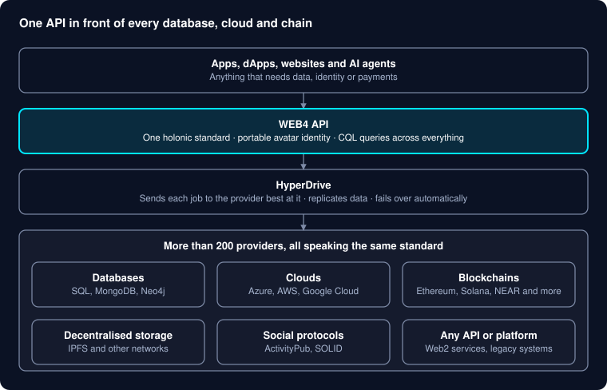

# WEB4: one world of data

26 October 2026 · David Ellams

WEB4 lets any app, database, cloud, blockchain or platform talk to any other through one universal API — so data is no longer trapped in silos, and every system can be used for what it does best.

## The problem: a world of silos

Today's data is locked inside thousands of separate systems that cannot talk to each other. Your identity, money, posts, health records and game items each live in a different walled garden, owned by someone else.

- **Every app rebuilds the same plumbing**: storage, logins, payments and integrations, again and again.
- **Web2 and Web3 live apart**: fast, cheap cloud services on one side; trustless, ownable blockchains on the other. Most products are forced to pick one.
- **Blockchains are siloed too**: assets and data on one chain are invisible to the next.
- **People don't own their data**: platforms do, and leaving means starting from zero.

## What WEB4 is

WEB4 is one universal API that sits in front of the world's databases, clouds, blockchains and platforms. Every system connects through the same holonic standard, so an app written once can read and write data anywhere.

*How WEB4 fits together · 3 layers over 6 provider families*

Apps talk only to the WEB4 API; HyperDrive decides which providers store and serve each piece of data, and automatically switches to another when one is unavailable.

## The best of all worlds

WEB4 doesn't ask you to choose between Web2 and Web3: it uses each platform for what it does best, together.

| Need | Best at it | How WEB4 uses it |
| --- | --- | --- |
| Speed and low cost | Web2 databases and clouds | Instant reads and writes, caching |
| Trust and ownership | Blockchains | Final, tamper-proof records and digital assets |
| Permanence | Decentralised storage (IPFS, Filecoin, Arweave) | Long-term, censorship-resistant archives |
| Relationships | Graph databases | Social graphs, recommendations, networks |
| Reach | Social protocols (ActivityPub, SOLID) | Content and identity that travel with the user |

Because one standard sits underneath, the same data can live in several places at once: fast where speed matters, on-chain where trust matters. That also makes WEB4 a gradual migration path from Web2 to Web3, instead of a risky rewrite.

## What WEB4 makes possible

Each use case combines the strengths of several platforms in a way no single platform can offer on its own.

| Theme | Use case | Today | With WEB4 |
| --- | --- | --- | --- |
| Speed + trust | **Everyday crypto payments** | Too slow and costly to pay for a coffee on-chain | Payment accepted instantly, settled on-chain later in batches |
| Speed + trust | **Real-time games and metaverse** | Game items locked inside one game | Fast gameplay, while items people own become portable on-chain assets |
| Speed + trust | **IoT and sensor data** | Huge data volumes, no proof it wasn't altered | Cheap storage for readings, with tamper-proof fingerprints on-chain |
| Resilience | **Outage- and censorship-proof apps** | One cloud outage or ban takes an app down | Data replicated across clouds, chains and IPFS, with automatic failover |
| Resilience | **Leave-anytime social** | Platforms own your followers and posts | Your content and audience move with you, across ActivityPub, SOLID and more |
| Resilience | **Data residency and compliance** | Hard to keep data in the right country | Rules decide where each record lives, automatically |
| Migration | **Web2 → Web3 on a dial** | Moving to Web3 means a full rewrite | Mirror to chain, then shift the source of truth step by step |
| Migration | **Chain-agnostic apps** | Locked into one blockchain's costs and limits | Switch chains as costs change, with no code changes |
| Migration | **Legacy system liberation** | Old bank, council and hospital systems trapped in the past | Legacy systems join the network and become queryable by modern apps |
| Identity | **One portable identity** | A new login, wallet and reputation in every app | One avatar carrying logins, wallets, reputation and credentials everywhere |
| Identity | **Verifiable credentials** | Sharing a degree or licence means sharing the document | Prove a fact without revealing the underlying data |
| Identity | **User-owned data marketplaces** | Platforms sell your data | People grant paid, time-limited access to their own data |
| Cost | **Smart storage tiers** | Everything stored at the same high cost | Hot data on fast databases, cold data on cheap permanent storage, moved automatically |
| Sectors | **Supply chain** | Each company sees only its own piece | The full journey of a product assembled across companies, with on-chain checkpoints |
| Sectors | **Healthcare** | Records scattered across hospitals | Patient-controlled records, with consent enforced on every query |
| Sectors | **Aid and disaster relief** | No connectivity, little transparency | Works offline, syncs later, with an open audit trail for donors |
| Sectors | **Charities and DAOs** | Trust depends on annual reports | Spending recorded instantly and published on-chain for anyone to check |
| AI | **One data layer for AI agents** | Agents need a separate integration for every system | Agents read and act across every connected system through one interface |
| AI | **Trustworthy AI training data** | No record of where data came from | Provenance and consent recorded for every piece of data |

## Spotlight: paying for a coffee with Bitcoin

Bitcoin payments can take minutes to confirm and cost more in fees than a coffee. WEB4 removes both problems by using Web2 and Web3 together:

1. **You tap to pay.** WEB4 records your payment instruction instantly in a fast database, so the café sees it accepted straight away.
2. **The café serves your coffee.** No waiting for the blockchain.
3. **Payments are batched.** Many small payments are grouped together, so the fees are shared.
4. **Settled on-chain.** The batch is recorded on the blockchain, giving a final, tamper-proof record.
5. **Reconciled automatically.** WEB4 matches every instant record to its on-chain settlement and tracks each payment through its stages: accepted, submitted, then final. Anything that doesn't settle in time is flagged and resolved, never silently lost.

The same pattern works for tipping, in-game purchases, transit fares and any other everyday micro-payment.

## Why OASIS

OASIS has been built for interoperability from the ground up since 2018, years before cross-chain and Web2–Web3 bridging became mainstream. Interoperability isn't bolted on; it is the foundation.

- **A universal holonic standard**: one data model and one set of interfaces that every connected system speaks.
- **More than 200 provider integrations** across databases, clouds, blockchains, storage networks and social protocols, with the most popular ones prioritised.
- **A live WEB4 API** with a portable avatar identity, wallets and reputation.
- **COSMIC ORM and its query language (CQL)**: one familiar, LINQ-style way to query data, demonstrated working across relational (SQL), document (MongoDB) and graph (Neo4j) databases.
- **HyperDrive**: the engine that routes, replicates and fails over data between providers. Auto-failover, load balancing and replication are proven in HyperDrive V1; V2 extends them with stronger guarantees across every provider.
- **AI-ready**: already exposes hundreds of tools to AI agents through the Model Context Protocol (MCP).

## What's next: AI that understands all your data

AI is only as good as the data it can reach. With WEB4, that data is unified, permissioned and queryable in one place, which opens up:

- **Ask in plain English**: a question becomes a CQL query, answered across every connected system at once, within the user's permissions.
- **A universal data layer for AI agents**: agents act across apps, chains and clouds through one interface.
- **Semantic search** across all connected data.
- **Connecting the dots**: recognising that a wallet, a social profile and an avatar belong to the same person or organisation, turning scattered data into insight.

**Get involved.** We are looking for investors, partners and pilot clients to bring these use cases to market. Contact details: _to be added._
