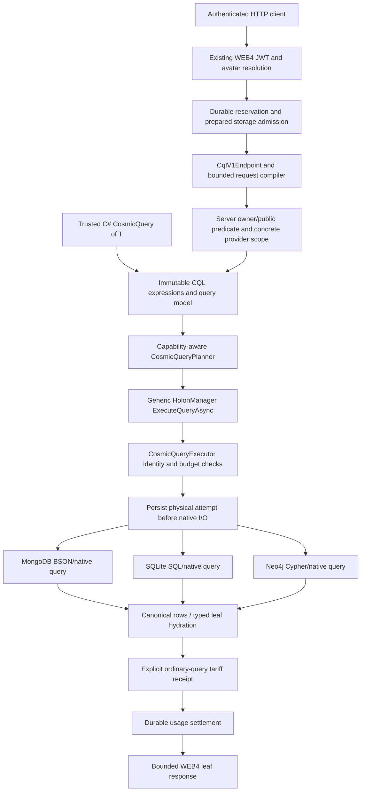

# CQL architecture

22 October 2026. CQL is a generic COSMIC ORM query pipeline. Native providers translate its admitted intermediate representation; they do not implement separate public query languages. [Developer manual](CQL_MANUAL.md), [HTTP contract](CQL_V1_HTTP_CONTRACT.md), [execution reference](CQL_EXECUTION_PIPELINE.md).

## Native graph execution checkpoint — 23 October

Core owns immutable graph intent, capability readmission, detached publication and typed selection ownership. Shared `HolonGraphQueryExpansion` assembles provider-owned native rows with cumulative node/UTF-8 bounds and persisted role ordering. SQLite owns one deferred Serializable native read transaction for roots and children, native parent/type/member predicates, pre-materialization row/byte bounds and the existing instruction/deadline hook. Caller Serializable transactions are reused without committing them. MongoDB now owns a snapshot session plus one cumulative native deadline for roots and child commands; its native104-case/admission31-case matrices pass, including cumulative-deadline and concurrent-write snapshot cases. Neo4j now uses one bounded native read-committed transaction; it does not claim snapshot isolation. Native81/unit31 pass, with final joint hosted82 also passing. Its schema2 projection adds canonical HolonType and is refreshed from canonical snapshots at activation. HTTP v1 remains leaf-only until authoritative graph access and accounting are implemented. [Contract and native evidence](CQL_GRAPH_LOADING.md).

## Explicit graph consistency admission

Immutable graph options distinguish ProviderDefault from ProviderSnapshot. Snapshot requests require the GraphSnapshot capability at planning and actual-adapter readmission; that capability requires GraphExpansion. SQLite/Mongo declare their existing native snapshot owners. Neo4j supplies its documented read-committed mode under ProviderDefault and rejects ProviderSnapshot with CQL_CONSISTENCY_UNSUPPORTED before native I/O. Claimed caller profiles cannot upgrade an adapter. The guarantee is local to each provider; it is not a distributed common snapshot. Both graph factory signatures share one validation owner and preserve the existing five-parameter binary ABI.

## Mandatory access binding

CosmicQueryReadAccess owns the existing WEB4 owner/public rule as immutable actor/predicate data. It is inserted ahead of business predicates and native paging; composition preserves the binding without duplicating it. WEB4 constructs it from its authenticated/admitted actor and reuses the same output rule. Core rejects an access actor different from the inherited execution and rejects foreign detached rows before typed publication. SDK creation is a restriction, not authentication or credentials. Visibility-bound graphs remain explicitly unsupported until native child selection and partial membership/materialization owners can uphold it. Arbitrary metadata sharing/role labels cannot grant access.

## Layers and ownership

The admission/attempt/receipt/settlement path applies when a hosted request supplies its PreparedStorageExecution. Trusted local SDK execution can run without that hosted scope; the application owns its access policy and adapters. The diagram does not imply a public unauthenticated SDK endpoint or simultaneous execution on all three providers for one v1 HTTP request.

| Owner/source | Responsibility |
|---|---|
| Core `Queries/CosmicQuery.cs`, expression/predicate types | Immutable composition, supported expression parsing and limits |
| Core `Queries/CosmicQueryPlanning.cs` | Resolve selected scopes against eligible targets; check declared capabilities |
| Core `Managers/HolonManager/HolonManager-Cql.V2.cs` | Generic public manager entry and typed integration |
| Core `Queries/CosmicQueryExecutor.cs` | Validate actual bindings/capabilities, inherited admission, cancellation and result budgets |
| Provider native CQL adapters/translators | Parameterized native predicates, ordering/page, native resource guards and canonical rows |
| ONODE `Services/Cql/CqlV1Compiler.cs` | Whitelisted JSON-to-CQL expressions, mandatory native access predicate, ordinal strings |
| ONODE `Services/Cql/CqlV1Endpoint.cs` | Exact actor/reservation binding, concrete server scope, planning, response limits/sanitization |
| Core prepared-storage/usage services | Physical attempt ownership, tariff evidence, no-execution proof, settlement and no replay |

All paths above are relative to their existing project roots; no duplicate query engine is introduced in Examples or providers.

## From expression to native execution

1. A trusted C# caller composes supported expression trees, or the v1 HTTP boundary compiles a bounded DTO. Metadata marker calls are parsed, never invoked as client predicates. Arbitrary CLR methods, getters/side effects and raw query text are not evaluated.
2. A planner binds the selected provider scope and required capabilities. An unsupported operation fails before native reads. Explicitly selected targets are not widened using registry contents.
3. HolonManager delegates to the generic executor. It rechecks actual adapter identities/capabilities; a stale/forged capability plan cannot authorize more work.
4. In a hosted request, the exact server-created PreparedStorageExecution owns the physical attempt. It persists intent before calling the native adapter and checks lifetime/cancellation around asynchronous work. Manager acquisition cannot silently activate a different paid provider as a constructor side effect.
5. The adapter applies native predicates, ordering and the page, enforces its resource controls, and returns canonical detached rows. Typed local hydration restores clean tracked leaf entities. Unsupported relationship loading is not simulated by fetching a dataset and applying LINQ in memory.
6. For the ordinary v1 service contract, a completed query attempt records its explicitly configured tariff receipt. Unknown completion is not converted into zero-cost evidence. The existing usage middleware settles durably before publishing its buffered response.

The bounded DTO and result recheck are separate protections. Visibility must be in the native WHERE/match predicate **before** the page; dropping forbidden rows after paging would produce incorrect pages and is not the implementation. The final result check refuses a provider visibility violation rather than silently repairing a bad result.

## Scope, consistency and provider selection

The local SDK supports current-default, named and all-eligible scopes over its supplied eligible snapshot. Results remain grouped with provider identity. Duplicate logical IDs from different providers are not globally merged; pages and ordering are per provider. There is no implied cross-provider snapshot, conflict resolution or distributed query transaction.

HTTP v1 chooses exactly one already-active MongoDB/SQLite/Neo4j provider. Omitted Provider resolves the server's current default, then the endpoint pins that concrete identity. A request cannot authorize extra providers, trigger activation, select a signer, override prices or request automatic failover. HyperDrive v2 supplies surrounding ORM routing/replication capabilities; broader query placement/federation policies are separate work.

## Security and data types

Production WEB4 supplies its existing verified avatar identity; the v1 query actor cannot come from request JSON. Admission must belong to that same avatar and execution handle. Server policy is owner-or-globally-public; Wizard and sharing-index metadata do not bypass it. Authoritative shared-recipient/tenant-specific policies are not claimed by this v1 contract.

Native type domains preserve exactness: numeric strings do not become integers, GUID comparison uses canonical validated text, and strings use the admitted ordinal operation. Typed invalid/missing values do not acquire accidental inequality matches. Metadata encryption remains the ORM's policy owner: encrypted content is not made queryable by an implicit client-side decryption scan.

HTTP v1 exposes String/Int64/Boolean/Guid metadata and a bounded canonical leaf-field set. Local CQL capabilities include additional explicitly declared types/operators; local availability does not widen the HTTP schema. [Scalar details](CQL_SCALAR_METADATA.md), [field comparisons](CQL_FIELD_COMPARISONS.md).

## Failure and lifecycle invariants

- No provider invocation before the required durable attempt. No later substitution of admission or concrete provider identity.
- No partial grouped result on a selected-provider failure or result-budget violation. Previously incurred reads are not described as rolled back.
- No guessed provider receipt, zero cost for unknown completion, or replay to discover an uncertain outcome.
- No hard five-second driver-interruption claim: HTTP cancellation is cooperative, with provider-native bounds preserved.
- No new version for a local no-op Save; conditional writes/committed deltas remain owned by the existing generic save pipeline.

## Demo and test architecture

The new three-provider demo deliberately reuses the native acceptance fixture's owned services, data journal, shipping controller/compiler/JWT validator, real native adapters and Mongo execution outbox. Avatar-directory resolution and reservation authority are controlled synthetic components. Demo-only `/demo` presentation, session tokens and Swagger exist solely in the loopback fixture; production Startup is not changed to expose them.

Readable SDK/HTTP examples live in `Examples/CosmicCqlDemo/V1NativeQueries.cs` and `V1Walkthrough.cs`. They are compiled into the existing native host and actually executed on every provider. The browser page uses the same HTTP endpoint, preserves Int64 JSON text, switches identities/providers and demonstrates duplicate operation rejection. Its presentation never implements predicate execution.

One producer lease wraps the owned Mongo/Neo runner and all shared builds. Success stops/awaits services, verifies terminal outbox states and removes only owned fixture resources after their processes close; failure preserves data for reviewed reconciliation. No new per-run runtime/container/environment is created. [Cleanup ledger](ENVIRONMENT_AND_CLEANUP_LEDGER.md).
