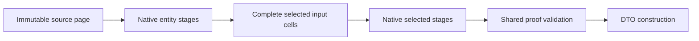

# CQL architecture

Current implementation state: [CURRENT_STATUS](CURRENT_STATUS.md); feature acceptance: [parity checklist](CQL_PARITY_CHECKLIST.md).

1. **Capture:** bounded immutable query/selected-stage intent and closed literals; no user callback execution.
2. **Plan/admit:** explicit scope, eligible targets, exact scalar/relationship capabilities, visibility and work bounds.
3. **Own execution:** V2 HolonManager and physical-attempt owner; preflight all targets and re-admit actual contracts before dispatch.
4. **Native adapters:** Mongo aggregation/snapshot owner, SQLite serializable read owner, Neo4j captured scalar pipeline/read owner. Do not invent stronger provider consistency.
5. **Validate/return:** acknowledged complete detached evidence, exact values and shared remaining work; materialize only where the requested result contract permits it.

For projected All, native counterexample reduction follows every selected stage. Complete source/stage evidence validates before the Boolean is published; final row evidence and the terminal scan consume their budgets.
Source relationship composition has separate admission from entity All predicates. All three native source compilers now support the separate source-composition capability. Complete protected scopes are validated before business truth and paging; source predicates stay native.
Keep source translation, protected errors, membership/visibility and remaining-work accounting in their owning layers. No parallel fallback or silent retry.

[Active acceptance contract](CQL_PROJECTED_ALL_EXECUTION_CONTRACT.md) defines the current invariants.
[Full architecture/history](Archive/CQL_ARCHITECTURE_history_2026-10-27.md) retains earlier detailed designs, subsystem contracts and checkpoint evidence.
[Full ORM history](Archive/COSMIC_ORM_IMPLEMENTATION_ROADMAP_history_2026-10-27.md) retains replication/history/migration/placement and other programme requirements.

The native-only acceptance assembly links the shipping demo and provider adapters;
it does not implement replacement query execution. Its host supplies a V2
HolonManager with an explicit provider registry. The source/composition demo checks
both successful results and protected errors through that manager. Fixture creation,
ownership journals and exact cleanup stay in the test host, outside the read-only
public example. HTTP host contracts remain in their separate integration project.
The partial IQueryable bridge is shared Core code, independent of database type.
It registers owned expression chains with weak keys, binds standard LINQ closure
parameters per execution, captures an immutable CosmicQuery, then re-admits live
capabilities and invokes the existing V2 typed query owner. It neither compiles
application predicates to delegates nor fetches rows for client filtering. The
initial increment flattens exactly one explicitly named physical sequence;
remaining terminal/repeated-selection dispatch remains Q01 work, with explicit unsupported errors.
Standard cardinality and All terminals dispatch through CosmicScalarPlanner and
the existing V2 scalar owner, independently admitting scalar capabilities. All's
predicate remains separate from its source window. Entity cardinality after a
window now carries its own CardinalityPredicate descriptor and independent
SupportsPostWindowCardinality admission. The shared scalar predicate lowering
counts matches for cardinality and counterexamples for All, retaining each
operation's own meaning and the original source window.
Queryable Select transitions to a typed selected-sequence provider. The shared
query envelope owns standard/async enumeration for entity and selected results.
The selected provider rebinds source intent and selected stages per execution,
then uses the existing projection or selected-composition owner; selected All
uses the independent projected-All owner. Constructors and setters run only in
the established validated projection materializer, never during capture and
never as an alternative to missing native execution.
Entity element terminals delegate to the existing element planner/executor and
V2 typed hydration owner. First/Single cardinality, tail windows, Index bounds,
tracking and error semantics stay in that owner. The bridge handles a caller's
OrDefault argument only after an acknowledged empty result; it cannot replace a
native failure or ambiguous cardinality with a default object.
Queryable value aggregates bind typed paths and exact result domains before
planning against independent scalar-selection capabilities. Plain scalar Select
can lower into the same native selector aggregate; selected stages are never
moved across the reduction. Int32 Average now has an independently admitted double-output contract; Int64
uses independent checked-prefix enrollment, now verified on MongoDB, SQLite and Neo4j. The existing decimal-output
CQL contract is preserved rather than approximated with a client conversion.
The Int32 double-output mode shares integer-packet validation with decimal means
and grouped slots, and adds no provider row buffer. The scalar descriptor records
the exact result mode; scalar selection admission checks the independent flag
again at execution. The selected-scalar validator also verifies the new result's
finite Double type and Int32 input bounds. Existing capability constructors leave
the flag false, so no other provider is silently enrolled.
MongoDB Int64 double Average orders the selected source window by its canonical
ordering keys plus identity tie-breaker, then computes exact Decimal128 running
sums. The bounded input/count domain fits Decimal128 precision. Its six-field
packet includes a strict Boolean `prefixOverflow`; missing, numeric or additional
fields are invalid. The shared numeric owner checks exact limbs/count, rejects
contradictory no-overflow sums, and returns overflow for any visited prefix.
Only an acknowledged checked Int64 total is converted once to double before
division. Neo4j also independently advertises this mode. No client row accumulator
or decimal-mean conversion grants this capability.

SQLite attaches a connection-owned checked Int64 prefix aggregate under the
existing exclusive read owner. The selected source carries an explicit ordering
ordinal; SQL aggregate ORDER BY consumes that ordinal after source paging.
The callback retains a bounded running total/count and overflow latch, checks
cancellation/deadline/work budgets, and never buffers source rows. SQL computes
the independent exact limb/count packet in the same statement. The owner checks
hook failures before interpreting its strict 0/1 acknowledgement and unregisters
the hook on disposal. Kernel and V2 manager native gates prove reverse ordering,
post-page prefixes, nulls, overflow, cancellation and teardown.

Neo4j checked Int64 means reassert the admitted source ordering plus identity
immediately before native collect, after SKIP/LIMIT. Cypher reduce retains a
checked total and overflow latch. Positive and negative branches use their own
safe boundary subtraction; only an admitted branch performs addition. The
ordered participating-value list remains on the server and uses proportional
memory within the input-work bound and native transaction memory/timeout limits.
The exact eight-field integer packet includes Boolean prefixOverflow in every
normal/error union branch. Empty windows and genuinely empty sources retain the
same required/nullable shared-owner semantics. Unit packet tests and83 native
checks/store prove both overflow directions, reversal, paging and empty results.

Selected element terminals lower through CosmicProjectionElementPlanner into
existing native composition plus bounded Skip/Take and an independently enrolled
Reverse stage for tails. SQLite reranks descending prior ordinals; MongoDB assigns
new window ranks in descending prior-rank order; Neo4j orders the previous stage
positions descending before collecting the next stage. Detached stage proofs are
validated by the existing composition owner. Its shared ExecuteOwnedAsync checks
empty/multiple cardinality before constructing any DTO. V2 HolonManager gates the
new public async entry; the element result carries HasValue separately from Value.
The IQueryable bridge binds source/selected predicates per execution and handles
caller-supplied defaults only after acknowledged empty proof. Budgets include
full bounded source participation and each terminal-lowering stage.

Selected cardinality adds explicit RequestsCardinality intent to composition
plans and independently enrolled SupportsCardinality. Legacy constructors keep
that permission false. Empty stage lists are admitted only for cardinality intent.
The shared composition attempt owner now accepts a typed finalizer after detached
proof validation: row/element finalizers construct their selected output, while
cardinality finalizers normalize native counts directly. Cardinality debits final
proof payload and terminal scan work across providers before publishing values.

CosmicProjectionCompositionPacket.NativeSelectedCount is mandatory for this
intent and must equal complete validated output participation. SQLite executes a
native count over the same materialized stage CTEs in its serializable owner.
MongoDB executes a count facet in its existing snapshot session, explicitly
acknowledging zero; its positive rank decoder permits zero only for this terminal.
Neo4j preserves the acknowledged source/final-stage native header count. Missing
or contradictory counts fail before result publication. No DTO constructor runs
for Count/LongCount/Any. Standard selected predicates append after captured
windows, with closure binding repeated per execution.

Entity cardinality predicate capture uses the bounded scalar terminal grammar,
including child/descendant markers and expansion admission. The terminal
admission descriptor inherits source scope/read access and has no source window.
Planning and execution independently admit its read paths and explicit traversal
permissions. Existing capability constructors keep post-window cardinality false.
SQLite applies matching predicates to its ordered source subquery, with protected
CASE reductions and a serializable owner where relationship scopes require it.
MongoDB and Neo4j share their scalar terminal traversal/error lowering, changing
only the match contribution for cardinality. An empty terminal page visits no
terminal scopes; source-scope failures still precede paging. IQueryable binds
parameters per execution, while fluent cardinality capture freezes them.

Selected numeric reduction uses immutable CosmicProjectedNumericIntent and
CosmicProjectedNumericPlan descriptors plus a bounded exact-word acknowledgement
in the composition packet. Each provider independently enrolls scalar numeric
permissions through NumericReductions; legacy capability constructors keep it
absent. Selected scalar expressions and flat-record numeric selectors bind an
exact column. The V2 manager and shared composition attempt owner preserve source
and stage scope, cross-check native participating count against validated selected
cells, charge acknowledgement/proof/terminal work, and normalize through existing
integer/decimal/floating numeric owners. The numeric finalizer constructs no DTOs.

SQLite currently enrolls signed Int32/Int64 Sum/Average and nullable forms. Its
native reduction runs over the final materialized stage CTE in the same
serializable owner. Two integer sum words retain exact totals; Int64 double means
reuse the checked aggregate hook ordered by the final stage rank. The hook checks
budgets and is removed on disposal. Selected ordering/offset occurs before prefix
accumulation. SQLite now also enrolls decimal/Single/Double/UInt64 and nullable selected reductions; all3 wider domains are independently enrolled;
selected Min/Max uses its independently enrolled extrema contract described below. Q01 remains red for Q01d/e/f.

MongoDB Q01a now independently enrolls signed Int32/Int64 Sum/Average and nullable
forms. Source and selected reductions share AppendNumericKernel, preserving the
published exact-word arithmetic and checked-prefix logic. The selected path
projects its admitted column and final rank, then executes that kernel in a
facet under the existing selected snapshot session/deadline. Empty input receives
an explicit native zero packet. The repository reuses strict numeric decoders,
checks terminal work/proof bounds, requires one packet and returns it through the
shared selected owner. Scalar/record selectors and all27 native integer cases
are verified on all3 providers.

Neo4j Q01a now independently enrolls the same signed integer domains. The numeric
terminal consumes the final native selected-position list and captured scalar
cells in the existing query. It reuses integral-word expressions and the guarded
checked-prefix reducer, emitting one exact count/word/Boolean acknowledgement.
The decoder requires complete source and stage participation before accepting
that terminal, rejects duplicate/missing/malformed packets and charges final
proof payload plus terminal scan work. Empty input has an explicit zero packet.
The shared owner validates participating count and normalizes the result without
constructing DTOs. All27 integer cases/store and129 Neo focused CQL tests pass;
Q01a is green while wider domains and selected extrema remain red.

SQLite Q01b reuses existing decimal limb, UInt64 split and floating packet kernels against the final selected CTE. Floating hooks belong to the same serializable connection owner, enforce its deadline and release on disposal. The decoder validates domain-specific packet width and participation before the shared typed finalizer. No client-side aggregation or record construction is introduced. Native proof:37 wider-domain cases in `CqlLinqStagedWideAcceptanceTests.cs`.

Mongo Q01b sends final selected cells to existing exact kernels within the same snapshot session. Empty packets preserve native domain types (Decimal128 decimal words; Int64 floating words). Strict scalar decoding owns packet validation; terminal proof budgets charge actual domain width. No client aggregation or DTO construction.

Neo Q01b derives exact decimal/floating words from captured final selected values and reduces each word natively. UInt64 uses the existing canonical20-digit splitter. The same single-query owner validates complete stages before normalization; packet widths and proof charges are domain-specific. No extra MATCH, client aggregation or DTO construction. This does not strengthen Neo repeatable-read guarantees.

Q01c shared extrema uses independently captured ExtremaDomains, rechecked against live adapter capabilities before execution. It appends null exclusion (nullable/reference domains), exact column ordering and Take(1) after all selected stages, respecting the32-stage bound. The common attempt owner validates complete native source/stage/order/output proof before its finalizer reads one detached cell. Required empty values produce CQL_EMPTY_SEQUENCE; nullable/reference empties return null. Neither record construction nor client aggregation participates. Old capability constructors leave extrema unenrolled. SQLite, MongoDB and Neo4j now have native proof and explicit enrollment.

SQLite Q01c explicitly enrolls selected ordering domains for extrema. Native final filter/order/Take execute in its existing serializable composition owner. Expanded all-null proof reproduced UInt64 key normalization padding the JSON null token; the shared UInt64 Column normalizer now returns SQL NULL before numeric padding, preserving null semantics for every consumer. Required values retain exact20-digit numeric keys. Regression tests cover null/zero/UInt64.MaxValue. Reviewed native continuation passed all218 extrema cases without replaying creates.

Mongo Q01c enrolls exact selected ordering domains. Final null filtering, ordering and one-row selection run under the existing snapshot session/deadline; each stage retains native identity/rank proof. The shared owner reads the winning detached field only after validating complete participation and every stage. All218 extrema cases/33 domains and202 Mongo CQL tests pass.

Neo Q01c enrolls exact selected ordering domains; null filter/order/Take operate on the captured selected positions in the same native query. Complete stage/ordering proof is validated before the shared finalizer reads the winning field. All218 cases/33 domains and137 Neo CQL tests pass. No stronger repeatable-read guarantee is implied. All3 Q01c cells are now verified; repeated Select Q01d is independently verified below.

Q01d separates physical native Columns from immutable OutputColumnIndices/OutputAliases. Reselection changes only the final shape/bindings; earlier predicates/order/windows retain their physical dependencies and complete native proof. Later selected predicates/terminals resolve outward aliases back to physical indices. Final construction maps validated cells and never creates intermediate DTOs. Retained physical cells continue to consume normal work/payload budgets. The standard provider captures a bounded deferred parent binding (maximum32 repeated selections), re-evaluating earlier closures at execution; fluent selections remain immutable. Composition-only adapters are admitted through their composition contract, without an unrelated ordinary-projection requirement.4 shared tests/2,536 CQL regressions pass; all3 native acceptance now passes26 cases/store.

Q01e shared row plans now carry PostWindowPredicate and PostWindowLimit independently of the original source page. Element lowering keeps the page unchanged, applies its terminal predicate, then selects1 row (First/Last) or at most2 (Single). Last retains native tail intent after terminal filtering. PostWindowElementPredicate is separately enrolled; admission validates terminal grammar/read-access and combined expansion bounds. Actual adapter capability admission and the physical attempt preserve every field. SQLite is enrolled after native proof; Mongo/Neo native proof is recorded below; admitted expanded-graph source options are preserved for the same native graph owner. No client filtering or extra provider read substitutes for native lowering.2,540 CQL regression tests pass; SQLite45 native cases pass, all3 native acceptance now passes.

SQLite Q01e uses two translators sharing one bound-parameter owner:source protected validation remains outside the source page, terminal protected validation is a complete native reduction over that page, and final predicate/order/element limit returns selected roots. Both scope reads and selected rows share the serializable transaction whenever relationships/graphs participate. Existing graph expansion consumes only selected roots in that same owner, enforcing depth/snapshot/node and visibility/catalogue limits.45 native cases plus35 compiler tests pass. No client filtering or second hydration read is used.

Mongo Q01e compiles the original selected page before its terminal predicate. A native unbounded window computes the highest terminal error across every paged root before match/order/output limits, so First/Single/Last cannot discard a different root’s scope error. Terminal outcomes and outer source errors normalize to one canonical envelope. Existing snapshot-session membership and graph ownership remain intact; no nested facet, client predicate evaluation or second root hydration read is introduced.45 native cases and207 CQL/compiler tests pass; Neo native proof is recorded below.

Neo Q01e captures ordered paged node/projection references and terminal outcomes before selecting winners, so protected errors anywhere in that page cannot be truncated. Capture is bounded to10,000 roots plus one detection row; overflow returns CQL_QUERY_LIMIT, never partial success. Traversal states survive the final ordering WITH, fixing the reproduced desc5 scope error. Selected snapshots/graph expansion use the existing read transaction/owner. ProviderSnapshot remains independently unsupported; an explicit rejection test passes rather than downgrading consistency. Reviewed native proof:46 new cases;141 CQL/compiler tests pass.

Q01f foundation introduces CosmicEntityCompositionQuery with immutable filter/order/window stages after its untouched CosmicQuery source. Separate ICosmicQueryEntityCompositionStorageProvider/Capabilities prevent old flat scalar/projection compilers from silently consuming a staged source. Exact ordering admission reuses the existing one owner; stage predicate/visibility and combined expansion bounds admit independently. Input row/payload and cumulative stage-work options are positive/bounded. The V2 manager dispatches through the existing row attempt owner on the original physical adapter, retaining actor/usage ownership, cancellation, detachment, identity/visibility checks and graph options. Missing stage contracts, capability drift, warnings and incomplete acknowledgements cannot fall back to flat reads.5 shared tests/2,545 CQL regressions pass; IQueryable/provider/terminal/projection integration remains pending.

### Selection after entity stages

`CosmicEntityProjectionQuery` retains immutable entity-stage intent separately from its detached selection definition. Its single-provider plan admits source stages and exact selected domains independently. Actual execution requires `ICosmicQueryEntityProjectionStorageProvider`; flat projection/row interfaces grant no substitution. `CosmicProjectionExecutor` owns both shapes through the same inherited physical-attempt boundary and native-cell validation/DTO construction sequence. Entity-stage acknowledgements also reject warnings and output counts exceeding the source/stage window bound shared with entity cardinality. This is currently a shared tested foundation; native providers, standard Select binding and selected-stage/numeric integration are pending.

## Native point-source profiles

`CosmicQueryCapabilities.ForStringMetadataPointLookup` admits exactly one bounded
string metadata equality and one selected target. Immutable `BusinessPredicates`
separates caller intent from mandatory read policy; the source adapter enforces
that policy on canonical point evidence. The ActivityPub/Mastodon adapter proves
this path without timeline scans or local query substitution. It reuses its
status projection owner, propagates cancellation, bounds streamed payloads and
rejects ambiguous JSON. [Verified scope and remaining gates](CQL_ACTIVITYPUB_NATIVE_PROFILE.md).

### Entity stages followed by selected stages

`CosmicProjectionCompositionPlanner.PlanEntity` retains an independent
`EntitySource` plan alongside the selected plan. Standard LINQ captures both
chains and rebinds them once per execution. Actual adapters must independently
enroll `ICosmicQueryEntityProjectionCompositionStorageProvider`; the flat native
entry point rejects combined plans. HolonManager uses the existing V2 composition
attempt owner. All3 implementations now have23 common native acceptance cases.

SQLite validates both chains inside one serializable owner. Mongo validates
entity proofs, selected inputs and selected stages in the same snapshot/deadline;
final entity ordering and identity direction determine selected ranks. Neo exports
the final entity relation from its existing compiler, then captures typed cells
and selected stages in one statement. A leading canonical proof phase validates
original source snapshots/revisions, sticky traversal errors and work bounds
before selected participation is accepted. It retains ProviderDefault consistency
limits and does not advertise snapshot isolation. No owner hydrates application
source entities as an intermediate query engine.

Combined graph sources and All/element/numeric terminals
following this selection remain unintegrated. Q01f stays red.

Entity-selected reselection uses the existing retained-column shape mapper. The
IQueryable provider carries a factory for the whole entity projection, rather
than separate source/selector factories that could rebind different query-source captures. Each read preserves both sequences and native input columns; only
final output bindings/DTO shape change. Intermediate DTO constructors/setters are
never part of execution. Explicit immutable builders use the same mapping rules.

Entity-selected cardinality retains EntitySource inside the existing selected
cardinality plan. An independent cardinality interface/flag is rechecked before
native dispatch, alongside selected cardinality capabilities. Count/LongCount/Any
share the existing native reduction/proof owner and exact result-domain validator;
terminal predicates append after preceding windows. No DTOs are constructed, and
missing/contradictory count acknowledgements fail before publication. Numeric,
All and element permissions are not inferred from this enrollment.

### Mixed native/indexed federation execution

The shared federation planner captures target-local index requirements; execution has
an explicit indexed-reader/observer registry separate from native adapters. Input
capture validates the complete read set, including prepared indexed admission, before
physical reads. Leaves retain their existing native/indexed executors and receipt
owners; merge and HolonManager hydration preserve IndexedEvidence on physical copies
and IndexedReads for empty pages. Input/output/work/attempt/deadline budgets cover
source evidence as well as rows. No evidence is injected into user metadata. Full
Core4298tests pass; actual Mongo+retained Solana/HTTP/browser acceptance is still open.

## Native-data materialization before CQL

Native import is a separate pipeline:the source's `INativeDataImportProvider` pages
application records; `NativeRecordHolonMapper` owns per-avatar source identity;
`NativeDataImportManager` saves through HolonManager to an explicitly configured
target. CQL then queries the target's ordinary holons through its native adapter.
This does not imply live CQL querying of an arbitrary application schema.

The reusable native-import demo now proves SQLite source -> SQLite and SQLite source
-> Mongo targets using one scenario owner. Provenance retains the original source;
the target adapter determines query execution. Explicit re-import preserves no-op
revisions or updates changed records. Save-owned metadata is preserved at mapping,
so refresh cannot manufacture a dirty revision by erasing framework fields.
Replication/encryption/CDC/reverse/chain acceptance remains separate from these gates.

### Replication policy boundary

`CommittedHolonReplicaTarget` exposes a policy/context constructor for server-owned
`IHolonReplicationAuthorizationPolicy` implementations. Configured catalogs reuse it
and retain their original versioned target hashes and captured policy binding. It
freezes the envelope before awaiting policy and reparses original bytes for the
receiver, so policy cannot rewrite the admitted mutation. The source-only constructor
is a low-level trusted adapter;source enrollment alone is not caller authorization.
Automatic WEB4 delivery now adopts the policy constructor. Startup registers
`CommittedOwnerReplicationPolicy` through TryAdd:nonempty committed actor and every
selected record owned by that actor. Hosts may register a full stricter
`IHolonReplicationAuthorizationPolicy` before the default registration (or supply it
with the host-owned service constructor). Existing `HolonReplicationActorGrant` can
constrain actors/expiry;native denial/expiry cases prove no replica write and retained
reconciliation-required obligations. A custom policy replaces the default admission
and must enforce all required host constraints.

Configured catalog JSON/hashed routes remain separate;their grants are not silently
borrowed by automatic canonical provider-type targets. Automatic physical endpoint/
store and durable policy-version binding,tenant/encryption/residency/placement grants
remain open. The default context GUID is protocol context,not endpoint attestation.
The sandbox request-only fault gate is unchanged and separate. Current tests/counts are in IMPLEMENTATION_STATUS.

### Native store identity capture (binding prerequisite)

`ICosmicStorageIdentityProvider.CaptureStorageIdentityAsync` is optional native
capability admission. SQLite now returns a credential-free authority/endpoint/store
binding from an activated existing file. The durable GUID and metadata table are
created together under an immediate transaction;existing empty/corrupt metadata
is an error,never a replacement identity. Capture never creates an absent database
or upgrades a read-only/memory provider. Repeated capture is a native read/no change.

The endpoint comes from native pragma_database_list,not mutable node DNA. Its path
spelling is preserved conservatively;aliases may have distinct fingerprints. A backup
copy retains the logical store GUID while another endpoint changes the binding. This
is not remote attestation or proof that an identical backup restored at the same
address is a new physical incarnation. Mongo capture now uses its actual repository database/client handle and the native
Holon collection UUID. It is read-only and adds no identity collection. The digest
includes actual namespace/seed endpoints/replica-set/TLS/direct mode,not credentials
or mutable public provider descriptors. Missing collection fails without repair;
explicit native recreation changes its identity at the same endpoint. This is holon-
store identity,not an attestation of every collection or authenticated tenant;the
native account must be able to read listCollections UUID metadata.

Neo captures its native opaque ID/name using [db.info](https://neo4j.com/docs/operations-manual/current/procedures/built-in-procedures/),a READ procedure. The retained node returned a64-character token,not a UUID;
StoreId therefore preserves a bounded native string without truncation/case guessing.
GUID constructors retain their previous fingerprint bytes;malformed UTF8 is rejected.
The storage driver creation URI is captured at actual driver construction and paired
with native metadata under the lifecycle gate. Mutable Host/user/password are not
used to guess the active endpoint. An injected driver with no captured endpoint is
explicitly unsupported. Capture adds no metadata node or graph/schema writes.

Single-node native tests verify independent clients,reopening,distinct URI alias
bindings and unchanged graph/schema counts. This does not certify clustered identity,
home-database reconfiguration or remote attestation. Consumption in durable automatic
routing/policy binding remains open;current automatic target IDs are unchanged.

### Replication receiver binding (28 October 2026)

Explicit catalogs may use a native `CosmicStorageIdentity` and
`IBoundCommittedHolonReplicaStorageProvider` destination. This hashes a distinct
bound-route contract and passes the captured identity into the receiver transaction.
SQLite checks its native file/identity row under BEGIN IMMEDIATE before receipt
replay or graph writes. Neo reads db.info on the write transaction before receipt
replay, holding the driver lifecycle gate through completion. Mongo asserts native
collectionUUID with a first transactional empty find before receipt replay and pins
all helper namespaces to the same database/client. This server field is unstable API;
local8.3.11 proof does not certify every server/StableAPI deployment. Refusal fails
closed. Automatic type-only enrollment/delivery remains unbound. This is separate from CQL read assurance and policy admission.
[Implementation, tests and open automatic-route scope](REPLICA_STORAGE_BINDING.md).

Native outboxes also provide bounded read-only inventory of oldest unfinished route
heads,independent of current configured targets. This keeps old route IDs discoverable
for subsequent operator handling;the worker has not yet adopted native binding/inventory.
[Contract,verification and remaining acceptance](REPLICA_ROUTE_INVENTORY.md).

Primary enrollment can additionally carry SourceStorageIdentity. The provider must
advertise IBoundAtomicHolonReplicationStorageProvider and check that identity in the
native graph/receipt/outbox transaction before replay;bound intent has a distinct
fingerprint from unbound intent. Original-outcome recovery repeats native source
verification. All3local native stores implement this optional contract;automatic
routing has not yet adopted it. [Proof and remaining scope](PRIMARY_SOURCE_BINDING.md).

### Ethereum demo adapter

`EthereumCqlCompiler` intersects captured ID selection with the trusted provider catalogue. `EthereumOASIS.Cql.cs` admits the full plan before native I/O, then reads bounded contract keys at one observed block number and reuses the shipping authenticated decoder. Any source failure discards the accumulated result. The generic identity federation walkthrough dispatches through HolonManager, shared by C# and HTTP; no browser-specific query engine. Local-chain acceptance and remaining limits: [Ethereum MVP](ETHEREUM_CQL_MVP.md).

### Polygon / Web3Core bounded native selection

The shared Web3Core base implements ICosmicQueryStorageProvider; the admitted authorities are Polygon and Arbitrum V2. The compiler selects a finite catalogue-intersected native key set, then shipping lookupHolon/decoder executes at one observed block number. The concrete Polygon wrapper retains provider/chain/contract encryption binding. Ethereum and Polygon paired acceptance use one parameterized fixture and the same HolonManager federation walkthrough/HTTP host. Unsupported shapes reject before native I/O. [Scope and evidence](POLYGON_CQL_MVP.md).

Arbitrum acceptance links the shipping EvmProviderFactory and asserts the V2 Web3Core result; the legacy custom adapter remains unchanged. The same compiler/decoder/teaching host serve both authorities with exact per-provider access/context binding. [Scope](ARBITRUM_CQL_MVP.md).

### Firestore native-key adapter

FirestoreCqlCompiler intersects captured ID algebra with the exact trusted Google catalogue. GoogleCloud.Cql.cs fetches only selected native document references using GetAllSnapshotsAsync, validates ordered complete acknowledgements, reuses shipping DecodeHolon and publishes only a complete admitted page. The teaching host reuses HolonManager federation. A hash-bound immutable native emulator checkpoint preserves one seed across runs under LocalState. [Scope](FIRESTORE_CQL_MVP.md).

### Cosmos blockchain key selection

CosmosCqlCompiler intersects captured ID selection with trusted authority records. CosmosBlockChainOASIS.Cql.cs uses the shared canonical RecordKey builder, shipping private-storage backend and canonical decoder. Selected native gets do not enumerate the source; visibility/paging follow complete validation. The teaching host calls the generic HolonManager federation walkthrough for both C# and HTTP. The original native contract/seed are separately owned and every initial physical submission was verified/journaled before broadcast. [Scope](COSMOS_BLOCKCHAIN_CQL_MVP.md).

## Polkadot bounded native adapter

`PolkadotCqlCompiler` admits identity algebra and intersects the captured selection
with the server-owned authority catalogue. `PolkadotOASIS.Cql.cs` reads canonical
shared keys through `PolkadotConfiguredRecordBackend` and its encrypted native
contract adapter. It neither enumerates records nor signs query reads. Genesis,
contract/code identity and authenticated decryption remain backend responsibilities.
The common `HolonManager` federation walkthrough powers C# and HTTP demos; physical
source copies remain visible. Initial seed writes have durable signed preparations
and finalized effect receipts; the demo retains them across restarts. Native reads
can observe different blocks. [Proof and remaining scope](POLKADOT_CQL_MVP.md).

## NEAR bounded native adapter

`NearCqlCompiler` admits bounded identity algebra and intersects selection with the
trusted server catalogue. `NEAROASIS.Cql.cs` uses `NearSdkService.GetAsync` with the
caller cancellation token and the shared load/save/query key builder. Authenticated
snapshot decoding stays in the SDK storage reader; cancellation uses the existing
worker-process owner, not an abandoned task. The common HolonManager federation
walkthrough serves both C# and HTTP. One-time diagnostic fixture discovery is
separate from execution: the reusable demo catalogue selects three existing encrypted
synthetic records. Subsequent queries read only selected native keys, without a
signer, source scan, mutation or historical replay. [Proof](NEAR_CQL_MVP.md).

## Base shared Web3Core admission

BaseOASIS inherits the same bounded native query engine as Polygon/Arbitrum, while
retaining its own authority and isolated native contract. The compiler's explicit
allowlist now admits Base after red/green authority controls. No new query engine
or legacy path was introduced. The central registration constructs the shipped
Base Web3Core class; the native fixture uses that concrete class against a retained
local EVM environment. The common HolonManager federation host preserves physical
source copies for C# and HTTP/browser demos. [Scope and proof](BASE_CQL_MVP.md).

## Avalanche factory and encryption identity

The explicit Web3Core CQL authority allowlist now includes Avalanche. Its actual
BootLoader factory parses configured positive chain IDs and passes them to the
shipped provider; the original constructor delegates to the same initialization
with C-chain43114. This fixes the native pre-write failure caused by an absent
chain component in authenticated encryption. The existing query engine, private
codec and HolonManager federation remain shared.

A test-only, explicit continuation handled the original failed setup: runtime
code/owner/empty native counters and unchanged original IDs were verified before
a durable admission and first record writes. Production APIs gained no replay or
migration endpoint. Normal demo reuse remains read-only for the source.
[Scope and evidence](AVALANCHE_CQL_MVP.md).

## Azure Blob + Mongo MVP

Run `Scripts/TestHosts/Run-CosmicCqlDemoHub.ps1 -Provider AzureBlob -Federated`.
The retained Azurite source supplies three records and Mongo two copies: full query
returns five physical rows; the two-ID subset returns four. C#, HTTP and browser
share HolonManager federation and preserve provider provenance. Reads observe
separate moments. This is local Azurite, not hosted Azure; arbitrary blob discovery,
content predicates and full provider parity remain outside this MVP.
See [commands, tests and limits](AZURE_BLOB_CQL_MVP.md).

## LocalFile + Mongo MVP

`Scripts/TestHosts/Run-CosmicCqlDemoHub.ps1 -Provider LocalFile -Federated`
serves localhost5108. A bounded authorized ID query returns five physical rows;
the two-ID subset returns four, preserving both provider copies. Native file reads,
process restart reuse and C#/HTTP/browser are verified. Source files are plaintext;
reads have separate observation times. [Tests, commands and limits](LOCALFILE_CQL_MVP.md).

## Aptos + Mongo direct preset

Start `Scripts/TestHosts/Start-CosmicAptosCqlNode.ps1` in terminal1, then
`Scripts/TestHosts/Run-CosmicAptosCqlNative.ps1 -Federated -Serve` in terminal2.
Browser localhost5109 shows full5/subset4 rows with provider provenance. Native,
restart, SDK, HTTP and browser are verified; main-hub enrollment remains pending.
The retained plaintext Move source/key is reused; no faucet or chain reset. Stop
the demo to clean Mongo, then Ctrl-C terminal1. [Tests and scope](APTOS_CQL_MVP.md).

## Sui + Mongo MVP

`Scripts/TestHosts/Run-CosmicCqlDemoHub.ps1 -Provider Sui -Federated` serves localhost5110
and owns its reusable local node/Mongo lifecycle. Full query returns5 physical rows,
two-ID subset4, with provenance. Native/restart/C#/HTTP/browser are verified on the
same dedicated encrypted source. Original deployment/Storage stays untouched; signed
preparations persist. No hosted/finality/snapshot or arbitrary content-query claim.
[Commands, evidence and limits](SUI_CQL_MVP.md).

## Redis + Mongo MVP

`Scripts/TestHosts/Run-CosmicCqlDemoHub.ps1 -Provider Redis -Federated` serves localhost5111.
Full query5/subset4 physical rows preserve provider copies. Native encrypted DB11,
exact ciphertext restart, C#/HTTP/browser and lifecycle cleanup are verified.
Original data/key persists; other Redis databases stay untouched. Direct demo
registration does not certify BootLoader registration or aliases. Bounded ID-query
scope only, no distributed snapshot. [Tests and commands](REDIS_CQL_MVP.md).

## PostgreSQL + Mongo MVP

Run `Scripts/TestHosts/Run-CosmicCqlDemoHub.ps1 -Provider PostgreSQL -Federated`.
Use `-ShowPlan` to inspect or `-VerifyOnly` for automated checks and teardown.
The teaching preset returns five physical rows, then four for a two-ID selection,
with provider labels. PostgreSQL uses one parameterized native SELECT over an
explicit trusted UUID catalogue; unsupported content predicates reject. This is
retained local canonical JSON, not application encryption or hosted certification.
Stop using the page button; the original PostgreSQL source is preserved and only
the verified temporary Mongo fixture is removed. [Full scope](POSTGRESQL_CQL_MVP.md).

## SQL Server + Mongo MVP

Run `Scripts/TestHosts/Run-CosmicCqlDemoHub.ps1 -Provider SQLServer -Federated`.
Use `-ShowPlan` to inspect or `-VerifyOnly` for automated verification/teardown.
The preset returns five physical rows, then four for the two-ID subset, preserving
provider copies. SQL Server uses parameterized native UUID selection and paging;
unsupported content predicates reject. This is Windows-authenticated local LocalDB
canonical JSON, not Azure SQL or full LINQ certification. Stop with the page button;
original SQL Server source is retained, verified temporary Mongo fixture removed.
[Full scope, tests and evidence](SQLSERVER_CQL_MVP.md).

## DuckDB + Mongo MVP

Run `Scripts/TestHosts/Run-CosmicCqlDemoHub.ps1 -Provider DuckDB -Federated`.
Use `-ShowPlan` to inspect or `-VerifyOnly` for automated checks/teardown. The shared
C# example uses `Where(row => selectedIds.Contains(row.Id))`, returning five rows,
then four for the subset, with provider labels. DuckDB performs native UUID selection,
tombstone filtering and paging over its retained local file. Canonical JSON is
plaintext; this does not certify MotherDuck or full LINQ parity. Stop with the page
button; original embedded source stays and only verified temporary Mongo data is
removed. [Full scope and evidence](DUCKDB_CQL_MVP.md).

## Hosted Upstash + Mongo MVP

Run `Scripts/TestHosts/Run-CosmicCqlDemoHub.ps1 -Provider Upstash -Federated`.
Use `-ShowPlan` for a non-launching preview or `-VerifyOnly` for checks/teardown.
The C# ID-membership example queries hosted Upstash and local Mongo, preserving
provider-labelled copies: five physical rows, four in the two-ID subset. Upstash
uses native bounded MGET, then pages the live bounded result. Source JSON is
plaintext; multi-command save atomicity/full LINQ parity are not certified.
The retained free scratch expires2026-10-31T21:15:49.3541451Z; expired admission or
missing source must be reconciled, never silently replaced. Stop with the page
button; only the verified temporary Mongo fixture is removed.
[Tests, commands and full scope](UPSTASH_CQL_MVP.md).

## Linux Litestream + Mongo MVP

Run `Scripts/TestHosts/Run-CosmicCqlDemoHub.ps1 -Provider Litestream -Federated`.
`-ShowPlan` previews; `-VerifyOnly` runs automated checks and teardown. The preset
executes in existing Ubuntu WSL with pinned native runtimes and one reusable Linux
Mongo store, keeping both services on loopback. CQL ID-membership returns five
physical rows, then four for the subset, preserving provider-labelled copies.
Actual Linux live file replication and restored CQL are separately proved against
the same retained source lineage. Stop with the page button; original source,
replicas and reusable native store remain, verified temporary Mongo data is removed.
Windows Litestream directory-fsync failure and remote/PITR/crash acceptance remain
separate open scopes. [Setup, tests, resource limits and evidence](LITESTREAM_CQL_MVP.md).

## Volatile Memcached + Mongo MVP

Run `Scripts/TestHosts/Run-CosmicCqlDemoHub.ps1 -Provider Memcached -Federated`.
`-ShowPlan` previews; `-VerifyOnly` checks and cleans up. The retained Linux runtime
starts one empty loopback cache generation using canonical synthetic identities.
Native CQL3/2/miss/tombstone/paging checks precede the shared C#/HTTP/browser preset:
five physical rows, four for the two-ID subset, preserving provider labels.
Independent native checks confirm cache values/CAS stay unchanged through the demo.
Stop with the page button to remove verified temporary Mongo data and retire the
volatile cache. Subsequent explicit warmup is not restart persistence; unknown
pending outcomes refuse replay. Existing Linux Mongo/runtime/store are reused.
[Scope, commands, tests and resource lifecycle](MEMCACHED_CQL_MVP.md).

## Native Valkey + Mongo MVP

Run `Scripts/TestHosts/Run-CosmicCqlDemoHub.ps1 -Provider Valkey -Federated`.
`-ShowPlan` previews; `-VerifyOnly` checks and tears down. Independently verified
Valkey9.0.4 uses its retained encrypted source and the existing loopback Linux Mongo
store. Shared C# ID-membership returns five physical rows, then four for the two-ID
subset, preserving provider labels. Native tests cover missing/deleted records,
paging, budgets and unchanged ciphertext across a clean server restart. Stop with
the page button; Valkey source stays and verified temporary Mongo data is removed.
Full LINQ, cluster behavior and distributed snapshots remain separate scopes.
[Commands, evidence and lifecycle](VALKEY_CQL_MVP.md).

## Native KeyDB + Mongo MVP

Run `Scripts/TestHosts/Run-CosmicCqlDemoHub.ps1 -Provider KeyDB -Federated`.
`-ShowPlan` previews; `-VerifyOnly` checks and tears down. The reusable Linux
KeyDB6.3.4 runtime was built from pinned official source without vendor patches.
Its encrypted source survives native restart unchanged. The shared C# membership
query returns five physical rows, then four for the two-ID subset, retaining source
labels. Missing/deleted records, paging, budgets and HTTP errors are verified.
Stop with the page button; original KeyDB data remains, verified temporary Mongo
fixture is removed and services stop. Full LINQ/cluster/distributed snapshots stay
separate scopes. [Commands, tests and lifecycle](KEYDB_CQL_MVP.md).

## Native Dragonfly + Mongo MVP

Run `Scripts/TestHosts/Run-CosmicCqlDemoHub.ps1 -Provider Dragonfly -Federated`.
`-ShowPlan` previews; `-VerifyOnly` checks and tears down. Pinned Dragonfly2.0.2
uses retained encrypted source and a completed native RDB snapshot; all original
record/index bytes survive a clean process restart. Native shutdown saves again,
so snapshot file metadata changes are separately tracked. The shared C# membership
query returns five physical rows, then four for the two-ID subset, preserving
provider labels. Stop with the page button; services stop, original source remains,
and verified temporary Mongo data is removed. This scope does not certify AOF,
crash durability, clusters or general LINQ. [Commands/evidence](DRAGONFLY_CQL_MVP.md).

## Native Garnet + Mongo MVP

Run `Scripts/TestHosts/Run-CosmicCqlDemoHub.ps1 -Provider Garnet -Federated`.
`-ShowPlan` previews; `-VerifyOnly` checks and tears down. The explicitly admitted
second synthetic fixture uses the existing Garnet2.2.5 runtime and completed native
checkpoint/restart proof. Shared C# ID-membership returns five physical rows, then
four for the two-ID subset, preserving provider labels. Stop retains the source,
removes verified temporary Mongo data and stops services. The initial failed fixture
and its loss remain documented separately; no original writes were replayed. Full
LINQ/AOF/crash/cluster/HyperDrive acceptance remains separate.
[Commands, evidence and fixture history](GARNET_CQL_MVP.md).

## PocketBase + Mongo MVP

[Verified scope, commands and examples](POCKETBASE_CQL_MVP.md). Run
`Scripts/TestHosts/Run-CosmicCqlDemoHub.ps1 -Provider PocketBase -Federated`
(add `-VerifyOnly` for bounded verification). The shared C# membership query
runs over retained native PocketBase0.40.6 and Mongo:5physical rows,4subset,
provider provenance preserved. Source is plaintext JSON; no distributed snapshot
or atomic conditional-write certification. Stop through the browser button;
the runner verifies temporary Mongo cleanup and preserves the original source.

## Supabase REST + Mongo MVP

[Verified scope, commands and C# example](SUPABASE_CQL_MVP.md). Run
`Scripts/TestHosts/Run-CosmicCqlDemoHub.ps1 -Provider Supabase -Federated`
(add `-VerifyOnly` for bounded verification). One CQL membership query returns
5physical rows or4for the subset, retaining provider copies. This uses real
JWT-authenticated PostgREST16.5/PostgreSQL, with retained plaintext JSON. Hosted
Supabase gateway/Auth and distributed snapshots remain unverified. Page shutdown
verifies temporary Mongo cleanup and preserves the original REST source.

## Firebase Realtime Database + Mongo MVP

[Verified scope, commands and C# example](FIREBASE_CQL_MVP.md). Run
`Scripts/TestHosts/Run-CosmicCqlDemoHub.ps1 -Provider Firebase -Federated`
(add `-VerifyOnly` for bounded verification). Native indexed key-equality union
plus Mongo yields5physical rows or4subset, preserving source provenance. This
uses cached RTDB4.11.2 emulator and original export/import checkpoint, distinct
from Firestore. No hosted-auth, distributed-snapshot or crashdurability claim.
Page shutdown verifies temporary Mongo cleanup and retains the original fixture.

## Optimism V2 + Mongo MVP

[Verified scope, commands and C# example](OPTIMISM_CQL_MVP.md). Run
`Scripts/TestHosts/Run-CosmicCqlDemoHub.ps1 -Provider Optimism -Federated`
(add `-VerifyOnly` for bounded verification). One native membership query returns
5physical rows or4subset through HolonManager, preserving provider copies. This
uses the actual V2 provider and encrypted original contract on retained local
EVM31338. Direct construction only; public OP Stack/finality and central registration
are not certified. Page shutdown cleans the temporary Mongo fixture and retains source.

## Rootstock V2 + Mongo MVP

[Verified scope, commands and C# example](ROOTSTOCK_CQL_MVP.md). Run
`Scripts/TestHosts/Run-CosmicCqlDemoHub.ps1 -Provider Rootstock -Federated`
(add `-VerifyOnly` for bounded verification). The shipping Rootstock factory uses
explicit local chain31338 and retained encrypted contract/records. CQL through
HolonManager returns5physical rows or4subset with provider copies preserved.
Public Rootstock/Bitcoin anchoring/finality and shared snapshots are unverified.
Page shutdown cleans temporary Mongo data and retains the original native source.

## BNB Chain V2 + Mongo MVP

[Verified scope, commands and C# example](BNB_CHAIN_CQL_MVP.md). Run
`Scripts/TestHosts/Run-CosmicCqlDemoHub.ps1 -Provider BNBChain -Federated`
(add `-VerifyOnly` for bounded verification). The shipping V2 provider uses retained
encrypted contract/records on local EVM31338. CQL through HolonManager returns
5physical rows or4subset with source copies preserved. Direct construction only;
central registration/public BNB consensus/bridging/finality and shared snapshots
remain unverified. Page shutdown cleans temporary Mongo data and retains source.

## Fantom V2 + Mongo MVP

[Verified scope, commands and C# example](FANTOM_CQL_MVP.md). Run
`Scripts/TestHosts/Run-CosmicCqlDemoHub.ps1 -Provider Fantom -Federated`
(add `-VerifyOnly` for bounded verification). Shipping Fantom V2 uses retained
encrypted contract/records on local EVM31338. CQL through HolonManager returns
5physical rows or4subset with provider copies preserved. Direct construction only;
central registration/public network behavior/migration and shared snapshots remain
unverified. Page shutdown cleans temporary Mongo data and retains original source.
