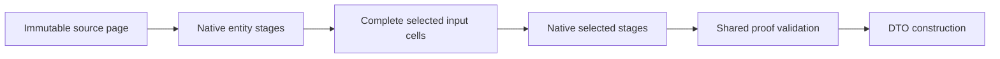

2026-11-18 — GROUPED SQL/ASK CLIENT VERIFIED AND PUSHED. Websiteac304a9e8a1dafd1689b2cb96d762b04b53ab0f0 passed all269 frozen-source parser/Playground/Ask cases, zero failures/skips, with matching HTML guidance/cache versions. Nine parser cases cover all3 stores, DISTINCT, hidden/count-only keys, independent typed values, reused aggregate inputs and invalid mapped fields;3 Ask cases preserve exact mapping/provider and require review. Backend build passed but2 positive wire fixtures failed in44412607223 (562/564 pass); corrected invariant-string Int64 literals and an explicit numeric rejection case produce exact3aff39819f1f, pending565+22+3 native qualification. Do not call the new grouping flow hosted, deployed or fully qualified. Full report: FULL_PROGRESS_REPORT_2026-11-18.md. Checklist remains50/164 per primary store. Shared Atlas/API/PIPER/DNA/deployment stand-down remains active.

2026-11-18 UTC — MAPPED TEXT EXTREMA VERIFIED / CANONICAL MIXED GROUPING SDK IN QUALIFICATION. Exacte9c2b556aa7ca86d575fe05bd456acd43387d7a7/Core29ae15ad8fc06919ef880bbef58d661831660fa3 PASSED https://github.com/NextGenSoftwareUK/OASIS/actions/runs/44380242516:532 selected tests,22 configured SQLite/profile tests,3 real native-store suites; zero failures/skips. Artifact14464800702/41,660bytes inspected in RAM only. Mongo147/Neo144/SQLite123 reports include textExtremaHttpVerified and prior selected-count/numeric/identity/global-ordering flags. Exact cleanup passed on Mongo/Neo; SQLite in-memory fixture/source unchanged. Actual HTTP text Min='xy'/Max='😀',15 owned settlements and caller isolation passed. Website1ce823257 client tests remain accepted, not repeated. One verified-batch image https://github.com/NextGenSoftwareUK/OASIS/actions/runs/44381916134/job/135076198484 is building exacte9/Core29ae with teaching_sidecars=false; no digest accepted yet and no local pull/deployment.

New Core9c0877a285eebd0345e064b0ae732f512b2cba7d / SDK candidate03e9ea46a858fa081838ed92c55134dc6fc16b3b adds PrepareGrouping/Group using the EXISTING typed CosmicGroupedSelection contract. Every key/aggregate must bind one exact projected path/function/domain on the same immutable source. CaptureAll validates complete actor/mapping/provider/version/schema/resource inputs and reconciles live winners BEFORE grouping; a stale materialized copy cannot contribute to its old category. Reuses the native grouping key comparer, HAVING predicate semantics, selected order/hidden key ties, exact integer/floating reductions and final detached DTO construction. Entire group budgets and off-page overflow are checked before any DTO construction;198 union inputs do not accidentally inherit a100-row single-branch result window. Saturated100-row input branches still refuse.

Exactly24 new Core scenarios cover changed categories, independent key/value paths, nullable/composite/Boolean/Unicode keys, counts, exact wide Int64 sum/mean, catastrophic floating cancellation, all-null values, empty input,198 inputs, HAVING/order/page, hidden-key ties, captured literals, caller/completeness/byte/group limits and zero constructor publication on off-page overflow. Three-store SDK fixture adds a REAL native Double projection plus controlled already-projected materialized cells, stale-key overlap and HAVING/order/page proof; this is NOT yet a full grouped HTTP demo. Qualification https://github.com/NextGenSoftwareUK/OASIS/actions/runs/44385792863 is pending; require556+22+3 and mixedGroupingSdkVerified on Mongo148/Neo145/SQLite124 reports before SDK acceptance. Existing native HTTP fixture remains15 settlements; no grouped HTTP query has been added yet.

Next priority is wiring this same prepared grouping owner into the existing mixed projection HTTP route and SQL/Ask flow, deep-freezing the nested grouping intent, compiling against the exact original source before I/O and proving all3 actual stored/native/JWT/usage branches. Mixed GROUP BY/HAVING is not recorded as complete. Grouped DISTINCT counts, computed aggregate selectors, other domains, larger-source planning, full EF/NHibernate/provider/hybrid/OPORTAL and hosted free-model acceptance remain open. Shared Atlas stand-down remains: zero shared DB/live API/browser calls, no DNA change or Dev/staging/prod deployment. Peer Core1437 profile logical commit stamp is separately prepared/unshipped, not swept into this batch.

2026-11-18 UTC — NUMERIC IMAGE NOW VERIFIED; TEXT QUALIFICATION STILL ACTIVE. Supersedes the earlier build-in-progress note: https://github.com/NextGenSoftwareUK/OASIS/actions/runs/44375239958 SUCCEEDED. Summary sourcee4690920980346de90a4cc165278bb395f842b86 and repository were checked; immutable image is ghcr.io/nextgensoftwareuk/oasis-web4@sha256:aabfd77288592e2d287a43799ab39f58b44de9de6e27504b3321b9e987f4ab35. Core8761 is paired in that exact source. This image contains the accepted numeric/identity/full count slice, but predates selected-value counts and text extrema; do not describe it as the latest feature set. No image downloaded or deployed.

Selected counts remain accepted by44377540932 (518+22+3); newer text sourcee9/Core29ae is under https://github.com/NextGenSoftwareUK/OASIS/actions/runs/44380242516/job/135070177924, last confirmed active at the actual WEB4 build. Native text acceptance is still unproven; require532+22+3, all3 textExtremaHttpVerified flags and owned cleanup before acceptance. Batch the next image only after that verified source outcome; avoid redundant intermediate builds. Shared Atlas/live API/browser/DNA/deployment stand-down remains. Full programme remains active and incomplete.

2026-11-18 UTC — MIXED SELECTED COUNTS VERIFIED / TEXT MIN-MAX QUALIFICATION PENDING. Exact283af5103a28ba1492a3f25823183e0c098c722f/Coref225638328a36d41983a01076bb79e26b9ac4451 PASSED https://github.com/NextGenSoftwareUK/OASIS/actions/runs/44377540932: actual WEB4 build,518 selected tests,22 configured SQLite/profile tests and3 real native store suites, zero failures/skips. Artifact14461704122/41,598bytes inspected solely in RAM: Mongo147,Neo144,SQLite123 report groups include selectedCountVerified,selectedCountHttpVerified and prior numeric/identity/global-ordering flags. Mongo/Neo exactCleanupVerified=true; SQLite owned in-memory fixture unchangedSource=true. Real SDK Double count2/distinct2 and real compiled LENGTH count4/distinct3 passed;13 owned settlements and caller isolation are asserted before cleanup. Five mapped domains/null/empty/identity/precision/Unicode/signed-zero guards have31 new Core cases plus6 compiled HTTP cases. Website4a0c253 tests passed. This qualifies bounded mixed COUNT(value)/COUNT(DISTINCT value), not arbitrary larger-source federation or full parity.

Next source e9c2b556aa7ca86d575fe05bd456acd43387d7a7/Core29ae15ad8fc06919ef880bbef58d661831660fa3 adds mapped String MIN/MAX using existing Unicode scalar ordering, live duplicate winners, null exclusion and exact original text. Empty/all-null String extrema return loaded null; text SUM/AVG and unmapped/grouped text routes remain unadmitted. Eight new Core cases cover private-BMP versus supplementary ordering, no normalization/case folding, empty/NUL text, overlap and empty/null output;6 compiled HTTP cases cover all3 providers. Actual native HTTP tests add text Min='xy'/Max='😀' with a known length2 filter,15 settlements and unchanged source/no virtual import. Qualification https://github.com/NextGenSoftwareUK/OASIS/actions/runs/44380242516 is pending; require532+22+3 and textExtremaHttpVerified on all3 native reports (147/144/123) before acceptance.

Website1ce8230585c2eebb7c946249cd7e0ceabfaee985 passed257 exact-source RAM tests (151 parser/106 Playground+Ask), zero skips/failures;4.349s observed total test process, not hosted request latency. Text extrema use known direct STRING metadata in the chosen mapping/provider, remain review-only when drafted by WEB6 and render successful null scalars without snapshot writes. No hosted real-model or browser acceptance is implied. Shared Atlas stand-down remains: zero live API/browser/database calls, no DNA changes, no Dev/staging/prod deployments. Numeric image44375239958/job135052551991 remains the existing exact e469/Core876 remote build, older than selected-count/text source; no new image dispatch or local pull. Full EF/NHibernate/provider/hybrid/OPORTAL/free-model programme remains open, including mixed grouping/joins, other domains and larger-source planning.

2026-11-18 UTC — SELECTED MIXED COUNTS IMPLEMENTED; NATIVE QUALIFICATION PENDING. Candidate283af5103a28ba1492a3f25823183e0c098c722f / Coref225638328a36d41983a01076bb79e26b9ac4451 adds COUNT(value) and COUNT(DISTINCT value) over the same validated complete stored+virtual identity union. Live representation wins overlap before null filtering and value equality; missing/null do not count. Domains are String (ordinal, no normalization), Boolean, Int32, exact Int64 and finite Double (signed zero equal), including native LENGTH output. The same caller/owner/provider/version/schema/budget/cancellation guards remain; a saturated100-row branch still refuses. No predicate/expression reevaluation, entity import, source write or snapshot action is added.

New31 Core cases and6 compiled HTTP cases cover identity overlap, nullable/empty values, all5 domains, Int64 beyond2^53, Unicode/case/empty strings, Double zero/subnormal/adjacent values, malformed whole input and existing authorization/completeness/resource refusal. Existing native tests add actual selected Double counts plus real compiled LENGTH counts (4 populated values,3 distinct values) on Mongo/SQLite/Neo, with13 settled owned operations per fixture and explicit cleanup. Expected selected518 + configured22 +3 native suites, report groups147/144/123; selectedCountVerified and selectedCountHttpVerified must be inspected before native acceptance. Source is not yet qualified or deployed.

Website4a0cc413303d7637c806af337bd643fc56f7c601 passed253 exact-source RAM cases (149 parser/104 Playground+Ask), zero skips/failures,0.423s. Editor and source-bound Ask support both COUNT forms with known typed direct metadata or LENGTH, returning the existing read-only scalar response; generated drafts require review. This is client/gateway-controlled acceptance, not hosted real-model verification. Larger-source planning, other domains, mixed grouping/joins, full EF/NHibernate and the full provider/hybrid/OPORTAL roadmap remain OPEN. No shared Mongo or live API/browser/DNA/deployment action.

2026-11-18 UTC — MIXED NUMERIC AGGREGATES VERIFIED, NOT DEPLOYED. Exact e4690920980346de90a4cc165278bb395f842b86 / Core8761c7b454d942b359832188a628c500769e8067 passed https://github.com/NextGenSoftwareUK/OASIS/actions/runs/44373073901: actual WEB4 build,481 selected cases,22 configured SQLite/profile cases and3 real native database suites; zero failed/skipped tests. RAM-inspected artifact14460207112/41,529bytes has146 Mongo,143 Neo4j and122 SQLite report groups with numericAggregationVerified,mixedNumericHttpVerified,identityHttpVerified and globalOrderingVerified. Mongo/Neo exactCleanupVerified is true; SQLite uses its in-memory owned fixture and unchangedSource=true. Source preservation assertions are also in the passing native fixture code. Report schemas intentionally differ: Mongo/Neo do not expose SQLite's unchangedSource key, so absence of that key is not a failed assertion in the shipping test.

MIN/MAX/SUM/AVG over the qualified de-duplicated stored+virtual union support Int32,Int64,finite Double and computed LENGTH; integer AVG returns exact Decimal and integer sums use exact range checks. Empty/null, cancellation, malformed inputs, source saturation, actor/owner/version/provider guards and adversarial floating cancellation are covered. Real compiled HTTP checks use all three shipping providers with the private owned mapping; four reductions assert 3 owner attempts/receipts each and the fixture settles11 operations before cleanup. These results qualify this bounded slice, not full EF/NHibernate parity or arbitrary federation: complete branch budget remains below100, other domains/grouping/joins and larger-source planning stay OPEN. Website49b8b082aee41c02db6025045ab4c9a774b51076 has249 RAM-only client cases (147 parser/102 Playground+Ask); hosted real free-model acceptance remains pending.

Count image44368155600 SUCCEEDED for exact e988e34034d59e572c6ca84ecac2f7dccbe3a66e: ghcr.io/nextgensoftwareuk/oasis-web4@sha256:1b6fb11bad3c1f31fb01db828135fb34fdf4a13b8e0f005fbd598b6009f64a02. It lacks the numeric update. New exact numeric image44375239958 dispatched from immutable cosmic-cql-mixed-numeric-e46909209803, teaching_sidecars=false; no digest acceptance yet. No local image pull, runtime/build/restore/database/environment or shared Atlas/live API/browser call. No Dev/staging/prod deployment or DNA setting change. Full roadmap remains active; peer native profile work remains separately owned and unshipped.

2026-11-18 UTC — Mixed numeric design implemented in source876/e469, qualification44373073901 PENDING: Aggregate reuses private CaptureAll, applies one selected numeric reduction after logical de-duplication and before paging, checks actor-bound source access, and skips declared nullable cells. Int32/Int64 form exact signed base2^32 high/low sums for existing CosmicNumericScalarResults; Double decomposes each finite IEEE value into existing70 signed base2^30 limbs and uses CosmicFloatingAggregateResults for one exact final rounding. No naive floating sum, client predicate/computed expression or fallback reader. Min/Max compare validated scalar cells; empty Sum=typedzero, nullable empty Min/Max/AVG=null, required empty=CQL_EMPTY_SEQUENCE, final overflow=CQL_SCALAR_OVERFLOW. Window/cardinality and whole-input completeness guards are unchanged. HTTP adds Min/Max/Sum/Average enum values and requires Id+one numeric/native LENGTH column with one unpaged scalar output; same route/3-attempt pricing/no DNA change. SQL and reviewed drafts accepted in249 client cases; actual native fixtures still pending. Larger-source/full parity remains open.

2026-11-18 UTC — Mixed Count architecture now VERIFIED by44365838769 on e988/Coreeed (405+22+3). Shared CaptureAll validates/captures the complete bounded qualified identity union once; Count does not sort or page it, while projection retains selected ordering/one page. HTTP LongCount uses existing projection/mixed route/3-attempt pricing, canonical Id-only input and one scalar output; exact Int64 wire value and mapping reference, no snapshot action. Projection DTO capture freezes the terminal operation, mapping, filters/JSON values, columns/functions and selected ordering before provider callbacks/awaits; mutation and deep-capture regressions pass. Real SDK/HTTP tests on all3 stores prove count4/0,7 settled owned operations, foreign refusal and source preservation/cleanup. This does not establish unlimited-source aggregates or complete snapshot consistency; saturation is explicitly refused and larger-source planning remains open. Website244 source cases include actual client scalar198 rendering without writes; no hosted/model/deployment acceptance.

2026-11-18 UTC — Mixed Count architecture sourcee988/Coreeed (44365838769 PENDING): CaptureAll is the sole whole-input validator/de-duplicator shared by projection and count. Projection applies selected ordering and page after capture; Count requires one canonical Guid column and source ReadAccess bound to the admitted actor, and returns the complete union total without sorting/paging. No record values or predicates are evaluated in memory. Existing complete-branch/budget/schema/owner/observation checks still refuse unproven counts; two99-row branches can count198, a saturated100-row branch is rejected. Larger-source planning remains open.

Wire contract extends existing projection/mixed with optional ResultOperation enum Rows/LongCount; Rows is ignored when writing default JSON. LongCount requires Id-only, OrderBy Id, Skip0/Take1 (one scalar output), no descending/selected order, and returns cql-scalar-v1 Int64 exact-string value plus mapping ID/canPrepareSnapshot=false. Admission stays exactly3 reads and existing query tariffs, with no new route/DNA. Projection requests now deep-capture the terminal operation, mapping, nested filters/JSON values/columns/functions and selected ordering before callbacks or awaits; count callback-mutation and function/order-capture tests lock that invariant. Identity-only actual SDK/HTTP flow is already accepted44357956649; count and full-capture extension qualify separately. Websiteeb6e244 tests cover SQL COUNT, source-bound reviewed draft and scalar198 display/no writes. Real model/hosted/unlimited aggregate/full parity acceptance remains open.

2026-11-18 UTC — Identity-only projection source (aea7/Core034, native proof44357956649 PENDING): the existing native projection contract always returns native identity and now accepts zero property columns/cells. It retains source/key uniqueness, byte/row/cancellation limits and mapping-owner/connection/admission checks. Main Mongo and Neo construct explicit zero-byte expressions; SQLite's existing native key selection needs no alternate reader. Root mixed SELECT Id composes that native identity with stored Guid identities through the same validated merge, preserving live-winner provenance/global ordering. Unselected native fields are not transferred or materialized. This is a real projection shape; aggregate/count support is still separate and unsupported in mixed SQL. Websiteae920951 has240 client cases accepted. Prior combined Double/profile71b0/Corefbe is fully accepted44354518380 (368+22+3) and exact image44356703060 is active, without the newer identity change.

2026-11-18 UTC — Finite Double native contract accepted in44351744975 (381bea/Core0cb). Mapped projections now admit String, Boolean, Int32, Int64 and finite Double; comparisons push down typed String/Boolean/Int32/Int64/Double NativeRecordFilter values in the real provider SDKs, with CQL Integer predicates retaining Int64 input. BSON double /SQLite real /Neo FLOAT inputs remain distinct from integer storage. Nonfinite filter/cell values are refused; invalid stored nonfinite projection inputs return explicit errors without partial results. Missing/null remains source-specific and nullable-driven; SQLite cannot distinguish an already stored null from an original NaN converted by SQLite to null. Double wire values use the existing exact invariant round-trip string encoding; live-winner dedup/global selected ordering/page remain shared. CAST(metadata.rate AS DOUBLE) filters now match the existing metadata.rate AS DOUBLE syntax in the client;237 source tests accepted. No materialization/save is introduced. NewCorefbe peer consistency composition qualifies separately in44354518380 before an image/deployment claim.

2026-11-18 UTC — Finite Double mapped-result extension (source published; native qualification44350525123 pending): NativeProjectionColumn admits exact System.Double; NativeRecordFilter and NativeProjectionCell reject NaN/infinities. Real SDK queries retain native numeric kinds (BSON double / SQLite real / Neo4j FLOAT), finite-range guards and bound comparison values; integer values are not converted to doubles. Missing/nullability remains explicit; Neo4j absent properties and SQLite stored nulls keep their native states. All-six numeric comparisons are source-side, while mixed selected-alias sorting occurs once over complete bounded branches after logical-ID live-winner de-duplication. No snapshot/materialization/save is introduced. Website6a7000ec adds typed metadata CAST predicates and mapped Double drafts with237 client cases; runtime/native acceptance remains pending, full scalar-domain parity remains open.

## 18 November — AI draft source binding (client-qualified, not hosted)

Ask Your Data now supplies the selected saved mapping ID and ready target database as source context. Only that mapping/provider may appear in a mapped draft. With no selected mapping, the model cannot introduce one. The server still owns definition lookup and authorization; browser selection never grants access. No native source records, connection settings or credentials are sent as model context.

The response must compile locally, preserve its source context and remain in the same visitor/session before it can be opened for explicit review. Mapping edits, saved-source selection and target changes invalidate old responses/drafts; programmatic changes are checked again when the response arrives and when opening it. Public examples clear the private source selection through the same Playground reset helper used by session changes. Neither drafting nor reviewing executes a data query.

Instructions cover admitted UTF-16 LENGTH syntax, mixed metadata aliases, global sorting/paging and explicit unsupported forms. Metadata paths/types must be supplied by the question; the model must not guess them. Free demo inference flags and the existing single WEB6 request are unchanged. Website58cb has95 controlled flow cases; SQL parser135/backend358/native3 are separately scoped evidence. Real configured-model and hosted browser acceptance remain open.

2026-11-18 UTC — GLOBAL MIXED ORDERING AND VIRTUAL-ONLY NON-IMPORT QUALIFIED ON ALL3: [44331657119](https://github.com/NextGenSoftwareUK/OASIS/actions/runs/44331657119) PASSED exactb88d25b856f8/Core3b0dfc8d5116:8 worker guard cases, actual WEB4 build,358 selected cases,18 configured SQLite and3 real native suites, zero skipped. RAM-only artifact14439797893/40,989bytes confirms Mongo143/Neo140/SQLite119 groups, globalOrderingVerified=true/orderedAttempts=3 on ALL3, exact Mongo/Neo cleanup and SQLite in-memory/source-byte preservation. The common network fixture now requires the known native7 record to have no Holon copy BEFORE and AFTER its queries on ALL3. It verifies stored9/native7/2-unit global ordering, one final page after live-winner de-duplication, text ordering, matching provenance,3 settled attempts for each owner request and2 for the foreign404. Source bytes stay unchanged; only4 explicitly owned seed Holons and owned outboxes are removed. SQLite network fixture group elapsed258ms in isolated CI, not hosted latency. Discovery/reservation remain controlled; no full production startup/global-enrollment/named-secret-store/hosted acceptance claim.

Websiteecfdde42 has135 passed SQL parser/snapshot-contract cases: aliases/repeated LENGTH expressions, multi-key sorting and LIMIT/OFFSET; snapshots still fetch original source fields. [New ordering image44328815426](https://github.com/NextGenSoftwareUK/OASIS/actions/runs/44328815426) is BUILDING exact acceptedf8df09b/Core3b. B88 differs from acceptedf8 ONLY in2 native test files; shipping API/provider/Core/DNA/manifest blobs are identical, so no duplicate image build was started. Earlier baselinefee3/Corec76 image44320650452 PASSED, digest ghcr.io/nextgensoftwareuk/oasis-web4@sha256:98f1d185faed89ff3b100713cf1b14d7ac0e3e874345dc2fa48ffdfd52db1287; it lacks new ordering. Neither image pulled or deployed. Development remains0f7, shared Atlas stand-down active. Full EF/NHibernate parity, hosted WEB6/SQL/browser acceptance, scalable/general mixed composition and hybrid placement/cache remain OPEN. No Development push, runtime setting, live API probe or PIPER write.

## 18 November source addition — bounded mixed ordering (native-qualified source)

Core `CosmicMixedProjectionResults.Merge` is the shared owner of two-representation result merging. Providers execute predicates and projections natively. The stored intent must be unpaged except for its100-row fetch bound; nonempty virtual reads carry the same requested bound plus their owner. Each branch must return fewer than100 rows. A full or shortened branch is refused, so a sorted prefix cannot masquerade as a complete result.

The merge validates the entire captured input, canonical identity, exact scalar schema, caller/mapping provenance, duplicate IDs and a combined2MiB input budget before exposing any page. Live mapped values win over an imported copy of the same stable logical ID. It orders one to eight exact selected aliases using existing Core scalar/null/Unicode comparison and a deterministic ascending logical-ID tie, then applies one global Skip/Take. Provenance follows the winning row through ordering/paging. Computed output cells remain detached; explicit snapshots fetch original mapped fields afresh.

Initial native domains remain String/Boolean/Int32/Int64 plus canonical Id; LENGTH preserves String input and Int32 output. This is bounded result federation, not client predicate evaluation or a substitute for provider execution. General/scalable mixed composition and full EF/NHibernate parity remain open. Exact backend proof is running at44324658319/65018cf72832/Core3b0dfc8; editor ecfdde42 has135 passed parser/snapshot cases, not hosted acceptance.

# CQL architecture

## Multiple predicates over stored and virtual Holons

The mixed compiler captures one to eight immutable typed metadata filters as
an AND expression. Both branches retain the original operator, scalar domain,
function and exact bound when aliases bind to native source fields. Code
contracts below describe implementation; [CURRENT_STATUS](CURRENT_STATUS.md)
records the separate source, native and hosted acceptance gates.

MongoDB, SQLite and Neo4j native implementations support integer comparisons,
String/Boolean equality and inequality, UTF-16 length comparisons, and ordinal
Contains/StartsWith/EndsWith with their negative forms. This is not universal
provider admission: Azure Cosmos DB retains its bounded String/Boolean
equality/inequality contract and rejects unadmitted functions. Unsupported
operations must fail explicitly rather than fetch rows for client evaluation.

A string match is a total guarded Boolean: a null, missing or non-string value
does not match; negating that complete predicate therefore returns true for
those values. This differs from an admitted scalar inequality or a length
comparison, which retains its own input-domain guard. Projection of a returned
field still validates its declared type; negation does not waive that check.
SDK prefix/suffix expressions must explicitly request StringComparison.Ordinal.
The SQL-like editor binds positive/negative LIKE prefix, suffix or contains
forms and escaped literal characters to these same operators, not to regex
execution or unrestricted SQL.

Length counts UTF-16 code units: a supplementary character counts as two.
Embedded NUL is part of both text and literals. SQLite query functions must
read complete, strict UTF-8 spans after native encoding conversion; its
NUL-terminated custom-function string wrapper cannot establish this contract.
Reader errors must not publish already collected rows or poison later reads.
The new decoder-failure regression and exact encoding cases remain subject
to the qualification state recorded in CURRENT_STATUS.

Apply native filtering before the independent completeness caps, then merge
logical IDs, deduplicate, order and page. A full capped branch cannot prove
collection completeness. Preserve exact BSON scalar types/simple collation,
SQLite storage classes/binary comparison, and Neo4j type predicates.

Snapshot preparation captures the same filters and the union of selected and
filter-referenced mapped fields within the existing budget. Save original
source values, not the length or Boolean predicate result, with provenance.
Preserve exact numeric metadata through the browser response/save boundary.
Stored and virtual reads use shipping provider code and existing caller,
owner and connection admission; a mapping grants no additional source access.

## Virtual Holon mapping boundary

See the [Virtual Holons import proposal](OASIS_Virtual_Holons_Import_Proposal.docx). Materialized import persists owned Holon payloads for
HyperDrive replication. Virtual mapping persists a collection mapping
and resolve bounded native queries into ephemeral Holons with stable IDs.
CQL can query approved mapping metadata for discovery and approved record fields
through bounded, typed native queries. Record provenance includes the mapping
revision, provider, fetch time and freshness. Keep credential references server
side and avoid exposing sensitive source keys. Treat source availability and
complete-results evidence as provider-specific capabilities.
Replicating the mapping carries the reference. Reading the payload still
requires authorized access to the native provider.

Hybrid mode would add explicitly selected cached or persisted records.
An explicit snapshot save creates an owned Holon with source provenance.
A source update requires its own authorization and write capability.
OPORTAL avatar/application policy controls and WEB4 settings/placement admission
now have source implementations under qualification; CURRENT_STATUS records the exact
revisions and remaining acceptance gates. New native imports, mapping registration
and explicit snapshots consult the selected policy. Placement preferences never filter
existing query results. An app override is an owner preference namespace, not an
application-access grant. Memory caching, automatic placement, collection/record
exceptions and the corresponding complete execution controls remain roadmap scope. Query results preserve logical identity,
authoritative source, representation, mapping revision and freshness when
virtual results, cached fields and full Holons share a collection.

For a million-row customer table with 30 fields, each mapping has up to 30
field definitions and one set of collection settings. Selecting Name and City
for 20 matching rows sends only those two record values per row through the
native projection, plus the source key needed for identity. Query execution
does not create persistent row Holons. Full imports, persistent caches and
per-row indexes have their own storage footprint, multiplied by any physical
copies. Benchmark mapping, query and replica bytes separately.

For a concrete mixed query, combine live supplier inventory from a virtual
mapping with replicated order Holons. Use one logical CQL filter and projection,
retain source provenance, and reconcile overlapping logical IDs. The virtual
source has its own visibility and failure semantics. HyperDrive may load-balance
an imported read or fail over only if the eligible provider can meet that
query's completeness and freshness requirements.

Host-owned read-source activation recovery is explicit per CqlReadSourceProfile. Blockscout opts into at most2awaited health checks, one5s delay, shared30s aggregate deadline, and only typedHTTP500/502/503/504. Other profiles default to1attempt. No user query/write/signing operation, auth/rate-limit error, malformed data or timeout is retried. Failed attempts are logged with safe typed event4831 and recovery event4832; exhausted recovery remains unavailable.

Blockscout uses shared query/read-only activation contracts with bounded configured address lookup and full validation before paging. Exact nullable balances/update heights and a public metadata allowlist avoid fabricated zeroes/private-field leakage. Explorer instance is part of source provenance/projected IDs. [Contract and limits](../../Devs/BLOCKSCOUT_PUBLIC_ADDRESS_CQL_GUIDE.md). Original read timeout preserved; successful read-only completion is functional proof, not reliability certification.

Celestia implements the shared ICosmicQueryStorageProvider/ICosmicReadOnlyQueryActivation contracts as a separate pinned-header read profile. Its explicit height catalogue maps to node-reported block IDs; bounded full selection is validated before paging, with native writes refused. This is not trusted consensus or data-availability verification. [Configuration, capabilities and proof limits](../../Devs/CELESTIA_PUBLIC_HEADER_CQL_GUIDE.md). Hosted HTTP3/2+Mongo5/4/reuse/privacy/exact replicas2/2 verified; card/public bytes6a863c7 verified; browser interaction remains separate.

Current scope (2 November 2026):55integrated query types/50scoped hosted functional HTTP proofs; browser5verified/45open. Matrix uses the shared HolonManager planner/deferred LINQ, explicit read-source activation and query-only tariff/admission boundaries. Alias equality/membership and complete-selection paging do not create a second query engine or grant native writes. [Profile contract](../../Devs/MATRIX_PUBLIC_ROOM_CQL_GUIDE.md), [current state](CURRENT_STATUS.md), [source/HTTP/replication/publication proof](MATRIX_PUBLIC_SOURCE_STATUS.md). Earlier dated checkpoints below remain historical.

## Historical Azure checkpoint — 1 November 2026

**40 providers have scoped hosted HTTP evidence; 5 have browser evidence and 35 browser gates remain open.** Azure Blob passes native3/2, Mongo-paired5/4, repeat0new/2existing, foreign-private0/public3 and exact SQLite/Neo4j replicas2/2. Two private saves acknowledged at version1; completion ACK prevents replay. Azure is anonymous public Blob properties, not hosted Cosmos DB or owned Azure writes.

Latest hosted acceptance: parent bccef53d6dbe0ec75028220b34eb0d3f2b0f4db8 / Core d133cc20c29441158da0e590d7f3c85b351dd826. Code job e6a98438-bf39-444e-89eb-5367322525bc and single settings job8e382a80-86ec-4d1d-8709-ca459f9e9781 succeeded. Exactly3settings applied once with per-key ACKs and complete candidate equality; canonical DNA/unrelated settings preserved. Original Azure cohort completion ACK retained; never replay it. Website969462188cd122f3dd0a2523b782e6f3ea2deefa publishes the Azure card with guide781bed195/C#bccef53d6 links. Public HTML158677bytes/SHA256f0ff7eccd617edcb3a754ce82a8b09184ce3a666ccf57aa84328ba07025c2106 and both script bytes match exact git blobs;92client tests pass. Browser interaction and real-expiry gates remain separate.

There are **45 currently integrated query types**: 3 canonical adapters, 38 bounded public/source profiles and 4 local PostgreSQL/Azure/Oracle/AWS implementations. PostgreSQL content and AWS DynamoDB Local identity queries pass native and local Mongo/HTTP checks; hosted PostgreSQL/owned AWS remain open. Azure Blob public properties pass SDK, manager/LINQ, local and hosted HTTP/Mongo checks. Hosted40/tariffs40/browser5/open35. Preserved broad-branch prototypes are not silently counted as current hosted coverage. Full ORM/EF parity/HyperDrive certification remains incomplete.

Current implementation state: [CURRENT_STATUS](CURRENT_STATUS.md); feature acceptance: [parity checklist](CQL_PARITY_CHECKLIST.md).

1. **Capture:** bounded immutable query/selected-stage intent and closed literals; no user callback execution.
2. **Plan/admit:** explicit scope, eligible targets, exact scalar/relationship capabilities, visibility and work bounds.
3. **Own execution:** V2 HolonManager and physical-attempt owner; preflight all targets and re-admit actual contracts before dispatch.
4. **Native adapters:** Mongo aggregation/snapshot owner, SQLite serializable read owner, Neo4j captured scalar pipeline/read owner. Do not invent stronger provider consistency.
5. **Validate/return:** acknowledged complete detached evidence, exact values and shared remaining work; materialize only where the requested result contract permits it.

## Explicit read representations

CqlReadSourceProfile owns an explicitly configured query-only adapter and its
read activation/lifetime. CqlHostedSourceRegistry resolves that representation
for CQL without registering it as the canonical wallet/default write provider.
The query manager remains unbound; named adapters and actual capabilities are
captured and re-admitted by the shared planner/executor. No failed native query
silently substitutes a Mongo copy or another endpoint.

Discovery combines explicit host permission, query tariff, activation and native
capability planning. A supported provider enum alone grants nothing. Missing Mongo
can disable a paired example while retaining the source's native leaf examples.
Examples own fixed Rows/Federation operations and named scope, not executable URLs.

StorageQueryTariff derives capture bounds from its single supported unsigned-read
set. PreparedStorageExecution still needs independent server permission and a
captured price; its query-only set cannot authorize storage writes. The current
factory rejects overlap with native signing bindings. Simultaneous public-read
and canonical signed-write representations for one provider need a future
operation/representation-aware admission contract; removing the fence is not a fix.

Public EVM adapters share EvmPublicAccountMetadataSource in Web3Core. Fixed trusted
descriptors bind provider, chain ID, genesis hash, metadata names and allowed RPC
path. Ethereum/Polygon remain root-path-only; Arbitrum uses the official /rpc path.
Every selected balance is read against one RPC-reported finalized canonical hash.
The descriptor does not come from query JSON; wallet/signer fields are forbidden.
This is native provenance, not a light-client settlement proof. Google/S3 use
anonymous metadata-only SDK operations rather than owned encrypted record storage.

All public views retain NativeRecordHolonMapper identities: stable mapping owner,
provider, source namespace and native key. Visitor preparation instead requests
Core-derived IDs in the actor's cosmic-cql-demo namespace, journals a create-only
Mongo save before submission and retains uncertain outcomes. These snapshots can
replicate through normal V2 owned writes; native public views are not replication
targets. PreserveCopies returns physical provenance, not a cross-provider snapshot.

Only explicitly declared metadata keys remain queryable when snapshot encryption
is active. AdditionalQueryableKeys is trusted runtime/deployment policy, separate
from globally reserved system keys. Native errors, late malformed values and empty
pages still require complete protected-source validation before publication.

Deployment configuration must match the source/application/Core revision. Joint
public-profile candidates compose their permissions/examples once; independent
candidates from the same old snapshot are not sequential updates to apply. Exact
pins, release scope, host acceptance and remaining gates belong in CURRENT_STATUS.

## Native query and selected-stage owners

For projected All, native counterexample reduction follows every selected stage. Complete source/stage evidence validates before the Boolean is published; final row evidence and the terminal scan consume their budgets.
Source relationship composition has separate admission from entity All predicates. All three native source compilers now support the separate source-composition capability. Complete protected scopes are validated before business truth and paging; source predicates stay native.
Keep source translation, protected errors, membership/visibility and remaining-work accounting in their owning layers. No parallel fallback or silent retry.

[Active acceptance contract](CQL_PROJECTED_ALL_EXECUTION_CONTRACT.md) defines the current invariants.
[Full architecture/history](Archive/CQL_ARCHITECTURE_history_2026-10-27.md) retains earlier detailed designs, subsystem contracts and checkpoint evidence.
[Full ORM history](Archive/COSMIC_ORM_IMPLEMENTATION_ROADMAP_history_2026-10-27.md) retains replication/history/migration/placement and other programme requirements.

The native-only acceptance assembly links the shipping demo and provider adapters;
it does not implement replacement query execution. Its host supplies a V2
HolonManager with an explicit provider registry. The source/composition demo checks
both successful results and protected errors through that manager. Fixture creation,
ownership journals and exact cleanup stay in the test host, outside the read-only
public example. HTTP host contracts remain in their separate integration project.
The partial IQueryable bridge is shared Core code, independent of database type.
It registers owned expression chains with weak keys, binds standard LINQ closure
parameters per execution, captures an immutable CosmicQuery, then re-admits live
capabilities and invokes the existing V2 typed query owner. It neither compiles
application predicates to delegates nor fetches rows for client filtering. The
initial increment flattens exactly one explicitly named physical sequence;
remaining terminal/repeated-selection dispatch remains Q01 work, with explicit unsupported errors.
Standard cardinality and All terminals dispatch through CosmicScalarPlanner and
the existing V2 scalar owner, independently admitting scalar capabilities. All's
predicate remains separate from its source window. Entity cardinality after a
window now carries its own CardinalityPredicate descriptor and independent
SupportsPostWindowCardinality admission. The shared scalar predicate lowering
counts matches for cardinality and counterexamples for All, retaining each
operation's own meaning and the original source window.
Queryable Select transitions to a typed selected-sequence provider. The shared
query envelope owns standard/async enumeration for entity and selected results.
The selected provider rebinds source intent and selected stages per execution,
then uses the existing projection or selected-composition owner; selected All
uses the independent projected-All owner. Constructors and setters run only in
the established validated projection materializer, never during capture and
never as an alternative to missing native execution.
Entity element terminals delegate to the existing element planner/executor and
V2 typed hydration owner. First/Single cardinality, tail windows, Index bounds,
tracking and error semantics stay in that owner. The bridge handles a caller's
OrDefault argument only after an acknowledged empty result; it cannot replace a
native failure or ambiguous cardinality with a default object.
Queryable value aggregates bind typed paths and exact result domains before
planning against independent scalar-selection capabilities. Plain scalar Select
can lower into the same native selector aggregate; selected stages are never
moved across the reduction. Int32 Average now has an independently admitted double-output contract; Int64
uses independent checked-prefix enrollment, now verified on MongoDB, SQLite and Neo4j. The existing decimal-output
CQL contract is preserved rather than approximated with a client conversion.
The Int32 double-output mode shares integer-packet validation with decimal means
and grouped slots, and adds no provider row buffer. The scalar descriptor records
the exact result mode; scalar selection admission checks the independent flag
again at execution. The selected-scalar validator also verifies the new result's
finite Double type and Int32 input bounds. Existing capability constructors leave
the flag false, so no other provider is silently enrolled.
MongoDB Int64 double Average orders the selected source window by its canonical
ordering keys plus identity tie-breaker, then computes exact Decimal128 running
sums. The bounded input/count domain fits Decimal128 precision. Its six-field
packet includes a strict Boolean `prefixOverflow`; missing, numeric or additional
fields are invalid. The shared numeric owner checks exact limbs/count, rejects
contradictory no-overflow sums, and returns overflow for any visited prefix.
Only an acknowledged checked Int64 total is converted once to double before
division. Neo4j also independently advertises this mode. No client row accumulator
or decimal-mean conversion grants this capability.

SQLite attaches a connection-owned checked Int64 prefix aggregate under the
existing exclusive read owner. The selected source carries an explicit ordering
ordinal; SQL aggregate ORDER BY consumes that ordinal after source paging.
The callback retains a bounded running total/count and overflow latch, checks
cancellation/deadline/work budgets, and never buffers source rows. SQL computes
the independent exact limb/count packet in the same statement. The owner checks
hook failures before interpreting its strict 0/1 acknowledgement and unregisters
the hook on disposal. Kernel and V2 manager native gates prove reverse ordering,
post-page prefixes, nulls, overflow, cancellation and teardown.

Neo4j checked Int64 means reassert the admitted source ordering plus identity
immediately before native collect, after SKIP/LIMIT. Cypher reduce retains a
checked total and overflow latch. Positive and negative branches use their own
safe boundary subtraction; only an admitted branch performs addition. The
ordered participating-value list remains on the server and uses proportional
memory within the input-work bound and native transaction memory/timeout limits.
The exact eight-field integer packet includes Boolean prefixOverflow in every
normal/error union branch. Empty windows and genuinely empty sources retain the
same required/nullable shared-owner semantics. Unit packet tests and83 native
checks/store prove both overflow directions, reversal, paging and empty results.

Selected element terminals lower through CosmicProjectionElementPlanner into
existing native composition plus bounded Skip/Take and an independently enrolled
Reverse stage for tails. SQLite reranks descending prior ordinals; MongoDB assigns
new window ranks in descending prior-rank order; Neo4j orders the previous stage
positions descending before collecting the next stage. Detached stage proofs are
validated by the existing composition owner. Its shared ExecuteOwnedAsync checks
empty/multiple cardinality before constructing any DTO. V2 HolonManager gates the
new public async entry; the element result carries HasValue separately from Value.
The IQueryable bridge binds source/selected predicates per execution and handles
caller-supplied defaults only after acknowledged empty proof. Budgets include
full bounded source participation and each terminal-lowering stage.

Selected cardinality adds explicit RequestsCardinality intent to composition
plans and independently enrolled SupportsCardinality. Legacy constructors keep
that permission false. Empty stage lists are admitted only for cardinality intent.
The shared composition attempt owner now accepts a typed finalizer after detached
proof validation: row/element finalizers construct their selected output, while
cardinality finalizers normalize native counts directly. Cardinality debits final
proof payload and terminal scan work across providers before publishing values.

CosmicProjectionCompositionPacket.NativeSelectedCount is mandatory for this
intent and must equal complete validated output participation. SQLite executes a
native count over the same materialized stage CTEs in its serializable owner.
MongoDB executes a count facet in its existing snapshot session, explicitly
acknowledging zero; its positive rank decoder permits zero only for this terminal.
Neo4j preserves the acknowledged source/final-stage native header count. Missing
or contradictory counts fail before result publication. No DTO constructor runs
for Count/LongCount/Any. Standard selected predicates append after captured
windows, with closure binding repeated per execution.

Entity cardinality predicate capture uses the bounded scalar terminal grammar,
including child/descendant markers and expansion admission. The terminal
admission descriptor inherits source scope/read access and has no source window.
Planning and execution independently admit its read paths and explicit traversal
permissions. Existing capability constructors keep post-window cardinality false.
SQLite applies matching predicates to its ordered source subquery, with protected
CASE reductions and a serializable owner where relationship scopes require it.
MongoDB and Neo4j share their scalar terminal traversal/error lowering, changing
only the match contribution for cardinality. An empty terminal page visits no
terminal scopes; source-scope failures still precede paging. IQueryable binds
parameters per execution, while fluent cardinality capture freezes them.

Selected numeric reduction uses immutable CosmicProjectedNumericIntent and
CosmicProjectedNumericPlan descriptors plus a bounded exact-word acknowledgement
in the composition packet. Each provider independently enrolls scalar numeric
permissions through NumericReductions; legacy capability constructors keep it
absent. Selected scalar expressions and flat-record numeric selectors bind an
exact column. The V2 manager and shared composition attempt owner preserve source
and stage scope, cross-check native participating count against validated selected
cells, charge acknowledgement/proof/terminal work, and normalize through existing
integer/decimal/floating numeric owners. The numeric finalizer constructs no DTOs.

SQLite currently enrolls signed Int32/Int64 Sum/Average and nullable forms. Its
native reduction runs over the final materialized stage CTE in the same
serializable owner. Two integer sum words retain exact totals; Int64 double means
reuse the checked aggregate hook ordered by the final stage rank. The hook checks
budgets and is removed on disposal. Selected ordering/offset occurs before prefix
accumulation. SQLite now also enrolls decimal/Single/Double/UInt64 and nullable selected reductions; all3 wider domains are independently enrolled;
selected Min/Max uses its independently enrolled extrema contract described below. Q01 remains red for Q01d/e/f.

MongoDB Q01a now independently enrolls signed Int32/Int64 Sum/Average and nullable
forms. Source and selected reductions share AppendNumericKernel, preserving the
published exact-word arithmetic and checked-prefix logic. The selected path
projects its admitted column and final rank, then executes that kernel in a
facet under the existing selected snapshot session/deadline. Empty input receives
an explicit native zero packet. The repository reuses strict numeric decoders,
checks terminal work/proof bounds, requires one packet and returns it through the
shared selected owner. Scalar/record selectors and all27 native integer cases
are verified on all3 providers.

Neo4j Q01a now independently enrolls the same signed integer domains. The numeric
terminal consumes the final native selected-position list and captured scalar
cells in the existing query. It reuses integral-word expressions and the guarded
checked-prefix reducer, emitting one exact count/word/Boolean acknowledgement.
The decoder requires complete source and stage participation before accepting
that terminal, rejects duplicate/missing/malformed packets and charges final
proof payload plus terminal scan work. Empty input has an explicit zero packet.
The shared owner validates participating count and normalizes the result without
constructing DTOs. All27 integer cases/store and129 Neo focused CQL tests pass;
Q01a is green while wider domains and selected extrema remain red.

SQLite Q01b reuses existing decimal limb, UInt64 split and floating packet kernels against the final selected CTE. Floating hooks belong to the same serializable connection owner, enforce its deadline and release on disposal. The decoder validates domain-specific packet width and participation before the shared typed finalizer. No client-side aggregation or record construction is introduced. Native proof:37 wider-domain cases in `CqlLinqStagedWideAcceptanceTests.cs`.

Mongo Q01b sends final selected cells to existing exact kernels within the same snapshot session. Empty packets preserve native domain types (Decimal128 decimal words; Int64 floating words). Strict scalar decoding owns packet validation; terminal proof budgets charge actual domain width. No client aggregation or DTO construction.

Neo Q01b derives exact decimal/floating words from captured final selected values and reduces each word natively. UInt64 uses the existing canonical20-digit splitter. The same single-query owner validates complete stages before normalization; packet widths and proof charges are domain-specific. No extra MATCH, client aggregation or DTO construction. This does not strengthen Neo repeatable-read guarantees.

Q01c shared extrema uses independently captured ExtremaDomains, rechecked against live adapter capabilities before execution. It appends null exclusion (nullable/reference domains), exact column ordering and Take(1) after all selected stages, respecting the32-stage bound. The common attempt owner validates complete native source/stage/order/output proof before its finalizer reads one detached cell. Required empty values produce CQL_EMPTY_SEQUENCE; nullable/reference empties return null. Neither record construction nor client aggregation participates. Old capability constructors leave extrema unenrolled. SQLite, MongoDB and Neo4j now have native proof and explicit enrollment.

SQLite Q01c explicitly enrolls selected ordering domains for extrema. Native final filter/order/Take execute in its existing serializable composition owner. Expanded all-null proof reproduced UInt64 key normalization padding the JSON null token; the shared UInt64 Column normalizer now returns SQL NULL before numeric padding, preserving null semantics for every consumer. Required values retain exact20-digit numeric keys. Regression tests cover null/zero/UInt64.MaxValue. Reviewed native continuation passed all218 extrema cases without replaying creates.

Mongo Q01c enrolls exact selected ordering domains. Final null filtering, ordering and one-row selection run under the existing snapshot session/deadline; each stage retains native identity/rank proof. The shared owner reads the winning detached field only after validating complete participation and every stage. All218 extrema cases/33 domains and202 Mongo CQL tests pass.

Neo Q01c enrolls exact selected ordering domains; null filter/order/Take operate on the captured selected positions in the same native query. Complete stage/ordering proof is validated before the shared finalizer reads the winning field. All218 cases/33 domains and137 Neo CQL tests pass. No stronger repeatable-read guarantee is implied. All3 Q01c cells are now verified; repeated Select Q01d is independently verified below.

Q01d separates physical native Columns from immutable OutputColumnIndices/OutputAliases. Reselection changes only the final shape/bindings; earlier predicates/order/windows retain their physical dependencies and complete native proof. Later selected predicates/terminals resolve outward aliases back to physical indices. Final construction maps validated cells and never creates intermediate DTOs. Retained physical cells continue to consume normal work/payload budgets. The standard provider captures a bounded deferred parent binding (maximum32 repeated selections), re-evaluating earlier closures at execution; fluent selections remain immutable. Composition-only adapters are admitted through their composition contract, without an unrelated ordinary-projection requirement.4 shared tests/2,536 CQL regressions pass; all3 native acceptance now passes26 cases/store.

Q01e shared row plans now carry PostWindowPredicate and PostWindowLimit independently of the original source page. Element lowering keeps the page unchanged, applies its terminal predicate, then selects1 row (First/Last) or at most2 (Single). Last retains native tail intent after terminal filtering. PostWindowElementPredicate is separately enrolled; admission validates terminal grammar/read-access and combined expansion bounds. Actual adapter capability admission and the physical attempt preserve every field. SQLite is enrolled after native proof; Mongo/Neo native proof is recorded below; admitted expanded-graph source options are preserved for the same native graph owner. No client filtering or extra provider read substitutes for native lowering.2,540 CQL regression tests pass; SQLite45 native cases pass, all3 native acceptance now passes.

SQLite Q01e uses two translators sharing one bound-parameter owner:source protected validation remains outside the source page, terminal protected validation is a complete native reduction over that page, and final predicate/order/element limit returns selected roots. Both scope reads and selected rows share the serializable transaction whenever relationships/graphs participate. Existing graph expansion consumes only selected roots in that same owner, enforcing depth/snapshot/node and visibility/catalogue limits.45 native cases plus35 compiler tests pass. No client filtering or second hydration read is used.

Mongo Q01e compiles the original selected page before its terminal predicate. A native unbounded window computes the highest terminal error across every paged root before match/order/output limits, so First/Single/Last cannot discard a different root’s scope error. Terminal outcomes and outer source errors normalize to one canonical envelope. Existing snapshot-session membership and graph ownership remain intact; no nested facet, client predicate evaluation or second root hydration read is introduced.45 native cases and207 CQL/compiler tests pass; Neo native proof is recorded below.

Neo Q01e captures ordered paged node/projection references and terminal outcomes before selecting winners, so protected errors anywhere in that page cannot be truncated. Capture is bounded to10,000 roots plus one detection row; overflow returns CQL_QUERY_LIMIT, never partial success. Traversal states survive the final ordering WITH, fixing the reproduced desc5 scope error. Selected snapshots/graph expansion use the existing read transaction/owner. ProviderSnapshot remains independently unsupported; an explicit rejection test passes rather than downgrading consistency. Reviewed native proof:46 new cases;141 CQL/compiler tests pass.

Q01f foundation introduces CosmicEntityCompositionQuery with immutable filter/order/window stages after its untouched CosmicQuery source. Separate ICosmicQueryEntityCompositionStorageProvider/Capabilities prevent old flat scalar/projection compilers from silently consuming a staged source. Exact ordering admission reuses the existing one owner; stage predicate/visibility and combined expansion bounds admit independently. Input row/payload and cumulative stage-work options are positive/bounded. The V2 manager dispatches through the existing row attempt owner on the original physical adapter, retaining actor/usage ownership, cancellation, detachment, identity/visibility checks and graph options. Missing stage contracts, capability drift, warnings and incomplete acknowledgements cannot fall back to flat reads.5 shared tests/2,545 CQL regressions pass; IQueryable/provider/terminal/projection integration remains pending.

### Selection after entity stages

`CosmicEntityProjectionQuery` retains immutable entity-stage intent separately from its detached selection definition. Its single-provider plan admits source stages and exact selected domains independently. Actual execution requires `ICosmicQueryEntityProjectionStorageProvider`; flat projection/row interfaces grant no substitution. `CosmicProjectionExecutor` owns both shapes through the same inherited physical-attempt boundary and native-cell validation/DTO construction sequence. Entity-stage acknowledgements also reject warnings and output counts exceeding the source/stage window bound shared with entity cardinality. This is currently a shared tested foundation; native providers, standard Select binding and selected-stage/numeric integration are pending.

## Native point-source profiles

`CosmicQueryCapabilities.ForStringMetadataPointLookup` admits exactly one bounded
string metadata equality and one selected target. Immutable `BusinessPredicates`
separates caller intent from mandatory read policy; the source adapter enforces
that policy on canonical point evidence. The ActivityPub/Mastodon adapter proves
this path without timeline scans or local query substitution. It reuses its
status projection owner, propagates cancellation, bounds streamed payloads and
rejects ambiguous JSON. [Verified scope and remaining gates](CQL_ACTIVITYPUB_NATIVE_PROFILE.md).

### Entity stages followed by selected stages

`CosmicProjectionCompositionPlanner.PlanEntity` retains an independent
`EntitySource` plan alongside the selected plan. Standard LINQ captures both
chains and rebinds them once per execution. Actual adapters must independently
enroll `ICosmicQueryEntityProjectionCompositionStorageProvider`; the flat native
entry point rejects combined plans. HolonManager uses the existing V2 composition
attempt owner. All3 implementations now have23 common native acceptance cases.

SQLite validates both chains inside one serializable owner. Mongo validates
entity proofs, selected inputs and selected stages in the same snapshot/deadline;
final entity ordering and identity direction determine selected ranks. Neo exports
the final entity relation from its existing compiler, then captures typed cells
and selected stages in one statement. A leading canonical proof phase validates
original source snapshots/revisions, sticky traversal errors and work bounds
before selected participation is accepted. It retains ProviderDefault consistency
limits and does not advertise snapshot isolation. No owner hydrates application
source entities as an intermediate query engine.

Combined graph sources, reselection and element/cardinality/numeric terminals
following this selection remain unintegrated. Q01f stays red.

Bitcoin native milestone (1 November): bounded public-header equality/key-set source passes20 controlled checks and real shared-manager C#/CLI3/2. [Guide](../../Devs/BITCOIN_PUBLIC_HEADER_CQL_GUIDE.md), [proof/next HTTP gates](BITCOIN_PUBLIC_SOURCE_STATUS.md). No hosted admission, full Bitcoin consensus or canonical on-chain write claim; live count remains26.

Bitcoin API milestone1November: explicit lazy read profile, independent tariff, actual four-preset planner and local HTTP3/2+Mongo5/4/isolation pass. Protected candidate prepared only; hosted/browser open. [Proof and exact rollout next step](BITCOIN_PUBLIC_SOURCE_STATUS.md). No signed-chain writes or hosted certification inferred.

Bitcoin hosted completion1November: exact f71e482c SUCCESS at19ebbfe2c/Core7317ba1. Normal visitors pass native3/2, paired5/4, repeat0new, foreign-private0 and SQLite/Neo4j replicas2/2. Totals27HTTP/5browser/22browseropen; no Bitcoin source writes. Earlier Bitcoin pending notes superseded. [Proof/hashes](HOSTED_PUBLIC_SOURCE_ACCEPTANCE_2026-11-01.md#additional-bitcoin-acceptance).

XRPL native milestone1November: bounded hash-verified header CQL passes21controls,1real C# walkthrough and actualCLI3/2. [Guide](../../Devs/XRPL_PUBLIC_HEADER_CQL_GUIDE.md), [proof/next HTTP gates](XRPL_PUBLIC_SOURCE_STATUS.md). Counts30implemented/29deployed tariff/27hosted HTTP; no XRPL hosting or signed-write claim.

XRPL API milestone1November: explicit read-only profile/admission, four exact shipping-planned presets and local HTTP3/2+Mongo5/4/private0 pass. Protected candidate prepared only; hosting/browser remain open, live27unchanged. [Proof and rollout next](XRPL_PUBLIC_SOURCE_STATUS.md).

XRPL hosted completion1November: free Ripple endpoint correction74bdf044 SUCCESS/c6e7f14ba/Coree032d0a, native3/2, paired5/4, repeat0new, private0 and replicas2/2. Prior402/expired-empty cohort preserved; explicit post-fix cohort has original ACKs. Counts28HTTP/5browser/23browseropen; no source writes. [Proof/hashes](HOSTED_PUBLIC_SOURCE_ACCEPTANCE_2026-11-01.md#additional-xrpl-acceptance).

Stellar complete header decoder1November:20cases pass, including real protocol29 headers, all5specified StellarValue unions and exact signed/unsigned64bit fields. Next CQL adapter must bind API metadata to decoded identities before publication. [Proof](STELLAR_PUBLIC_SOURCE_STATUS.md#complete-header-decoder-milestone). No Stellar CQL/hosted certification yet.

Stellar native CQL1November: complete XDR-bound sequence-key queries pass21source+1real C# controls and actualCLI3/2. [Guide](../../Devs/STELLAR_PUBLIC_HEADER_CQL_GUIDE.md), [proof/HTTP next](STELLAR_PUBLIC_SOURCE_STATUS.md#native-cql--developer-demo-complete). Counts31implemented/30deployed tariff/28hosted HTTP; no Stellar hosting grant.

Stellar API milestone1November: independent read-only admission, exact four-preset shipping planner and local HTTP3/2+Mongo5/4/private0 pass; protected3setting candidate prepared only. Hosting/browser remain open; live28unchanged. [Proof/next rollout](STELLAR_PUBLIC_SOURCE_STATUS.md#api--local-http-complete).

Stellar hosted completion (1 November): application637a6d49f/Core2dd3c37, exact settings deployment3eda0ea7 SUCCESS. Native3/2, private Mongo2, federation5/4, repeat0new/2existing, foreign-private0/public3, replicas2/2 pass. Counts29hosted HTTP,5browser,24browser-open;31deployed query-tariff types. Read-only hash-pinned public headers, no Stellar writes or consensus/signature verification. [Evidence](HOSTED_PUBLIC_SOURCE_ACCEPTANCE_2026-11-01.md#additional-stellar-acceptance).

Algorand native CQL milestone (1 November):21controlled +1real HolonManager3/2 pass, actual commented CLI3/2 passes. Explicit current-account catalogue, SHA512/256 address checksums, exact UInt64 strings and per-row rounds; no historical/shared snapshot or source writes.32implemented query types/31deployed tariff/29hosted HTTP. API/hosting remain open. [Guide](../../Devs/ALGORAND_PUBLIC_ACCOUNT_CQL_GUIDE.md), [proof/next gates](ALGORAND_PUBLIC_SOURCE_STATUS.md).

Algorand API/local HTTP milestone (1 November):3API/prepared+1Core+1native HTTP tests pass;3publisher+1client controls pass. Native3/2, pairedMongo5/4, foreign-private0 verified locally. Original marker-verified fixture removed and ACKs retained. Protected3setting candidate prepared only; hosted/browser pending. [Proof](ALGORAND_PUBLIC_SOURCE_STATUS.md#api-and-local-http-complete).

Aptos native milestone1November:25controlled+1real HolonManager3/2 pass/no skips, actual commentedCLI3/2 passes. Explicit Mainnet account catalogue and one requested ledger version per source query; exact sequence strings, no state/consensus proof or cross-provider snapshot.33implemented query types;29hosted HTTP unchanged. API/hosting remain open. [Guide](../../Devs/APTOS_PUBLIC_ACCOUNT_CQL_GUIDE.md), [proof](APTOS_PUBLIC_SOURCE_STATUS.md#native-cql-milestone).

Aptos API/local HTTP milestone1November:2API+1Core+1native HTTP pass/no skips,3pure publisher+1client controls pass. Native3/2, Mongo federation5/4 and foreign-private0 locally verified; marker-owned fixture removed/ACKs retained. Coree845c62/task-only. Protected candidate/export planner and hosting wait for current Algorand rollout. [Proof](APTOS_PUBLIC_SOURCE_STATUS.md#api-and-local-http-milestone).

Algorand hosted completion1November:7a9ca308e/Corec17db5f, exact settingsf3ee7f37 SUCCESS. Native3/2, paired5/4, repeat0new/2existing, foreign-private0/public3, replicas2/2 pass. Current-account/per-response-round semantics, exact quantities; no source writes/historical/shared snapshot. Counts30hosted HTTP/5browser/25open,32deployed query-tariff types. [Proof/hashes](HOSTED_PUBLIC_SOURCE_ACCEPTANCE_2026-11-01.md#additional-algorand-acceptance).

Hedera/Hashgraph native milestone1November:21controlled+1real shared HolonManager3/2 tests pass/no skips; actual commentedCLI3/2 passes. LatestIndexed account catalogue, exact tinybars/native timestamps and strict official Mainnet endpoint; no SDK payment, source writes, freshness/shared snapshot or consensus proof.34implemented query types/30hosted HTTP; API/hosting remain open. [Guide](../../Devs/HEDERA_PUBLIC_ACCOUNT_CQL_GUIDE.md), [proof](HEDERA_PUBLIC_SOURCE_STATUS.md#native-cql-milestone).

Hedera API/local HTTP milestone1November:2API+1Core+1native HTTP+1actual4preset shipping planner pass/no skips;3publisher+1client controls pass. Native3/2, Mongo federation5/4 and private0 locally verified; owned fixture removed/ACKs retained. Protected3setting candidate prepared only, Core89b5ffa/task-only. Hosted/cloud query/browser gates remain open. [Proof](HEDERA_PUBLIC_SOURCE_STATUS.md#api-and-local-http-complete).

Aptos hosted completion1November:1cfb893c8/Coree845c62, exact settings1c100994 SUCCESS. Native3/2, paired5/4, repeat0new/2existing, foreign-private0/public3, replicas2/2 pass. Per-native-query ledger version and exact strings; no cross-provider historical snapshot, state/consensus proof or source writes. Counts31hosted HTTP/5browser/26open;33deployed query-tariff types. [Proof/hashes](HOSTED_PUBLIC_SOURCE_ACCEPTANCE_2026-11-01.md#additional-aptos-acceptance).

Radix native resource CQL: [commented C# guide](../../Devs/RADIX_PUBLIC_RESOURCE_CQL_GUIDE.md). 50/50 tests and actual CLI3/2 verified; API/localHTTP/hosted scopes pass; browser renewal remains open. Exact supply strings and one Gateway ledger state per query.

Radix hosted milestone: original cohort completed at74aaa9b4d/Core8b79301 after settlement correction; no duplicate saves. [Scope, failure history and hashes](RADIX_PUBLIC_SOURCE_STATUS.md#hosted-acceptance-complete). Browser renewal/interaction remain separate. Earlier deployed-tariff headlines incorrectly included local Azure/Oracle: actual live catalogue35, implemented types37.

Starknet bounded header profile: [setup/commented C# guide](../../Devs/STARKNET_PUBLIC_HEADER_CQL_GUIDE.md), [native/API/local HTTP proof and pending hosted gates](STARKNET_PUBLIC_SOURCE_STATUS.md). Explicit enrolled block-hash equality/membership, exact field/integer strings and RPC-reported L1 acceptance. Local paired3+2/2+2results and visitor privacy verified; hosted/browser publication separate.

AzureStorageOASIS also has an explicitly configured anonymous public Blob-properties representation: HEAD-only SDK reads, bounded AzureBlobKey equality/IN, exact string byte lengths, no canonical storage registration or default-write change. See [profile and limits](AZURE_PUBLIC_BLOB_STATUS.md).

Fantom Opera adds an immutable latest-canonical-at-read EVM descriptor policy: hash-pinned EIP-1898 balances plus a final height/hash fence. The policy is an init property preserving the existing descriptor constructor, and is not a request-controlled fallback. Existing finalized profiles keep their semantics. Native and hosted HTTP/Mongo/privacy/replica proof now pass; browser interaction is separate. See [Fantom scope](FANTOM_PUBLIC_SOURCE_STATUS.md).

## Filecoin native identity in the shared EVM reader

Filecoin selects an immutable native genesis-CID identity policy before any request. It verifies mainnet chain314 and the exact singleton genesis tipset CID/height0 via Filecoin.ChainGetGenesis, then uses the existing finalized/hash-bound balance path. This is a specified representation, not an after-failure alternate genesis method. Existing provider descriptors retain Ethereum block0 hash checks and the original constructor signature. Configuration cannot select the policy or pin. Controlled/native manager and actual CLI3/2 pass; Local and hosted WEB4/Mongo/reuse/privacy/replicas pass; browser interaction remains separate. Generic private demo records retain identity/name/description, not full native metadata. FilecoinBalanceWei holds FEVM attoFIL decimal strings; no ETH unit or cross-provider currency equivalence. [Source scope](FILECOIN_PUBLIC_SOURCE_STATUS.md).

## Native EOSIO/Vaulta account query profile

EosioPublicAccountMetadataSource implements the shared capability-aware query and read-only activation contracts in the existing EOSIO project, separate from legacy signed storage. The API lazily registers CQL_EOSIO_PUBLIC_SOURCE_JSON; independent read permission/free tariff is required. Native get_info checks mainnet identity, then get_account reads only explicit configured names. Key equality/membership is bounded to8names/13characters, errors publish no partial page and64-bit quantities remain decimal strings. Account responses have independent head markers: no common finalized snapshot is implied. Hosted native3/2, paired Mongo5/4, reuse/privacy and exact SQLite/Neo4j replica gates pass. Browser Mongo copies currently retain identity/name/description/provenance rather than all native fields. See [scope/evidence](EOSIO_PUBLIC_SOURCE_STATUS.md) and [developer guide](../../Devs/EOSIO_PUBLIC_ACCOUNT_CQL_GUIDE.md).

## ChainLink public feed query profile

ChainLinkPublicFeedMetadataSource is a separate anonymous read-only profile in the existing provider project. Shared CQL plans bound exact configured proxy equality/membership, then chain/genesis checks and an RPC-reported finalized block bind all description/decimals/latestRoundData calls by EIP1898 hash. ABI validation preserves exact signed int256 answers/uint80 rounds/uint256 times as strings and publishes no partial page. Explicit CQL_CHAINLINK_PUBLIC_SOURCE_JSON, independent read permission/free tariff and4presets keep signed storage separate. Hosted native3/2/Mongo5/4/reuse/privacy/exact SQLite+Neo4j replicas pass; full browser native-payload mapping and interaction remain separate gaps. No current-price or independent consensus guarantee. [Scope/evidence](CHAINLINK_PUBLIC_SOURCE_STATUS.md).

## Nostr signed public event source - 2 November 2026

Nostr read-only CQL source passes32focused CQL/transport controls plus36signature/schema tests and actual manager/LINQ3/2. Bounded configured immutable event-ID equality/membership only, complete matching EOSE and verified NIP01hash/BIP340signature before paging. Metadata retains exact signed event fields; no native write/search/identity/freshness/completeness claim. API/Mongo/hosted gates pending. Current breadth51integrated/46hosted; [guide](../../Devs/NOSTR_PUBLIC_EVENT_CQL_GUIDE.md), [evidence](NOSTR_PUBLIC_SOURCE_STATUS.md).

Nostr API/local milestone2November: Core1/API2/localHTTP1/publisher9/prepared1/client1 pass. Actual native3/2, Mongo5/4 and visitor privacy verified; original two saves preserved during read-only correction/continuation, exact owned fixture removed. Three-key candidate/four presets prepared, no hosted settings mutated yet. [Current proof](NOSTR_PUBLIC_SOURCE_STATUS.md).

Bittensor bounded header source uses the same HolonManager/LINQ and WEB4 compiler/read-admission pipeline: configured Finney block-hash eq/IN+paging, guarded RPC/local content-hash checks, explicit node-reported finality policy and read-only tariff. Canonical V2 API saves own private Mongo copies and replication delivery; public source never enters the write registry. [Scope/evidence](BITTENSOR_PUBLIC_SOURCE_STATUS.md).

### Zcash public-source boundary

ZcashPublicBlockMetadataSource is an explicit ICosmicQueryStorageProvider/read activation profile, separate from the legacy wallet provider. A configured height/hash catalogue drives bounded point summaries; genesis/network/units/height/hash validation precedes row publication. It uses shared HolonManager/LINQ planning and capability admission. The HTTP registration, compiler and server read tariff require explicit enrollment; source registration never grants native write routing. [Evidence and hosted gate](ZCASH_PUBLIC_SOURCE_STATUS.md).

### Public analytical and grid node profiles

ClickHousePublicCountryMetadataSource executes fixed typed-parameterSQL against the qualified publiccountries table; ThreeFoldPublicNodeMetadataSource composes a bounded set of explicit nativepointreads. Both share HolonManager/LINQ admission, canonical publicholon mapping, access/page handling and explicitread-onlymutation boundary. Source projectionowner/key/namespace are durable; no ownedprovider write route is inferred. ThreeFold remains separate from its canonical MinIO-backed provider implementation. Shared developer walkthroughs resolve the native metadata key from StringKeySetLookup.MetadataKey. Server providerpermission/tariff enrollment remains independent and explicit.

## Explicit activation recovery

The host owns one activation gate per enrolled read-only source,shared by startup and explicit Wizard recovery. Discovery exposes process identity/generation;requests from another host or stale generations cannot start activation. One bounded immutable receipt per source prevents duplicate completed requests from reactivating;receipts are historical,in-memory,not business outbox history. Pending/cancelled/failed attempts remain unavailable;native ownership is awaited even if cancellation is ignored. Query/discovery paths never trigger recovery.27controller/discovery/schema tests pass;hosted gate remains open. See [contract](CQL_SOURCE_RECOVERY.md).
