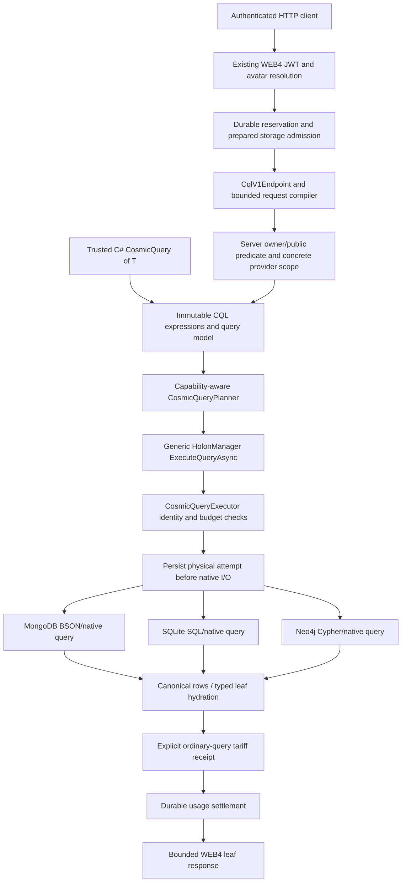

# CQL architecture

22 October 2026. CQL is a generic COSMIC ORM query pipeline. Native providers translate its admitted intermediate representation; they do not implement separate public query languages. [Developer manual](CQL_MANUAL.md), [HTTP contract](CQL_V1_HTTP_CONTRACT.md), [execution reference](CQL_EXECUTION_PIPELINE.md).

## Native graph execution checkpoint — 23 October

Core owns immutable graph intent, capability readmission, detached publication and typed selection ownership. Shared `HolonGraphQueryExpansion` assembles provider-owned native rows with cumulative node/UTF-8 bounds and persisted role ordering. SQLite owns one deferred Serializable native read transaction for roots and children, native parent/type/member predicates, pre-materialization row/byte bounds and the existing instruction/deadline hook. Caller Serializable transactions are reused without committing them. MongoDB now owns a snapshot session plus one cumulative native deadline for roots and child commands; its native104-case/admission31-case matrices pass, including cumulative-deadline and concurrent-write snapshot cases. Neo4j now uses one bounded native read-committed transaction; it does not claim snapshot isolation. Native81/unit31 pass, with final joint hosted82 also passing. Its schema2 projection adds canonical HolonType and is refreshed from canonical snapshots at activation. HTTP v1 now has optional bounded access-bound graph requests and explicit safe DTO projection. [Contract and native evidence](CQL_GRAPH_LOADING.md).

## Explicit graph consistency admission

Immutable graph options distinguish ProviderDefault from ProviderSnapshot. Snapshot requests require the GraphSnapshot capability at planning and actual-adapter readmission; that capability requires GraphExpansion. SQLite/Mongo declare their existing native snapshot owners. Neo4j supplies its documented read-committed mode under ProviderDefault and rejects ProviderSnapshot with CQL_CONSISTENCY_UNSUPPORTED before native I/O. Claimed caller profiles cannot upgrade an adapter. The guarantee is local to each provider; it is not a distributed common snapshot. Both graph factory signatures share one validation owner and preserve the existing five-parameter binary ABI.

## Mandatory access binding

CosmicQueryReadAccess owns the existing WEB4 owner/public rule as immutable actor/predicate data. It is inserted ahead of business predicates and native paging; composition preserves the binding without duplicating it. WEB4 constructs it from its authenticated/admitted actor and reuses the same output rule. Core rejects an access actor different from the inherited execution and rejects foreign detached rows before typed publication. SDK creation is a restriction, not authentication or credentials. Visibility-bound graphs require GraphReadAccess alongside GraphExpansion at planning and actual-adapter readmission; the three native readers, detached capture and typed selection owners enforce it. Arbitrary metadata sharing/role labels cannot grant access.

## Layers and ownership



The admission/attempt/receipt/settlement path applies when a hosted request supplies its PreparedStorageExecution. Trusted local SDK execution can run without that hosted scope; the application owns its access policy and adapters. The diagram does not imply a public unauthenticated SDK endpoint or simultaneous execution on all three providers for one v1 HTTP request.

| Owner/source | Responsibility |
|---|---|
| Core `Queries/CosmicQuery.cs`, expression/predicate types | Immutable composition, supported expression parsing and limits |
| Core `Queries/CosmicQueryPlanning.cs` | Resolve selected scopes against eligible targets; check declared capabilities |
| Core `Managers/HolonManager/HolonManager-Cql.V2.cs` | Generic public manager entry and typed integration |
| Core `Queries/CosmicQueryExecutor.cs` | Validate actual bindings/capabilities, inherited admission, cancellation and result budgets |
| Provider native CQL adapters/translators | Parameterized native predicates, ordering/page, native resource guards and canonical rows |
| ONODE `Services/Cql/CqlV1Compiler.cs` | Whitelisted JSON-to-CQL expressions, mandatory native access predicate, ordinal strings |
| ONODE `Services/Cql/CqlV1Endpoint.cs` | Exact actor/reservation binding, concrete server scope, planning, response limits/sanitization |
| Core prepared-storage/usage services | Physical attempt ownership, tariff evidence, no-execution proof, settlement and no replay |

All paths above are relative to their existing project roots; no duplicate query engine is introduced in Examples or providers.

## From expression to native execution

1. A trusted C# caller composes supported expression trees, or the v1 HTTP boundary compiles a bounded DTO. Metadata marker calls are parsed, never invoked as client predicates. Arbitrary CLR methods, getters/side effects and raw query text are not evaluated.
2. A planner binds the selected provider scope and required capabilities. An unsupported operation fails before native reads. Explicitly selected targets are not widened using registry contents.
3. HolonManager delegates to the generic executor. It rechecks actual adapter identities/capabilities; a stale/forged capability plan cannot authorize more work.
4. In a hosted request, the exact server-created PreparedStorageExecution owns the physical attempt. It persists intent before calling the native adapter and checks lifetime/cancellation around asynchronous work. Manager acquisition cannot silently activate a different paid provider as a constructor side effect.
5. The adapter applies native predicates, ordering and the page, enforces its resource controls, and returns canonical detached rows. Typed local hydration restores clean tracked leaf entities. Unsupported relationship loading is not simulated by fetching a dataset and applying LINQ in memory.
6. For the ordinary v1 service contract, a completed query attempt records its explicitly configured tariff receipt. Unknown completion is not converted into zero-cost evidence. The existing usage middleware settles durably before publishing its buffered response.

The bounded DTO and result recheck are separate protections. Visibility must be in the native WHERE/match predicate **before** the page; dropping forbidden rows after paging would produce incorrect pages and is not the implementation. The final result check refuses a provider visibility violation rather than silently repairing a bad result.

## Scope, consistency and provider selection

The local SDK supports current-default, named and all-eligible scopes over its supplied eligible snapshot. Results remain grouped with provider identity. Duplicate logical IDs from different providers are not globally merged; pages and ordering are per provider. There is no implied cross-provider snapshot, conflict resolution or distributed query transaction.

HTTP v1 chooses exactly one already-active MongoDB/SQLite/Neo4j provider. Omitted Provider resolves the server's current default, then the endpoint pins that concrete identity. A request cannot authorize extra providers, trigger activation, select a signer, override prices or request automatic failover. HyperDrive v2 supplies surrounding ORM routing/replication capabilities; broader query placement/federation policies are separate work.

## Security and data types

Production WEB4 supplies its existing verified avatar identity; the v1 query actor cannot come from request JSON. Admission must belong to that same avatar and execution handle. Server policy is owner-or-globally-public; Wizard and sharing-index metadata do not bypass it. Authoritative shared-recipient/tenant-specific policies are not claimed by this v1 contract.

Native type domains preserve exactness: numeric strings do not become integers, GUID comparison uses canonical validated text, and strings use the admitted ordinal operation. Typed invalid/missing values do not acquire accidental inequality matches. Metadata encryption remains the ORM's policy owner: encrypted content is not made queryable by an implicit client-side decryption scan.

HTTP v1 exposes String/Int64/Boolean/Guid metadata and a bounded canonical leaf-field set. Local CQL capabilities include additional explicitly declared types/operators; local availability does not widen the HTTP schema. [Scalar details](CQL_SCALAR_METADATA.md), [field comparisons](CQL_FIELD_COMPARISONS.md).

## Failure and lifecycle invariants

- No provider invocation before the required durable attempt. No later substitution of admission or concrete provider identity.
- No partial grouped result on a selected-provider failure or result-budget violation. Previously incurred reads are not described as rolled back.
- No guessed provider receipt, zero cost for unknown completion, or replay to discover an uncertain outcome.
- No hard five-second driver-interruption claim: HTTP cancellation is cooperative, with provider-native bounds preserved.
- No new version for a local no-op Save; conditional writes/committed deltas remain owned by the existing generic save pipeline.

## Demo and test architecture

The new three-provider demo deliberately reuses the native acceptance fixture's owned services, data journal, shipping controller/compiler/JWT validator, real native adapters and Mongo execution outbox. Avatar-directory resolution and reservation authority are controlled synthetic components. Demo-only `/demo` presentation, session tokens and Swagger exist solely in the loopback fixture; production Startup is not changed to expose them.

Readable SDK/HTTP examples live in `Examples/CosmicCqlDemo/V1NativeQueries.cs` and `V1Walkthrough.cs`. They are compiled into the existing native host and actually executed on every provider. The browser page uses the same HTTP endpoint, preserves Int64 JSON text, switches identities/providers and demonstrates duplicate operation rejection. Its presentation never implements predicate execution.

One producer lease wraps the owned Mongo/Neo runner and all shared builds. Success stops/awaits services, verifies terminal outbox states and removes only owned fixture resources after their processes close; failure preserves data for reviewed reconciliation. No new per-run runtime/container/environment is created. [Cleanup ledger](ENVIRONMENT_AND_CLEANUP_LEDGER.md).


### Selected typed role ownership

`HolonChildRoleHydration.ApplySelectedView` accepts explicit selected IDs against the owner's retained full stored manifest. The common hydration owner validates selection and resolution before factories/callbacks, preserves role ordering and the complete observation, and marks the result incomplete for replacement saves even after prior complete hydration. `HolonManager` uses it for type-filtered typed loads. This supplies a prerequisite for authorized graphs; it grants no authorization and does not expose a public graph transport.

The access-bound shared assembler carries `CosmicQueryChildSelection.ReadAccess` unchanged to native reads and defensively rejects unauthorized output. It records a monotonic incomplete child selection before publication. This does not authenticate the actor, filter fetched rows, grant completeness, or enable Core/HTTP graph admission. Provider query translation is still required.


### Native child policy boundary

The SQLite, Mongo and Neo child readers now apply the selection's mandatory owner/public policy through the existing CQL translator before native limits. Their graph entry points explicitly select the unrestricted or access-bound shared contract; both use the same transaction/snapshot/deadline owner. Mongo requires an explicit policy argument (possibly null for the unrestricted contract), so callers cannot accidentally omit propagation. No application-side result filtering occurs. Core/SDK/HTTP graph-policy admission requires the explicit GraphReadAccess capability, detached/typed validation and safe DTO output. Boundary fixtures now use public composition; private constructor reflection has been removed.

Detached graph capture now owns whole-graph policy validation before typed construction. The same immutable policy reaches typed selection observation after callbacks; typed partial hydration does not assume complete membership merely because ChildType is All. Base-state copying retains IsPublic alongside version/relationship observation, so materialization cannot silently change stored visibility. SDK/HTTP access-graph composition is admitted only with the native GraphReadAccess capability and uses verified safe HTTP output.

WEB4 public graph output has an explicit iterative DTO projector. It validates policy and selected shape, caps depth8/nodes and cancellation, retains the one-MiB serialized response bound, and never projects stored role/provider/runtime properties. Graph roots omit external ancestor IDs; leaf output remains compatible. Root trees may overlap independently, but duplicate roots and within-tree cycles reject. Public graph request/capability admission now validates bounded shape and re-admits the actual adapter before I/O.

Public graph admission now binds graph options before business ordering/paging and requires the explicit GraphReadAccess capability. Core composition supports both graph-first and access-first binding, preserving actor identity; the actual adapter is re-admitted before any physical attempt. WEB4 validates bounded graph parameters before provider lookup, and its signed actor/admission remains authoritative. No caller profile can upgrade an unsupported adapter.


## Native relationship predicate owner

CosmicQueryAnyChild is an immutable child predicate node produced by WhereAnyChild through the existing scalar expression compiler. ChildExists admission traverses the child predicate and rechecks the actual adapter. SQLite owns a single correlated EXISTS statement: current parent plus declared-role/parent-link membership, child visibility and scalar conditions precede root paging. Child/root aliases share one parameter budget. Neo4j owns a native HAS_CHILD EXISTS subquery with canonical schema3 role membership, child access, current parentage and revision checks. Its existing locked activation migration rebuilds the membership projection without modifying canonical snapshots. Mongo owns bounded native lookup with a protected root envelope, canonical membership and child access before paging; validation and lookup share one snapshot. Details in CQL_RELATIONSHIPS.md.

Mongo relationship preparation now owns the provider-only CosmicCqlMembership BSON descriptor in MongoNativeRecordWriter.SerializePayload. Projection derives from final canonical manifest after membership preparation and shares the authoritative record replacement. Activation upgrades missing/schema0 descriptors under whole-record equality without logical revision changes. Future schemas reject. Native relationship reads validate descriptors and perform bounded lookup in one snapshot, with one deadline and existing query budgets. Unit216/native37/joint96 certify this owner; see CQL_RELATIONSHIPS.md.

The HTTP compiler maps bounded anyChildren groups to immutable WhereAnyChild before sorting/paging. It shares the twelve-filter budget across root/child filters and permits at most four nonempty groups; server-owned read access remains the single authority. It resolves inherited IHolon contract members explicitly when building child expression trees, using the same whitelisted scalar compiler. Signed native HTTP and annotated SDK/HTTP examples pass on all three providers.

Descendant intent has explicit immutable depth/node bounds and certified adapter limits. Existing constructor signatures remain present; new overloads carry traversal limits. Actual-adapter readmission rejects borrowed bounds before dispatch. MongoDB, SQLite and Neo4j now declare native descendant ownership with explicit certified traversal limits. [Contract](CQL_DESCENDANT_CONTRACT.md).

SQLite now implements descendant intent with a bounded native recursive CTE and a connection-owned typed traversal outcome. Canonical membership validation is shared with direct-child queries and runs before existence even for empty parents. Both callbacks unregister before the existing EF/native read owner exits. Scope validation precedes result publication. Mongo uses a flat bounded breadth pipeline; Neo owns bounded quantified paths with inline membership/access pruning and native scope errors outside paging. [Details](CQL_DESCENDANT_CONTRACT.md).

Neo descendant scopes deduplicate endpoint states, retain first-cycle outcomes and produce typed cycle/node-limit columns before paging. Separate projection MATCH scopes permit self-loop validation. Certified runtimeNeo5.26.12, quantified-path requirement5.9+; read-committed semantics preserved. Unit316/scoped45/joint109 pass. [Evidence](CQL_DESCENDANT_CONTRACT.md#neo4j-native-execution).

Mongo descendant execution keeps a protected root envelope through flat breadth-first lookups, tracking visited IDs and node budgets under the same snapshot as membership validation. Every scope validates before the final business conjunction; an independent native facet error branch precedes root paging. The reader unwraps only provider-owned outcomes. Native memory146/292 returns a typed limit; no client scan or alternate query path is used. [Execution and resource contract](CQL_DESCENDANT_CONTRACT.md#mongodb-native-execution).

WEB4 descendant groups reuse the same relationship predicate expression builder as direct children. Bounds enter immutable CosmicQueryTraversalOptions; the server binds actor before composition and actual-adapter admission remains authoritative. Four combined relationship groups/twelve total filters bound input. Graph response shape stays independent. Core1830/joint109 pass signed native privacy/count/paging controls.

Native descendant boundary/reparent acceptance shares one test-only fixture across3existing test projects, not a production alternative. FullSQLite1249/focused46/Mongo62/jointNeo110 pass with strict Core712/Shared55 consumer/source identity. The actual33-edge chain verifies boundary semantics separately from shallow-graph compiler admission. [Planned aggregate invariants](CQL_AGGREGATE_IMPLEMENTATION_CONTRACT.md) retain explicit scope, policy, windows and exact result ownership; those APIs are not yet shipped.


## Pre-admission transport failure ownership

The usage middleware distinguishes a native Kestrel body-limit rejection before reservation from an authority outage. It returns `REQUEST_TOO_LARGE` (413), with an explicit UTF-8 payload length and zero authority/native calls. A network exception alone never proves an operation was absent: reconciliation checks its canonical identity and durable receipts. Known oversized HTTP/1 test requests use `Expect: 100-continue` so the server can reject the declaration before an unread body is uploaded; normal CQL requests and ledger settlement retain their existing owner. [HTTP contract](CQL_V1_HTTP_CONTRACT.md).


## Scalar execution foundation

`CosmicScalarQuery<T,TResult>` retains the original immutable query and its actor, provider scope, relationship predicates, graph consistency and window. Count/LongCount/Any expose exact Int32/Int64/Boolean result domains. `CosmicScalarPlanner` requires explicit scalar capabilities in addition to source-query admission; `CosmicScalarExecutor` re-admits every actual adapter before the first dispatch and publishes detached per-provider values without summing replicas.

Rows and scalars now share `CosmicQueryAttemptOwner`, which captures the inherited prepared execution, checks actor/provider/lifetime, persists the physical attempt and delegates completed-query receipts to the existing owner. `HolonManager.ExecuteScalarQueryAsync` requires HyperDrive V2 and invokes this generic executor without entity factories. Full Core 1,956 tests pass. The later SQLite scalar gate below implements native terminals; MongoDB/Neo4j scalar adapters and scalar transport remain pending, and row-only adapters reject scalar execution before I/O. [Implementation contract](CQL_AGGREGATE_IMPLEMENTATION_CONTRACT.md).


## SQLite scalar read owner

SQLite scalar execution reuses `CqlSqlTranslator`, `SqliteCqlReadBudget` and `SqliteCqlTraversalGuard`. A native `count(*)` validates the complete eligible source, then exact SQL integer arithmetic applies normalized window cardinality. EF maps the one Int64 result directly, without stored-holon deserialization, typed factories or graph assembly. Scalar admission still checks source ordering/graph/consistency capability; requested snapshots use the same deferred Serializable owner, preserving read-only and caller-owned transaction/connection behavior. Native callbacks and owned connections are released before returning success/error. FullSQLite1,269 passes, including actual-reader cancellation and fresh reuse. Mongo/Neo scalar read owners remain pending.


## MongoDB scalar read owner

`CompileSource` and the bounded pipeline guard are shared by row and scalar shapes. Scalar `$group` reduces count/cycle/limit outcomes over the complete eligible scope, followed by exact native window cardinality. It never publishes a successful value before consuming and validating the controlled scalar envelope. Snapshot membership validation and count execution share one session and cumulative cancellation/deadline; no snapshot guarantee is removed when graph output expansion is omitted. Native scalar output rejects coercion through binary64 or numeric strings. Mongo unit229/native76 pass, including concurrent reparent snapshot behavior. Neo scalar ownership/certification remains pending.


## Neo4j scalar read owner

`CompileCqlSource` now supplies the common projection/access/membership/traversal source to both row and scalar native commands. Scalar validation/error branches precede successful outcome publication and remain outside window cardinality. The reader requires exactly one nonnegative Int64 success, rejects error branches and retains one read-committed transaction plus the cumulative read budget. Count output never invokes entity factories or graph expansion. Actual adapter admission rejects ProviderSnapshot, and no common distributed snapshot is implied. Unit322/joint129 pass, including15new controls; strict blocked-I/O interruption remains separate. Scalar HTTP transport is implemented and certified in [its contract](CQL_SCALAR_HTTP_CONTRACT.md).


## WEB4 scalar transport — 23 October 2026

`CqlScalarV1Request` is a separate strict transport DTO at `POST /api/data/query-cql/scalar`. `CqlV1Compiler.CompileScalarSource` and the row compiler call one shared source builder; nullable scalar Take preserves an unbounded input while row Take retains its published default25. The server binds authenticated access before composing filters, relationship predicates and consistency. No DTO can supply a plan or actor grant.

Both endpoint paths share admission capture, eligible-provider resolution, failure mapping and bounded JSON serialization. Scalar execution still uses the generic Core planner/manager and common prepared attempt owner. Count/Any have fixed JSON numeric/Boolean domains; LongCount is always an invariant decimal string tagged Int64. This prevents browser rounding without coercing native values. Startup reservation-coverage validation includes both exact routes.

Full Core1982 and signed joint native129 pass. A separate137-input fixture within the same retained environment proves unwindowed HTTP counts on each native store. Its manifest records all planned scalar IDs and acknowledged provider writes; failed outcomes retain the fixture, while successful settlement precedes exact owned cleanup. The reviewed earlier predispatch failure proves settled zero-attempt evidence before cleanup. Projections, non-count aggregates, joins, federation and prompt blocked Neo4j driver-I/O cancellation remain open.


## Detached projection execution

Projection permissions are explicit field/type read domains, separate from filter operations. Planning binds source admission and column admission; execution snapshots all actual adapters and preflights them before the first call. The common prepared attempt owner supplies lifetime, provider affinity and durable accounting. Native adapters return bounded scalar-cell buffers only. Core validates all stores before DTO construction, retains per-provider provenance and rejects global count/byte overflow without truncation or partial publication. The generic V2 manager facade never hydrates holons to evaluate a selector. [Implementation and current availability](CQL_AGGREGATE_IMPLEMENTATION_CONTRACT.md#core-projection-execution-owner--23-october-2026).


## SQLite projection read owner

SQLite compiles source filters/order/window and selected columns natively through one `CqlSqlTranslator`. Projection aliases are compiler-owned ordinals; bound metadata paths return separate presence/type/value cells and reject duplicate path matches. Exact decoding uses existing scalar-domain guards and checked CLR conversion, without holon deserialization. Required traversal validation precedes paging; the same deferred serializable owner covers validation and projection so acknowledged concurrent writes cannot change the selected snapshot. The connection-local native budget, EF concurrency owner and caller/read-only ownership remain intact. Graph output caps do not limit projected input; explicit row/byte limits reject instead of truncating. Full1,282plus final16native controls pass on one unchanged provider binary. [SDK usage](CQL_MANUAL.md#native-select--sqlite-sdk).


## MongoDB projection read owner

MongoDB source compilation retains the existing protected membership/traversal pipeline. Native ordering/windowing and scalar-cell projection occupy only the eligible result branch; traversal errors remain outside the page in the existing outcome envelope. Metadata paths are literal expressions and dictionary duplicates are counted before extraction, avoiding array-to-object last-value selection. Native cells expose explicit presence/type state and exact BSON values. UTC tick companions have singular ownership, and both stored UUID layouts decode explicitly.

Required membership validation and projection share a snapshot and cumulative native/driver deadline. Cursor processing validates every envelope and scalar, rejects count/byte overflows without truncation, and returns no entities. Core's generic prepared attempt and detached construction owner remains unchanged. Unit237/native91 pass,15new native projection controls and 8unit cases; Core720/Shared55 source unchanged. Neo4j projection and authenticated transport remain open. [SDK availability](CQL_MANUAL.md#mongodb-select-availability).

### Neo4j native selected-column owner

The additive adapter feeds the common detached projection executor without a separate hydration or accounting path. The existing native source compiler preserves mandatory root access, membership and pre-page traversal errors; the operand translator supplies typed scalar guards. Only selected cell buffers cross the driver. A native structural/character lower bound suppresses impossible rows, one-row fetches bound driver buffering, and the shared native read budget validates exact strict UTF-8 bytes and cumulative cancellation/deadline checks. Read committed is explicit; no snapshot or strict blocked-I/O guarantee is inferred. Final unit328/joint native-WEB4 147 pass unskipped, including18new native projection controls and actual cursor-buffer inspections. [Detailed contract](CQL_AGGREGATE_IMPLEMENTATION_CONTRACT.md#neo4j-native-projection-slice--23-october-2026).

### Runtime result-column records

Core now binds runtime-selected columns through `CosmicProjectionSelection<T>` and `SelectColumns`, sharing the same scalar path compiler with ordinary Select. The immutable record shape retains source intent and independent projection capabilities; aliases and exact native values remain ordered and detached. Global buffer validation still precedes all construction. No runtime code generation, arbitrary delegate execution, entity hydration or parallel attempt accounting is introduced. FullCore2,018/dual-target builds pass; authenticated projection transport and native runtime-record execution now pass fullCore2,059 and signed three-store native acceptance. Expanded annotated30SDK/30HTTP walkthroughs and broad147native regression pass unskipped, with195settled operations/190physical attempts.

### Public selected-column transport

`CqlProjectionV1Compiler` binds bounded public columns through the same Core scalar path compiler and protected source owner as SDK queries. `CqlV1Endpoint.ExecuteProjectionAsync` captures the existing authenticated admission, resolves one eligible actual adapter, plans its separate read domains and executes through V2's common prepared-attempt/receipt owner. Global raw-buffer validation precedes immutable record construction. The wire layer formats only admitted scalar domains, with Int64 text and UTC tick-preserving dates; serialization is atomic and bounded1MiB. No public actor, executable expression, CLR type name or native identifier is accepted. [Contract and native acceptance](CQL_PROJECTION_HTTP_CONTRACT.md).

### Selected Min/Max scalar contract

Core extends the existing CosmicScalarQuery/planner/executor with a typed selector and operation-specific CosmicScalarSelectionCapability. Selector construction shares the projection path compiler; exact field/domain admission shares the projection read-permission owner. The existing attempt/receipt owner remains the sole execution path. Result validation scopes nonnegative checks to counts, permits negative extrema and validates exact selected types, UTC/finite/UTF8 domains and payload limits. Empty required versus nullable/string results are explicit. FullCore2,102/dual-target builds pass; no native provider declares Min/Max before its execution gate.

### SQLite selected extrema

The scalar adapter now shares projection operand/type guards and the exact decoder. Native input validation precedes MIN/MAX, with source visibility/order/window preserved and no entity materialization. Invalid ownership/traversal scope validation retains its pre-page read owner and snapshot. The read-budget owner supplies raw UTF8 validity plus existing native instruction/deadline/limit lifecycle. A malformed non-winning canonical value and invalid UTF8 cannot become a successful extremum. Caller transactions remain caller-owned. Full native feature controls are covered; full SQLite regression passes1,318tests with zero skips (2m9s), including all33new Min/Max cases. [Contract/evidence](CQL_AGGREGATE_IMPLEMENTATION_CONTRACT.md#sqlite-native-minmax-slice).


### MongoDB selected extrema

Count and extrema share ExecuteNativeCqlScalarAsync as the sole cursor/session/deadline owner. SelectedWindow, ProjectionCell and DecodeNativeProjectionCell are shared with projection reads. A native comparison-key/original-value reduction preserves UUID representation and UTC/integer precision while global invalid/present reductions prevent a bad non-winning value from disappearing. Traversal failure envelopes remain outside the source window. The existing Core attempt/receipt owner and operation-specific read admission remain unchanged. Final acceptance passes 124 native CQL tests plus all 237 provider unit tests, with zero skips; all 33 new extrema controls pass. [Contract/evidence](CQL_AGGREGATE_IMPLEMENTATION_CONTRACT.md#mongodb-native-minmax-slice).


## Neo4j selected Min/Max — 23 October 2026

Native Min/Max now executes through Neo4j's existing scalar owner, sharing projection guards and exact decoding. Final acceptance: **111 native CQL tests plus 328 provider unit tests, zero skips**, including all 28 new cases. The 18 supported reference vectors pass; UTC DateTime reads remain unsupported and borrowed date permissions are rejected before fetch. Read-committed semantics, blocked-I/O interruption and native character-count wire-bound limitations remain explicit. [Implementation and exact evidence](CQL_AGGREGATE_IMPLEMENTATION_CONTRACT.md#neo4j-native-minmax-slice).

Next: selected-scalar HTTP and demonstrations, followed by the remaining aggregate/read-domain and CQL/ORM gates. This does not complete the full roadmap.


### Shared HTTP scalar selector binding

The bounded projection compiler now feeds a generic typed consumer: projection creates a Core column; selected scalar creates typed Core Min/Max. Both preserve one validation authority for canonical types, metadata paths, nullability and supported domains. The scalar route reuses its existing V2 manager/receipt owner and exact wire encoder. Full2,117Core/HTTP tests pass; native/demo final gate is pending reviewed fixture reconciliation. [Checkpoint](CQL_SCALAR_HTTP_CONTRACT.md#selected-minmax-http-checkpoint--23-october-2026).


Selected HTTP binding now passes full2,117Core/HTTP tests and the fresh175native regression/36SDK/36HTTP gate across allthree stores. Exact fixture reconciliation verified terminal accounting and store ownership before cleanup. The existing manager/attempt/receipt owner remains the sole execution path. [Evidence](CQL_SCALAR_HTTP_CONTRACT.md#selected-http-and-demo-gate-verified--23-october-2026).


## Integer Sum/Average Core checkpoint — 23 October 2026

Immutable typed intents, operation-specific exact read admission and constant-size native accumulator normalization now pass both Core targets and all **2,141 tests, zero skips**, including24new cases. Integer Sum checks its final mathematical domain; Average returns Decimal without a binary64 intermediate. Empty/null, precision/rounding and explicit work-limit semantics are specified. **No native provider advertises Sum/Average yet**; native execution/HTTP/demos and the rest of the roadmap remain open. [Contract, examples and evidence](CQL_NUMERIC_AGGREGATES.md).


## SQLite numeric gate — 23 October 2026

Native Sum/Average now share the existing scalar read owner and exact projection operand guard. Native two-limb reduction preserves exact mathematical sums and Decimal averages without a binary64 accumulation or input-row buffer. Final **1,345 SQLite tests pass, zero skips**, including 27 new numeric cases; producer/consumer identities agree and fixed fixture files are absent after teardown. MongoDB/Neo4j numeric execution and HTTP/demos remain open. [Semantics and exact evidence](CQL_NUMERIC_AGGREGATES.md#sqlite-native-sumaverage-verified--23-october-2026).


## MongoDB numeric checkpoint — 23 October 2026

Native Sum/Average now use exact signed limb aggregation through the existing scalar read/snapshot/cancellation owner. The final Mongo suite passes **144 native tests and 245 unit tests, zero skips**;20 native and 8 decoder controls are new. Core and SQLite numerical support remain verified from their earlier checkpoints. See [numeric contract and evidence](CQL_NUMERIC_AGGREGATES.md). Neo4j numeric support, numeric HTTP/Decimal wire and demos, GroupBy, composition/federation, strict blocked-I/O interruption and the remaining roadmap gates are still open. This checkpoint is not full CQL/ORM completion.


## Neo4j numeric checkpoint — 23 October 2026

Neo4j Sum/Average now use exact integer limb reductions through the existing scalar transaction/read-budget owner. The final suite passes **131 native tests and 331 provider unit tests, zero skips**, including 20 new native cases and three packet unit controls. SQLite, MongoDB and Neo4j numeric SDK execution are now verified. See [numeric contract and evidence](CQL_NUMERIC_AGGREGATES.md). Numeric HTTP/Decimal wire and demonstrations are next; grouping, composition/federation, strict blocked-I/O interruption, Neo UTC DateTime reads and the remaining CQL/ORM gates remain open. This is not full roadmap completion.


## Numeric scalar HTTP checkpoint — 23 October 2026

The existing scalar route now accepts Sum/Average with a required typed Int32/Int64 selection (nullable allowed). Average returns valueType Decimal and an invariant string; Sum retains the existing exact integer wire contract. The existing admission, manager, receipt and atomic response owner are reused. All 14 new endpoint controls pass in the full **2,155-test suite, zero skips**. [Contract/evidence](CQL_NUMERIC_AGGREGATES.md). Live three-provider HTTP acceptance and numeric demo examples remain pending; this does not complete the roadmap.

```json
{
  "provider": "MongoDBOASIS",
  "operation": "Average",
  "selection": {
    "metadataPath": ["stock"],
    "valueType": "Int64",
    "nullable": true
  }
}
```

Use the same request shape with SQLLiteDBOASIS or Neo4jOASIS when admitted. Int64 and Decimal response values are strings; parse them with an exact numeric library when arithmetic is required, rather than JavaScript Number.


## Numeric SDK/HTTP demos verified — 23 October 2026

The fresh joint acceptance run passes **195 native regression tests, zero skips**, plus **42 SDK queries and 42 signed HTTP examples** across MongoDB, SQLite and Neo4j. Examples13–14 demonstrate an exact signed Int64 Sum and an ordered two-row Average returning Decimal text `-9007199254740990.5`. Browser presets and Swagger match the spaced/commented C# examples. The actual run recorded **222 settled operations and 217 physical attempts**; no count was inferred from earlier reports. Full endpoint unit acceptance remains **2,155 tests, zero skips**.

Evidence: TestResults/Neo4jCurrent/neo4j-cql-v1-web4-current.trx; TestResults/CosmicCqlDemo/numeric-demo-native.log, v1-demo-result.json, v1-walkthrough.txt and numeric-demo-artifacts.json. Core, Shared and all three provider producer/native-consumer hashes agree. The retained Neo container is exited, Mongo/Bolt/demo ports have no listeners, and the readiness marker and fixed SQLite fixture are absent after acknowledged cleanup. No runtime/environment/download/restore was added.

Run `Scripts/TestHosts/Run-CosmicCqlV1Demo.ps1 -IncludeRegression` for the same bounded acceptance or `-Serve` for the browser demo. Numeric transport and these integer-domain demos are now verified. Decimal/double/UInt64 selector expansion, GroupBy, composition/federation, strict blocked-I/O interruption, Neo UTC DateTime reads and all other unchecked roadmap gates remain open.


## GroupBy key foundation — 23 October 2026

Core now captures `source.GroupBy(h => h.Name)` and scalar/composite DTO keys through the existing projection compiler. One to eight key columns and separate immutable grouped-output bounds preserve the original source, trusted actor, relationships, ordering/window and consistency. No selected code or result constructor executes during capture. Both Core targets build and all **2,169 tests pass, zero skips**, including14 new controls. Private Core commit ec7d26c1ab9b3dffc268d4732348f59f17f0d000 is paired with the parent gitlink/manifest.

[Grouping contract and remaining acceptance](CQL_GROUPING_CONTRACT.md). This is capture only: grouped result selection, capability planning/readmission, attempt ownership, native grouping, HTTP and examples remain to implement. No provider advertises grouping yet; the full roadmap remains active.


## Grouped selection capture — 23 October 2026

`GroupBy(...).Select(g => new { g.Key.Name, Rows = g.LongCount(), Mean = g.Average(h => h.Version) })` now captures bounded typed key/aggregate slots without executing user code. Count/LongCount, Min/Max and exact integer Sum/Average are supported in the expression surface; Average returns Decimal. Ordinary and grouped Select share one detached DTO-shape parser. Both Core targets build; full **2,182 tests pass, zero skips**, including13 new grouped-selection controls. [Contract and evidence](CQL_GROUPING_CONTRACT.md). Planning, detached grouped-result validation, physical-attempt ownership, native grouping, HTTP and demos are still required; no provider advertises grouping execution yet.


## Grouped planning/readmission — 23 October 2026

Independent grouping profiles now admit all key components, every selected aggregate and group/column/payload ceilings. Source planning preserves scope, actor, relationships, windows and consistency. Actual single-provider readmission rejects borrowed query/group profiles. Scalar and grouped operation/read-path checks share one owner. Both Core targets build; full **2,200 tests pass, zero skips**, including18 new planning controls. [Contract/evidence](CQL_GROUPING_CONTRACT.md). Grouped result validation/materialization, physical-attempt ownership, native GroupBy, HTTP and demos remain open; no provider advertises grouping execution.


## Grouped result validation — 23 October 2026

Immutable native rows now require positive input-count proof, complete typed key cells and selected cells. Whole-buffer validation checks unique ordered identity, key/count agreement, source windows, scalar domains, numeric work and payload bounds before any DTO construction. Ordinary projection and grouped results share scalar validation and constructor/member assignment owners; non-UTC dates and undefined enums now reject in projections too. Full **2,224 tests pass, zero skips**, including24 new controls; both Core targets build. [Contract/evidence](CQL_GROUPING_CONTRACT.md). Grouped physical-attempt execution, native adapters, HTTP and demos remain required; no provider advertises grouping execution.


## Grouped V2 execution owner — 23 October 2026

Generic HolonManager grouped execution now preflights all actual adapters and reuses the existing prepared physical-attempt/receipt owner. Global group/payload budgets are enforced across all buffers before any DTO construction. Per-provider rows remain separate; zero remaining bounds do not skip a later empty provider's execution. Both Core targets build; full **2,239 tests pass, zero skips**, including15 new controlled executor/hosted cases. [Contract/evidence](CQL_GROUPING_CONTRACT.md). Native GroupBy, HTTP and demos are still required; no provider advertises native grouping yet.


## SQLite native GroupBy checkpoint - 23 October 2026

SQLite now advertises the independent grouped adapter contract for Count/LongCount, Min/Max and exact Int32/Int64 Sum/Average. Reduction runs in SQL over the admitted source predicate and ordered source window; it does not hydrate holons or evaluate groups in memory. Every key and selected aggregate domain is checked, including unselected identity keys. Composite keys, NULL-first ordering, case-insensitive logical GUID equality and normalized UTC date equality follow the Core contract.

The current native profile permits up to 1,000 output groups, 32 selected columns and 32 MiB of buffered proof/result data. Input participation has an explicit Int32.MaxValue work bound, independently of the output-group limit: the native sentinel detects excess and returns an error. Excess groups, payload, invalid domains and true final numeric overflow return no partial results. Exact grouped numeric normalization uses the shared Core signed-limb owner; nullable all-empty Sum is zero and Average is null.

Read execution reuses SQLite's scope predicate, deadline/traversal guards and concurrency detector. Relationship scope checks run before source windows. An owned read snapshot is rolled back and its connection closed; a caller-owned serializable transaction/connection remains owned by the caller. Cancellation and subsequent reuse are covered. Inactive providers return CQL_PROVIDER_NOT_READY explicitly.

Verification: **1,364 native SQLite tests passed, zero skipped**, including 19 new grouping controls. Evidence: TestResults/SQLiteCurrent/cql-grouped-full-current.trx; TestResults/CosmicCqlDemo/sqlite-group-full.log and sqlite-group-artifacts.json. Core SHA256 starts 6D193362, Shared 996EE8E6, SQLite 98D67EC2; producer and test-output copies match. The fixed fixture database, WAL and SHM are absent after teardown. This certifies this SQLite slice only: MongoDB/Neo4j native grouping, grouped HTTP/demos, post-group filters/order/pages and remaining roadmap gates are still open.


## MongoDB grouped native read checkpoint - 23 October 2026

MongoDB now implements ICosmicQueryGroupedStorageProvider with independent grouped planning/readmission. It shares projection's bounded selected-row read owner for deadline/cancellation, snapshots, protected membership checks, traversal outcomes and buffering. Empty selected windows retain mandatory protected validation. Native cursor batch size is one. Counts and extrema reduce natively; integer Sum/Average use the existing exact Decimal128 signed-limb/shared Core normalization path. Source windows precede reduction; work and group sentinels reject excess without partial publication.

Verification: producer/consumer build, **260 unit tests and 147 native CQL regression tests passed, zero skips**. The native total includes three new grouped controls: all six aggregate families without hydration, ordered source windows and excess-group rejection. Evidence: TestResults/MongoCurrent/cql-grouped-read-owner-final-current.trx, cql-grouped-native-final-current.trx, cql-grouped-native-regression-current.trx; TestResults/CosmicCqlDemo/mongo-group-{read-rebuild,native-final,native-regression}.log. Producer/consumer hashes in TestResults/MongoCurrent/grouped-native-artifacts.json: Core6D193362, Shared996EE8E6, MongoB9500284. Owned fixture absent and retained Mongo process stopped after verified identity and admin shutdown.

This is initial native integration evidence. Expanded grouped composite/null/date/GUID/visibility/cancellation/overflow acceptance is still open, as are Neo4j native grouping, grouped HTTP/demos and post-group composition. The overall grouping gate remains unchecked.
