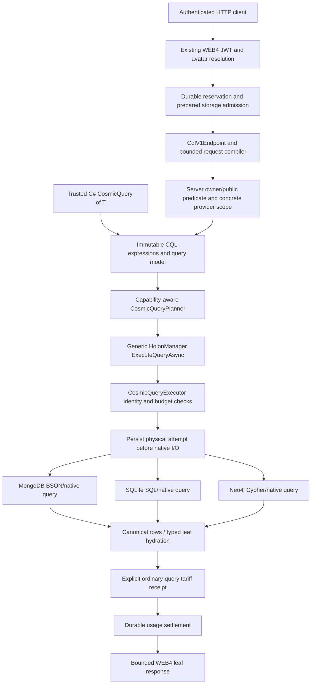
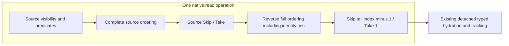

## Latest cursor lineage ownership correction — 26 October 2026

The shared admission owner now returns its validated execution handle. Federation
freezes the root operation GUID before application callbacks or provider awaits;
response framing never reloads it from mutable HttpContext.Items. Existing resumed
pages retain their protected root lineage. Three genuine initial-page regressions
(removal, replacement and wrong-type context item) and three resumed controls now
pass, including original receipt ownership.

Full Core3,750pass0skip and shippingWEB4build pass. Evidence:
Verification/cursor-lineage-{red,core}.trx.gz and cursor-lineage-identities.json.
This focused owner-capture correction did not rerun the separately recorded
526-settlement/608-attempt native gate. Broader roadmap acceptance remains open.

## Latest request ownership correction — 26 October 2026

Two genuine failing schedules reproduced a mutable-DTO ownership defect: changing
IncludeMetadata or MaximumOutputBytes while a provider await was suspended could
expand disclosure or bypass the admitted public wire ceiling. CqlRequestCapture
now detaches row and federation requests before application callbacks or awaits,
including provider/priority arrays, nested relationship/filter/path descriptors,
graph shape and owned scalar JsonElements. The compiler remains the semantic
admission owner; capture ceilings only bound allocation. No retry, alternate
writer or provider fallback was introduced.

Full Core3,744pass0skip and shippingWEB4build pass. Five new controls cover the two
original regressions, ordinary-row disclosure, nested mutation/disposed JSON and
Exists-without-Value compatibility. Fresh native526settlements608attempts passes
all three providers, cursor/key/process restart, graph and transport checks;
source snapshots unchanged and seven producer/consumer pairs match. Owned test
fixtures, temporary protected keys and services were verified clean.

Evidence: Verification/request-ownership-{red,core,native,process-second}.trx.gz,
-native-source.json.gz, -native-binaries.json, -native-result.json,
-process-pids.json and -unit-identities.json. The overall roadmap remains open.

## Latest: actual cursor process restart verified — 26 October 2026

A settled three-provider page survives abrupt termination of its hosting process.
A distinct fresh host resumes the exact protected cursor using the unchanged
Windows DPAPI-protected persisted key. Three pages/nine provider attempts settle
through one parent reservation authority and the production HTTP authorization
client; a duplicate redemption is rejected without another execution start.
Readiness JSON is published atomically. This is actual process evidence, separate
from the earlier in-process host restart/key-rotation matrix.

Full native cohort:526settled operations/608physical attempts, unchanged sources,
seven matching producer/consumer pairs. Original twenty cursor requests and
existing writer-process recovery remain green. The owning fixture removed its
small test key/config directory after both process trees stopped; no private key
or controlled credential was archived. Native databases/services were cleaned.

Evidence: Verification/federation-cursor-process{.trx.gz,-second.trx.gz,
-source.json.gz,-binaries.json,-result.json,-pids.json}; earlier initial proof is
retained separately. Scope is same-user Windows DPAPI persistence. Multi-host,
container/KMS key deployments, broader failure windows, causal agreement,
repeatable distributed snapshots, distributed joins and the full remaining ORM
roadmap are still open. Core3,739 is the separate preceding regression gate.

# CQL architecture

## Request routing ownership — 26 October 2026

`ProviderRoutingPolicy` is an immutable observation of the three routing flags,
ordered provider lists and preferred provider. `ProviderRoutingOverrides` keeps
inheritance distinct from explicit values. Converting an observation back to
overrides retains every captured value, including the absence of a default.
`ProviderManager` owns capture, validation and atomic explicit publication;
request completion never restores a prior global snapshot.

`HolonManager.CreateRequestContext` creates an isolated routing registry over
existing registered provider instances and the existing runtime DNA. It shares
performance monitoring and load-balancer selection history, preserving fairness,
but owns its routing lists and current/default pointers. Construction performs no
provider activation and adds no persistent provider event subscriptions. Original
public constructor signatures remain available.

WEB4 graph-save actions bind their manager and detailed response to the same
observation. This does not authorize access, change conditional write authority,
replace usage admission, or deep-copy all configuration. Non-migrated routes
still require separate migration and cross-route verification. See
[ownership and evidence](CQL_HTTP_CONFIGURATION_OWNERSHIP.md).

## Conditional serialized graph planning — 26 October 2026

Generic `HolonSavePlan` now distinguishes explicit conditional intent from
ordinary process-local hydration authority. A complete serialized graph may bind
its exact materialized stored roles to a conditional plan; incomplete and
mismatched views remain rejected. No observation authority is published during
admission. All owned and ordinary conditional sync/async single/batch saves use
that same owner, with native CAS retaining the final revision decision.

The WEB4 serializer supplies the ordinary recursive `IHolon` wire contract and
retains child membership observations. It does not choose providers or perform
ownership checks. Prepared admission records durable affirmative no-execution
evidence for requests that end before provider preparation; uncertain preparation
cannot become a zero-execution claim. Existing reservation, outbox and settlement
owners remain shared across CQL and storage writes. Current joined native
certification is tracked in [storage accounting](CQL_STORAGE_WRITE_ACCOUNTING.md).

## Latest floating HTTP/demo acceptance — 25 October 2026

Required/nullable Single/Double Sum/Average now use the shared WEB4 scalar/grouped
binder. All56new endpoint tests and full3,154Core tests pass; shipping WEB4 builds.
Fresh signed live acceptance passes138SDK/138HTTP queries across MongoDB, SQLite
and Neo4j,345settled operations/337attempts. Examples41–46 and six matching browser
presets demonstrate scalar and grouped filtering/order/pages; all18offline preset
checks pass. Source snapshots are unchanged and six producer/native copies match.
This supersedes earlier pending HTTP/floating enrollment notes below. Neo4j still
uses ProviderDefault; ProviderSnapshot is unsupported. Broader policy/federation
and certification requirements remain open. See [demo evidence](CQL_V1_DEMO_VERIFICATION.md).


SQLite floating Sum/Average now has native scalar/grouped SDK acceptance:
**1,763 production integration /74 unit tests**, zero skips, stable source and
six matching copies. SQL-local constant-size packets retain source/budget/access
and off-page error ownership. MongoDB/Neo4j and HTTP floating arithmetic remain
pending. See [the contract](CQL_FLOATING_AGGREGATE_CONTRACT.md).

## Floating aggregate capture - 25 October 2026

Full Core **3,098 tests** pass without failures/skips; both Core targets build.
Eight new cases verify required/nullable Single/Double Average overloads, Sum,
explicit input admission versus legacy read-only permissions, typed empty sums,
rejection of integer-packet substitution and scalar/grouped publication without
Decimal conversion. Nonfinite and wrong-type values still reject. Existing
unsupported-domain tests now use DateTime/TimeSpan/Boolean instead of newly
supported floating capture.

The shared layer captures immutable floating intents and preserves their declared
result type. The native/HTTP capability profiles remain unchanged: this does not
enable floating Sum/Average on an adapter. SQLite, MongoDB and Neo4j native
translations, group keys, acceptance and explicit HTTP/demo enrollment remain next.
See [the contract](CQL_FLOATING_AGGREGATE_CONTRACT.md).

## Finite floating aggregate foundation - 25 October 2026

Full Core **3,090 tests** pass without failures/skips; both netstandard2.1/net10.0
builds pass. Eleven new controls include every exponent, seeded finite bit
patterns, 256 seeded reductions checked by an independent adjacent-IEEE binary
search, signed cancellation, underflow, ties and overflow thresholds. One-input
packets cannot hide source rounding or noncanonical signed digits.

The new generic Core owner normalizes ten/seventy signed base2^30 native limb
sums into Single/Double, rounding once to nearest/ties-to-even. It preserves
finite output and canonical zero; it neither scans source rows nor grants an
adapter capability. Floating query capture/grouping, native translations on all
three stores, HTTP enrollment and live arithmetic demos remain open. See the
[floating aggregate contract](CQL_FLOATING_AGGREGATE_CONTRACT.md).

Native Decimal/nullable Sum/Average and live signed HTTP are certified on all
three priority stores. The latest demo passes120SDK/120HTTP queries, including
examples38-40; see [demo acceptance](CQL_DEMO_RUNBOOK.md). Dated implementation
checkpoints below retain their historical scope and restrictions at that time.

## Neo4j Decimal query checkpoint - 25 October 2026

Scalar/grouped Decimal Sum/Average integration passes 23 focused native tests
and the full 529-unit suite, with no skips. Full acceptance passes **416 native /529 units**, without failures or skips. Seven signed Int64 sums preserve exact scaled28 values; native rounded
ordinal keys drive group filtering/order while raw packets retain all off-page
error proofs. Existing read ownership, source windows and interruption behavior
remain in force. Neo4j provider-default consistency remains read committed.
Decimal HTTP inputs and live demos remain unenrolled. See the
[Decimal contract](CQL_DECIMAL_AGGREGATE_CONTRACT.md).

## MongoDB Decimal query integration - 25 October 2026

Scalar/grouped Decimal and nullable Sum/Average now have native seven-word
reductions and exact rounded native group filter/order values. Focused23 native
cases and full550 units pass without skips. Full416 native tests pass without failures or skips; native SDK enrollment is verified. HTTP Decimal inputs
and Neo4j Decimal arithmetic remain pending. See the
[exact reduction and rounding contract](CQL_DECIMAL_AGGREGATE_CONTRACT.md).

## SQLite Decimal native acceptance - 25 October 2026

SQLite now enrolls native Decimal/nullable Sum/Average for scalar and grouped
queries, including selected filters/order/pages. Full1,702 native/72 unit tests
pass without failures/skips, with23 new Decimal controls. They cover boundaries,
large cancellation, final rounding, overflow versus valid means, nullable/empty
inputs, source windows, privacy, cancellation/reuse,137inputs independent of graph
publication limits, exact key comparisons and rejection of unrepresentable JSON.

Seven signed INTEGER sums preserve the existing exact Decimal key domain. Grouped
filter/order keys normalize that constant-size packet with the same Core owner
used for returned values. No float cast, entity hydration or manager-side input
scan is introduced. Existing snapshot/traversal/budget/error ownership remains.

MongoDB/Neo4j native Decimal and Decimal HTTP/demo enrollment remain pending.
The shared v1 binder explicitly limits Sum/Average inputs to Int32/Int64/UInt64
and nullable forms, preventing SDK capability expansion from silently changing
transport enrollment. See [Decimal contract](CQL_DECIMAL_AGGREGATE_CONTRACT.md).


## Decimal numeric Core foundation - 25 October 2026

Full Core3,046 and SQLite72/Mongo539/Neo520 unit tests pass without failures/skips;
Core netstandard2.1/net10.0 builds pass. Thirty new controls include2,048 seeded
reference samples. Separate prior native/demo checkpoints retain their scope.

Core now captures Decimal/nullable Sum/Average and normalizes a constant-size
seven-limb scaled28 native packet. Final rounding is nearest/ties-to-even from
the exact rational; mathematical out-of-range sums fail explicitly. Cancellation
can retain tiny values after oversized intermediates. The legacy integer packet
rejects Decimal intents. Existing native profiles remain unenrolled; provider
unit gates prove that read permissions and caller claims cannot upgrade them.

See [the Decimal aggregate contract](CQL_DECIMAL_AGGREGATE_CONTRACT.md). Native
translation/grouped keys on all three stores, HTTP enrollment and live Decimal
arithmetic demos remain pending. This does not change verified UInt64 execution.


## UInt64 live demo acceptance - 25 October 2026

The walkthrough now has **37 examples per provider**: **111 SDK /111 signed HTTP**
queries pass on MongoDB, SQLite and Neo4j, with318 settled operations/310 attempts.
The joint native demo passes1/1 without skips. Source snapshots remain unchanged;
six producer/consumer identities match under the build lease. Standalone demo
builds and9 offline browser preset checks pass. Owned services stopped normally.

Examples35-37 show exact UInt64 Sum, Decimal Average retaining the fraction
18446744073709551612.5, and grouped mean filters/order/pages. Browser presets:
`unsignedSum`, `unsignedAverage`, `unsignedMeanGroups`. Swagger adds named UInt64
Sum/Average examples. These close the unsigned numeric live-demo gate, while
other numeric input domains, sharing/tenant policy, graph-source composition and
federation remain open.

Evidence in TestResults/CosmicCqlDemo: unsigned-numeric-demo.log,
v1-demo-result.json, v1-walkthrough.txt, v1-source-identities.json,
v1-binary-identities.json, unsigned-numeric-demo-build.log and
v1-decimal-ui-check.json. Native report:
TestResults/Neo4jCurrent/neo4j-cql-v1-demo-current.trx.


25 October 2026. CQL is a generic COSMIC ORM query pipeline. Native providers translate its admitted intermediate representation; they do not implement separate public query languages. [Developer manual](CQL_MANUAL.md), [HTTP contract](CQL_V1_HTTP_CONTRACT.md), [execution reference](CQL_EXECUTION_PIPELINE.md).

## Native graph execution checkpoint — 23 October

Core owns immutable graph intent, capability readmission, detached publication and typed selection ownership. Shared `HolonGraphQueryExpansion` assembles provider-owned native rows with cumulative node/UTF-8 bounds and persisted role ordering. SQLite owns one deferred Serializable native read transaction for roots and children, native parent/type/member predicates, pre-materialization row/byte bounds and the existing instruction/deadline hook. Caller Serializable transactions are reused without committing them. MongoDB now owns a snapshot session plus one cumulative native deadline for roots and child commands; its native104-case/admission31-case matrices pass, including cumulative-deadline and concurrent-write snapshot cases. Neo4j now uses one bounded native read-committed transaction; it does not claim snapshot isolation. Native81/unit31 pass, with final joint hosted82 also passing. Its schema2 projection adds canonical HolonType and is refreshed from canonical snapshots at activation. HTTP v1 now has optional bounded access-bound graph requests and explicit safe DTO projection. [Contract and native evidence](CQL_GRAPH_LOADING.md).

## Explicit graph consistency admission

Immutable graph options distinguish ProviderDefault from ProviderSnapshot. Snapshot requests require the GraphSnapshot capability at planning and actual-adapter readmission; that capability requires GraphExpansion. SQLite/Mongo declare their existing native snapshot owners. Neo4j supplies its documented read-committed mode under ProviderDefault and rejects ProviderSnapshot with CQL_CONSISTENCY_UNSUPPORTED before native I/O. Claimed caller profiles cannot upgrade an adapter. The guarantee is local to each provider; it is not a distributed common snapshot. Both graph factory signatures share one validation owner and preserve the existing five-parameter binary ABI.

## Mandatory access binding

CosmicQueryReadAccess owns the existing WEB4 owner/public rule as immutable actor/predicate data. It is inserted ahead of business predicates and native paging; composition preserves the binding without duplicating it. WEB4 constructs it from its authenticated/admitted actor and reuses the same output rule. Core rejects an access actor different from the inherited execution and rejects foreign detached rows before typed publication. SDK creation is a restriction, not authentication or credentials. Visibility-bound graphs require GraphReadAccess alongside GraphExpansion at planning and actual-adapter readmission; the three native readers, detached capture and typed selection owners enforce it. Arbitrary metadata sharing/role labels cannot grant access.

## Protected scope precedes empty result windows

A zero source window changes publication, not the validity of protected native
relationship work. Empty shortcuts are eligible only when the compiled source
has no protected relationship/traversal requirement. Native error envelopes and
scope validation stay outside the result-page branch. The same rule applies to
rows, graph roots, projections and scalars; no manager reload or client scan is
introduced.

SQLite shares a native relationship-scope preflight across rows, projections,
selected scalars and groups. When scope and result require separate commands,
one serializable read owner spans both. Caller transactions must satisfy that
contract and remain caller-owned. A protected row query therefore may execute a
scope-count command before its paged read, including when the page is empty.
This bounded work is intentional; the existing cumulative deadline/instruction
owner still governs it.

Neo4j's translator records relationship participation, so its existing validation
branches still execute when the result LIMIT is zero. Its read-committed contract
is unchanged. MongoDB retains protected scalar/row/graph execution and the
snapshot needed for membership validation even for a zero page. Its row compiler
reuses the selected-window owner: a zero page filters rows while the outer source
retains traversal error frames, preventing a sentinel row from being published.

Multiple native commands within one admitted query remain one V2 physical query
attempt, with the existing receipt owner. Command count, result count and billable
attempt count must not be conflated. Current positive/negative native evidence
and pending full regressions are tracked in the
[empty-window contract](CQL_SCALAR_HTTP_CONTRACT.md#empty-windows-and-protected-scope).

## Aggregate input domains are independent permissions

`CosmicScalarSelectionCapability` now separates exact read paths from the input
types permitted for one aggregate operation. Its existing two-argument numeric
constructor remains signed Int32/Int64, including nullable forms; new Core domain
knowledge cannot upgrade that promise. An additive immutable input-type list
supports explicit enrollment only when the provider's native reduction is ready.
Both scalar and grouped planning/readmission use this same check. Min/Max retain
their existing read-domain permissions unless explicitly restricted.

The UInt64 Core foundation captures exact unsigned Sum/Average and validates
bounded unsigned accumulator packets. SQLite native unsigned arithmetic is
verified (1,679 native/72 unit); MongoDB explicit enrollment passes391 full
native/539 unit cases (17 new unsigned native controls). Neo4j now passes391 native/520 unit cases with exact INTEGER-only chunk
lowering shared across scalar/grouped reductions and sum comparisons. Read/Min/Max permissions remain independent; numeric HTTP/demo
enrollment requires separate certification. SQLite shares its exact integer chunk
lowering; MongoDB reuses Decimal128-to-limb reduction and exact mean normalization.
Shared grouped result validation preserves the declared unsigned bounds. [Contract](CQL_NUMERIC_AGGREGATES.md#uint64-core-foundation--25-october-2026).

The shared HTTP scalar/grouped selection visitor now binds UInt64/nullable
Average through typed Core overloads. Core3,017 passes, including9new exact wire/
type/access/receipt controls; shipping WEB4 builds. Sum retains tagged UInt64
strings, Average tagged Decimal strings/null. Live signed numeric demo acceptance
is still pending and is separate from compiler/mocked-wire evidence.

## Layers and ownership



The admission/attempt/receipt/settlement path applies when a hosted request supplies its PreparedStorageExecution. Trusted local SDK execution can run without that hosted scope; the application owns its access policy and adapters. The diagram does not imply a public unauthenticated SDK endpoint or simultaneous execution on all three providers for one v1 HTTP request.

| Owner/source | Responsibility |
|---|---|
| Core `Queries/CosmicQuery.cs`, expression/predicate types | Immutable composition, supported expression parsing and limits |
| Core `Queries/CosmicQueryPlanning.cs` | Resolve selected scopes against eligible targets; check declared capabilities |
| Core `Managers/HolonManager/HolonManager-Cql.V2.cs` | Generic public manager entry and typed integration |
| Core `Queries/CosmicQueryExecutor.cs` | Validate actual bindings/capabilities, inherited admission, cancellation and result budgets |
| Provider native CQL adapters/translators | Parameterized native predicates, ordering/page, native resource guards and canonical rows |
| ONODE `Services/Cql/CqlV1Compiler.cs` | Whitelisted JSON-to-CQL expressions, mandatory native access predicate, ordinal strings |
| ONODE `Services/Cql/CqlV1Endpoint.cs` | Exact actor/reservation binding, concrete server scope, planning, response limits/sanitization |
| Core prepared-storage/usage services | Physical attempt ownership, tariff evidence, no-execution proof, settlement and no replay |

All paths above are relative to their existing project roots; no duplicate query engine is introduced in Examples or providers.

## From expression to native execution

1. A trusted C# caller composes supported expression trees, or the v1 HTTP boundary compiles a bounded DTO. Metadata marker calls are parsed, never invoked as client predicates. Arbitrary CLR methods, getters/side effects and raw query text are not evaluated.
2. A planner binds the selected provider scope and required capabilities. An unsupported operation fails before native reads. Explicitly selected targets are not widened using registry contents.
3. HolonManager delegates to the generic executor. It rechecks actual adapter identities/capabilities; a stale/forged capability plan cannot authorize more work.
4. In a hosted request, the exact server-created PreparedStorageExecution owns the physical attempt. It persists intent before calling the native adapter and checks lifetime/cancellation around asynchronous work. Manager acquisition cannot silently activate a different paid provider as a constructor side effect.
5. The adapter applies native predicates, ordering and the page, enforces its resource controls, and returns canonical detached rows. Typed local hydration restores clean tracked leaf entities. Unsupported relationship loading is not simulated by fetching a dataset and applying LINQ in memory.
6. For the ordinary v1 service contract, a completed query attempt records its explicitly configured tariff receipt. Unknown completion is not converted into zero-cost evidence. The existing usage middleware settles durably before publishing its buffered response.

The bounded DTO and result recheck are separate protections. Visibility must be in the native WHERE/match predicate **before** the page; dropping forbidden rows after paging would produce incorrect pages and is not the implementation. The final result check refuses a provider visibility violation rather than silently repairing a bad result.

## Scope, consistency and provider selection

The local SDK supports current-default, named and all-eligible scopes over its supplied eligible snapshot. Results remain grouped with provider identity. Duplicate logical IDs from different providers are not globally merged; pages and ordering are per provider. There is no implied cross-provider snapshot, conflict resolution or distributed query transaction.

HTTP v1 chooses exactly one already-active MongoDB/SQLite/Neo4j provider. Omitted Provider resolves the server's current default, then the endpoint pins that concrete identity. A request cannot authorize extra providers, trigger activation, select a signer, override prices or request automatic failover. HyperDrive v2 supplies surrounding ORM routing/replication capabilities; broader query placement/federation policies are separate work.

## Security and data types

Production WEB4 supplies its existing verified avatar identity; the v1 query actor cannot come from request JSON. Admission must belong to that same avatar and execution handle. Server policy is owner-or-globally-public; Wizard and sharing-index metadata do not bypass it. Authoritative shared-recipient/tenant-specific policies are not claimed by this v1 contract.

Native type domains preserve exactness: numeric strings do not become integers, GUID comparison uses canonical validated text, and strings use the admitted ordinal operation. Typed invalid/missing values do not acquire accidental inequality matches. Metadata encryption remains the ORM's policy owner: encrypted content is not made queryable by an implicit client-side decryption scan.

HTTP v1 exposes String/Int64/Boolean/Guid metadata and a bounded canonical leaf-field set. Local CQL capabilities include additional explicitly declared types/operators; local availability does not widen the HTTP schema. [Scalar details](CQL_SCALAR_METADATA.md), [field comparisons](CQL_FIELD_COMPARISONS.md).

## Failure and lifecycle invariants

- No provider invocation before the required durable attempt. No later substitution of admission or concrete provider identity.
- No partial grouped result on a selected-provider failure or result-budget violation. Previously incurred reads are not described as rolled back.
- No guessed provider receipt, zero cost for unknown completion, or replay to discover an uncertain outcome.
- No hard five-second driver-interruption claim: HTTP cancellation is cooperative, with provider-native bounds preserved.
- No new version for a local no-op Save; conditional writes/committed deltas remain owned by the existing generic save pipeline.

## Demo and test architecture

The new three-provider demo deliberately reuses the native acceptance fixture's owned services, data journal, shipping controller/compiler/JWT validator, real native adapters and Mongo execution outbox. Avatar-directory resolution and reservation authority are controlled synthetic components. Demo-only `/demo` presentation, session tokens and Swagger exist solely in the loopback fixture; production Startup is not changed to expose them.

Readable SDK/HTTP examples live in `Examples/CosmicCqlDemo/V1NativeQueries.cs` and `V1Walkthrough.cs`. They are compiled into the existing native host and actually executed on every provider. The browser page uses the same HTTP endpoint, preserves Int64 JSON text, switches identities/providers and demonstrates duplicate operation rejection. Its presentation never implements predicate execution.

One producer lease wraps the owned Mongo/Neo runner and all shared builds. Success stops/awaits services, verifies terminal outbox states and removes only owned fixture resources after their processes close; failure preserves data for reviewed reconciliation. No new per-run runtime/container/environment is created. [Cleanup ledger](ENVIRONMENT_AND_CLEANUP_LEDGER.md).


### Selected typed role ownership

`HolonChildRoleHydration.ApplySelectedView` accepts explicit selected IDs against the owner's retained full stored manifest. The common hydration owner validates selection and resolution before factories/callbacks, preserves role ordering and the complete observation, and marks the result incomplete for replacement saves even after prior complete hydration. `HolonManager` uses it for type-filtered typed loads. This supplies a prerequisite for authorized graphs; it grants no authorization and does not expose a public graph transport.

The access-bound shared assembler carries `CosmicQueryChildSelection.ReadAccess` unchanged to native reads and defensively rejects unauthorized output. It records a monotonic incomplete child selection before publication. This does not authenticate the actor, filter fetched rows, grant completeness, or enable Core/HTTP graph admission. Provider query translation is still required.


### Native child policy boundary

The SQLite, Mongo and Neo child readers now apply the selection's mandatory owner/public policy through the existing CQL translator before native limits. Their graph entry points explicitly select the unrestricted or access-bound shared contract; both use the same transaction/snapshot/deadline owner. Mongo requires an explicit policy argument (possibly null for the unrestricted contract), so callers cannot accidentally omit propagation. No application-side result filtering occurs. Core/SDK/HTTP graph-policy admission requires the explicit GraphReadAccess capability, detached/typed validation and safe DTO output. Boundary fixtures now use public composition; private constructor reflection has been removed.

Detached graph capture now owns whole-graph policy validation before typed construction. The same immutable policy reaches typed selection observation after callbacks; typed partial hydration does not assume complete membership merely because ChildType is All. Base-state copying retains IsPublic alongside version/relationship observation, so materialization cannot silently change stored visibility. SDK/HTTP access-graph composition is admitted only with the native GraphReadAccess capability and uses verified safe HTTP output.

WEB4 public graph output has an explicit iterative DTO projector. It validates policy and selected shape, caps depth8/nodes and cancellation, retains the one-MiB serialized response bound, and never projects stored role/provider/runtime properties. Graph roots omit external ancestor IDs; leaf output remains compatible. Root trees may overlap independently, but duplicate roots and within-tree cycles reject. Public graph request/capability admission now validates bounded shape and re-admits the actual adapter before I/O.

Public graph admission now binds graph options before business ordering/paging and requires the explicit GraphReadAccess capability. Core composition supports both graph-first and access-first binding, preserving actor identity; the actual adapter is re-admitted before any physical attempt. WEB4 validates bounded graph parameters before provider lookup, and its signed actor/admission remains authoritative. No caller profile can upgrade an unsupported adapter.


## Native relationship predicate owner

CosmicQueryAnyChild is an immutable child predicate node produced by WhereAnyChild through the existing scalar expression compiler. ChildExists admission traverses the child predicate and rechecks the actual adapter. SQLite owns a single correlated EXISTS statement: current parent plus declared-role/parent-link membership, child visibility and scalar conditions precede root paging. Child/root aliases share one parameter budget. Neo4j owns a native HAS_CHILD EXISTS subquery with canonical schema3 role membership, child access, current parentage and revision checks. Its existing locked activation migration rebuilds the membership projection without modifying canonical snapshots. Mongo owns bounded native lookup with a protected root envelope, canonical membership and child access before paging; validation and lookup share one snapshot. Details in CQL_RELATIONSHIPS.md.

Mongo relationship preparation now owns the provider-only CosmicCqlMembership BSON descriptor in MongoNativeRecordWriter.SerializePayload. Projection derives from final canonical manifest after membership preparation and shares the authoritative record replacement. Activation upgrades missing/schema0 descriptors under whole-record equality without logical revision changes. Future schemas reject. Native relationship reads validate descriptors and perform bounded lookup in one snapshot, with one deadline and existing query budgets. Unit216/native37/joint96 certify this owner; see CQL_RELATIONSHIPS.md.

The HTTP compiler maps bounded anyChildren groups to immutable WhereAnyChild before sorting/paging. It shares the twelve-filter budget across root/child filters and permits at most four nonempty groups; server-owned read access remains the single authority. It resolves inherited IHolon contract members explicitly when building child expression trees, using the same whitelisted scalar compiler. Signed native HTTP and annotated SDK/HTTP examples pass on all three providers.

Descendant intent has explicit immutable depth/node bounds and certified adapter limits. Existing constructor signatures remain present; new overloads carry traversal limits. Actual-adapter readmission rejects borrowed bounds before dispatch. MongoDB, SQLite and Neo4j now declare native descendant ownership with explicit certified traversal limits. [Contract](CQL_DESCENDANT_CONTRACT.md).

SQLite now implements descendant intent with a bounded native recursive CTE and a connection-owned typed traversal outcome. Canonical membership validation is shared with direct-child queries and runs before existence even for empty parents. Both callbacks unregister before the existing EF/native read owner exits. Scope validation precedes result publication. Mongo uses a flat bounded breadth pipeline; Neo owns bounded quantified paths with inline membership/access pruning and native scope errors outside paging. [Details](CQL_DESCENDANT_CONTRACT.md).

Neo descendant scopes deduplicate endpoint states, retain first-cycle outcomes and produce typed cycle/node-limit columns before paging. Separate projection MATCH scopes permit self-loop validation. Certified runtimeNeo5.26.12, quantified-path requirement5.9+; read-committed semantics preserved. Unit316/scoped45/joint109 pass. [Evidence](CQL_DESCENDANT_CONTRACT.md#neo4j-native-execution).

Mongo descendant execution keeps a protected root envelope through flat breadth-first lookups, tracking visited IDs and node budgets under the same snapshot as membership validation. Every scope validates before the final business conjunction; an independent native facet error branch precedes root paging. The reader unwraps only provider-owned outcomes. Native memory146/292 returns a typed limit; no client scan or alternate query path is used. [Execution and resource contract](CQL_DESCENDANT_CONTRACT.md#mongodb-native-execution).

WEB4 descendant groups reuse the same relationship predicate expression builder as direct children. Bounds enter immutable CosmicQueryTraversalOptions; the server binds actor before composition and actual-adapter admission remains authoritative. Four combined relationship groups/twelve total filters bound input. Graph response shape stays independent. Core1830/joint109 pass signed native privacy/count/paging controls.

Native descendant boundary/reparent acceptance shares one test-only fixture across3existing test projects, not a production alternative. FullSQLite1249/focused46/Mongo62/jointNeo110 pass with strict Core712/Shared55 consumer/source identity. The actual33-edge chain verifies boundary semantics separately from shallow-graph compiler admission. [Planned aggregate invariants](CQL_AGGREGATE_IMPLEMENTATION_CONTRACT.md) retain explicit scope, policy, windows and exact result ownership; those APIs are not yet shipped.


## Pre-admission transport failure ownership

The usage middleware distinguishes a native Kestrel body-limit rejection before reservation from an authority outage. It returns `REQUEST_TOO_LARGE` (413), with an explicit UTF-8 payload length and zero authority/native calls. A network exception alone never proves an operation was absent: reconciliation checks its canonical identity and durable receipts. Known oversized HTTP/1 test requests use `Expect: 100-continue` so the server can reject the declaration before an unread body is uploaded; normal CQL requests and ledger settlement retain their existing owner. [HTTP contract](CQL_V1_HTTP_CONTRACT.md).


## Scalar execution foundation

`CosmicScalarQuery<T,TResult>` retains the original immutable query and its actor, provider scope, relationship predicates, graph consistency and window. Count/LongCount/Any expose exact Int32/Int64/Boolean result domains. `CosmicScalarPlanner` requires explicit scalar capabilities in addition to source-query admission; `CosmicScalarExecutor` re-admits every actual adapter before the first dispatch and publishes detached per-provider values without summing replicas.

Rows and scalars now share `CosmicQueryAttemptOwner`, which captures the inherited prepared execution, checks actor/provider/lifetime, persists the physical attempt and delegates completed-query receipts to the existing owner. `HolonManager.ExecuteScalarQueryAsync` requires HyperDrive V2 and invokes this generic executor without entity factories. Full Core 1,956 tests pass. The later SQLite scalar gate below implements native terminals; MongoDB/Neo4j scalar adapters and scalar transport remain pending, and row-only adapters reject scalar execution before I/O. [Implementation contract](CQL_AGGREGATE_IMPLEMENTATION_CONTRACT.md).


## SQLite scalar read owner

SQLite scalar execution reuses `CqlSqlTranslator`, `SqliteCqlReadBudget` and `SqliteCqlTraversalGuard`. A native `count(*)` validates the complete eligible source, then exact SQL integer arithmetic applies normalized window cardinality. EF maps the one Int64 result directly, without stored-holon deserialization, typed factories or graph assembly. Scalar admission still checks source ordering/graph/consistency capability; requested snapshots use the same deferred Serializable owner, preserving read-only and caller-owned transaction/connection behavior. Native callbacks and owned connections are released before returning success/error. FullSQLite1,269 passes, including actual-reader cancellation and fresh reuse. Mongo/Neo scalar read owners remain pending.


## MongoDB scalar read owner

`CompileSource` and the bounded pipeline guard are shared by row and scalar shapes. Scalar `$group` reduces count/cycle/limit outcomes over the complete eligible scope, followed by exact native window cardinality. It never publishes a successful value before consuming and validating the controlled scalar envelope. Snapshot membership validation and count execution share one session and cumulative cancellation/deadline; no snapshot guarantee is removed when graph output expansion is omitted. Native scalar output rejects coercion through binary64 or numeric strings. Mongo unit229/native76 pass, including concurrent reparent snapshot behavior. Neo scalar ownership/certification remains pending.


## Neo4j scalar read owner

`CompileCqlSource` now supplies the common projection/access/membership/traversal source to both row and scalar native commands. Scalar validation/error branches precede successful outcome publication and remain outside window cardinality. The reader requires exactly one nonnegative Int64 success, rejects error branches and retains one read-committed transaction plus the cumulative read budget. Count output never invokes entity factories or graph expansion. Actual adapter admission rejects ProviderSnapshot, and no common distributed snapshot is implied. Unit322/joint129 pass, including15new controls; strict blocked-I/O interruption remains separate. Scalar HTTP transport is implemented and certified in [its contract](CQL_SCALAR_HTTP_CONTRACT.md).


## WEB4 scalar transport — 23 October 2026

`CqlScalarV1Request` is a separate strict transport DTO at `POST /api/data/query-cql/scalar`. `CqlV1Compiler.CompileScalarSource` and the row compiler call one shared source builder; nullable scalar Take preserves an unbounded input while row Take retains its published default25. The server binds authenticated access before composing filters, relationship predicates and consistency. No DTO can supply a plan or actor grant.

Both endpoint paths share admission capture, eligible-provider resolution, failure mapping and bounded JSON serialization. Scalar execution still uses the generic Core planner/manager and common prepared attempt owner. Count/Any have fixed JSON numeric/Boolean domains; LongCount is always an invariant decimal string tagged Int64. This prevents browser rounding without coercing native values. Startup reservation-coverage validation includes both exact routes.

Full Core1982 and signed joint native129 pass. A separate137-input fixture within the same retained environment proves unwindowed HTTP counts on each native store. Its manifest records all planned scalar IDs and acknowledged provider writes; failed outcomes retain the fixture, while successful settlement precedes exact owned cleanup. The reviewed earlier predispatch failure proves settled zero-attempt evidence before cleanup. Projections, non-count aggregates, joins, federation and prompt blocked Neo4j driver-I/O cancellation remain open.


## Detached projection execution

Projection permissions are explicit field/type read domains, separate from filter operations. Planning binds source admission and column admission; execution snapshots all actual adapters and preflights them before the first call. The common prepared attempt owner supplies lifetime, provider affinity and durable accounting. Native adapters return bounded scalar-cell buffers only. Core validates all stores before DTO construction, retains per-provider provenance and rejects global count/byte overflow without truncation or partial publication. The generic V2 manager facade never hydrates holons to evaluate a selector. [Implementation and current availability](CQL_AGGREGATE_IMPLEMENTATION_CONTRACT.md#core-projection-execution-owner--23-october-2026).


## SQLite projection read owner

SQLite compiles source filters/order/window and selected columns natively through one `CqlSqlTranslator`. Projection aliases are compiler-owned ordinals; bound metadata paths return separate presence/type/value cells and reject duplicate path matches. Exact decoding uses existing scalar-domain guards and checked CLR conversion, without holon deserialization. Required traversal validation precedes paging; the same deferred serializable owner covers validation and projection so acknowledged concurrent writes cannot change the selected snapshot. The connection-local native budget, EF concurrency owner and caller/read-only ownership remain intact. Graph output caps do not limit projected input; explicit row/byte limits reject instead of truncating. Full1,282plus final16native controls pass on one unchanged provider binary. [SDK usage](CQL_MANUAL.md#native-select--sqlite-sdk).


## MongoDB projection read owner

MongoDB source compilation retains the existing protected membership/traversal pipeline. Native ordering/windowing and scalar-cell projection occupy only the eligible result branch; traversal errors remain outside the page in the existing outcome envelope. Metadata paths are literal expressions and dictionary duplicates are counted before extraction, avoiding array-to-object last-value selection. Native cells expose explicit presence/type state and exact BSON values. UTC tick companions have singular ownership, and both stored UUID layouts decode explicitly.

Required membership validation and projection share a snapshot and cumulative native/driver deadline. Cursor processing validates every envelope and scalar, rejects count/byte overflows without truncation, and returns no entities. Core's generic prepared attempt and detached construction owner remains unchanged. Unit237/native91 pass,15new native projection controls and 8unit cases; Core720/Shared55 source unchanged. Neo4j projection and authenticated transport remain open. [SDK availability](CQL_MANUAL.md#mongodb-select-availability).

### Neo4j native selected-column owner

The additive adapter feeds the common detached projection executor without a separate hydration or accounting path. The existing native source compiler preserves mandatory root access, membership and pre-page traversal errors; the operand translator supplies typed scalar guards. Only selected cell buffers cross the driver. A native structural/character lower bound suppresses impossible rows, one-row fetches bound driver buffering, and the shared native read budget validates exact strict UTF-8 bytes and cumulative cancellation/deadline checks. Read committed is explicit; no snapshot or strict blocked-I/O guarantee is inferred. Final unit328/joint native-WEB4 147 pass unskipped, including18new native projection controls and actual cursor-buffer inspections. [Detailed contract](CQL_AGGREGATE_IMPLEMENTATION_CONTRACT.md#neo4j-native-projection-slice--23-october-2026).

### Runtime result-column records

Core now binds runtime-selected columns through `CosmicProjectionSelection<T>` and `SelectColumns`, sharing the same scalar path compiler with ordinary Select. The immutable record shape retains source intent and independent projection capabilities; aliases and exact native values remain ordered and detached. Global buffer validation still precedes all construction. No runtime code generation, arbitrary delegate execution, entity hydration or parallel attempt accounting is introduced. FullCore2,018/dual-target builds pass; authenticated projection transport and native runtime-record execution now pass fullCore2,059 and signed three-store native acceptance. Expanded annotated30SDK/30HTTP walkthroughs and broad147native regression pass unskipped, with195settled operations/190physical attempts.

### Public selected-column transport

`CqlProjectionV1Compiler` binds bounded public columns through the same Core scalar path compiler and protected source owner as SDK queries. `CqlV1Endpoint.ExecuteProjectionAsync` captures the existing authenticated admission, resolves one eligible actual adapter, plans its separate read domains and executes through V2's common prepared-attempt/receipt owner. Global raw-buffer validation precedes immutable record construction. The wire layer formats only admitted scalar domains, with Int64 text and UTC tick-preserving dates; serialization is atomic and bounded1MiB. No public actor, executable expression, CLR type name or native identifier is accepted. [Contract and native acceptance](CQL_PROJECTION_HTTP_CONTRACT.md).

### Selected Min/Max scalar contract

Core extends the existing CosmicScalarQuery/planner/executor with a typed selector and operation-specific CosmicScalarSelectionCapability. Selector construction shares the projection path compiler; exact field/domain admission shares the projection read-permission owner. The existing attempt/receipt owner remains the sole execution path. Result validation scopes nonnegative checks to counts, permits negative extrema and validates exact selected types, UTC/finite/UTF8 domains and payload limits. Empty required versus nullable/string results are explicit. FullCore2,102/dual-target builds pass; no native provider declares Min/Max before its execution gate.

### SQLite selected extrema

The scalar adapter now shares projection operand/type guards and the exact decoder. Native input validation precedes MIN/MAX, with source visibility/order/window preserved and no entity materialization. Invalid ownership/traversal scope validation retains its pre-page read owner and snapshot. The read-budget owner supplies raw UTF8 validity plus existing native instruction/deadline/limit lifecycle. A malformed non-winning canonical value and invalid UTF8 cannot become a successful extremum. Caller transactions remain caller-owned. Full native feature controls are covered; full SQLite regression passes1,318tests with zero skips (2m9s), including all33new Min/Max cases. [Contract/evidence](CQL_AGGREGATE_IMPLEMENTATION_CONTRACT.md#sqlite-native-minmax-slice).


### MongoDB selected extrema

Count and extrema share ExecuteNativeCqlScalarAsync as the sole cursor/session/deadline owner. SelectedWindow, ProjectionCell and DecodeNativeProjectionCell are shared with projection reads. A native comparison-key/original-value reduction preserves UUID representation and UTC/integer precision while global invalid/present reductions prevent a bad non-winning value from disappearing. Traversal failure envelopes remain outside the source window. The existing Core attempt/receipt owner and operation-specific read admission remain unchanged. Final acceptance passes 124 native CQL tests plus all 237 provider unit tests, with zero skips; all 33 new extrema controls pass. [Contract/evidence](CQL_AGGREGATE_IMPLEMENTATION_CONTRACT.md#mongodb-native-minmax-slice).


## Neo4j selected Min/Max — 23 October 2026

Native Min/Max now executes through Neo4j's existing scalar owner, sharing projection guards and exact decoding. Final acceptance: **111 native CQL tests plus 328 provider unit tests, zero skips**, including all 28 new cases. The 18 supported reference vectors pass; UTC DateTime reads remain unsupported and borrowed date permissions are rejected before fetch. Read-committed semantics, blocked-I/O interruption and native character-count wire-bound limitations remain explicit. [Implementation and exact evidence](CQL_AGGREGATE_IMPLEMENTATION_CONTRACT.md#neo4j-native-minmax-slice).

Next: selected-scalar HTTP and demonstrations, followed by the remaining aggregate/read-domain and CQL/ORM gates. This does not complete the full roadmap.


### Shared HTTP scalar selector binding

The bounded projection compiler now feeds a generic typed consumer: projection creates a Core column; selected scalar creates typed Core Min/Max. Both preserve one validation authority for canonical types, metadata paths, nullability and supported domains. The scalar route reuses its existing V2 manager/receipt owner and exact wire encoder. Full2,117Core/HTTP tests pass; native/demo final gate is pending reviewed fixture reconciliation. [Checkpoint](CQL_SCALAR_HTTP_CONTRACT.md#selected-minmax-http-checkpoint--23-october-2026).


Selected HTTP binding now passes full2,117Core/HTTP tests and the fresh175native regression/36SDK/36HTTP gate across allthree stores. Exact fixture reconciliation verified terminal accounting and store ownership before cleanup. The existing manager/attempt/receipt owner remains the sole execution path. [Evidence](CQL_SCALAR_HTTP_CONTRACT.md#selected-http-and-demo-gate-verified--23-october-2026).


## Integer Sum/Average Core checkpoint — 23 October 2026

Immutable typed intents, operation-specific exact read admission and constant-size native accumulator normalization now pass both Core targets and all **2,141 tests, zero skips**, including24new cases. Integer Sum checks its final mathematical domain; Average returns Decimal without a binary64 intermediate. Empty/null, precision/rounding and explicit work-limit semantics are specified. **No native provider advertises Sum/Average yet**; native execution/HTTP/demos and the rest of the roadmap remain open. [Contract, examples and evidence](CQL_NUMERIC_AGGREGATES.md).


## SQLite numeric gate — 23 October 2026

Native Sum/Average now share the existing scalar read owner and exact projection operand guard. Native two-limb reduction preserves exact mathematical sums and Decimal averages without a binary64 accumulation or input-row buffer. Final **1,345 SQLite tests pass, zero skips**, including 27 new numeric cases; producer/consumer identities agree and fixed fixture files are absent after teardown. MongoDB/Neo4j numeric execution and HTTP/demos remain open. [Semantics and exact evidence](CQL_NUMERIC_AGGREGATES.md#sqlite-native-sumaverage-verified--23-october-2026).


## MongoDB numeric checkpoint — 23 October 2026

Native Sum/Average now use exact signed limb aggregation through the existing scalar read/snapshot/cancellation owner. The final Mongo suite passes **144 native tests and 245 unit tests, zero skips**;20 native and 8 decoder controls are new. Core and SQLite numerical support remain verified from their earlier checkpoints. See [numeric contract and evidence](CQL_NUMERIC_AGGREGATES.md). Neo4j numeric support, numeric HTTP/Decimal wire and demos, GroupBy, composition/federation, strict blocked-I/O interruption and the remaining roadmap gates are still open. This checkpoint is not full CQL/ORM completion.


## Neo4j numeric checkpoint — 23 October 2026

Neo4j Sum/Average now use exact integer limb reductions through the existing scalar transaction/read-budget owner. The final suite passes **131 native tests and 331 provider unit tests, zero skips**, including 20 new native cases and three packet unit controls. SQLite, MongoDB and Neo4j numeric SDK execution are now verified. See [numeric contract and evidence](CQL_NUMERIC_AGGREGATES.md). Numeric HTTP/Decimal wire and demonstrations are next; grouping, composition/federation, strict blocked-I/O interruption, Neo UTC DateTime reads and the remaining CQL/ORM gates remain open. This is not full roadmap completion.


## Numeric scalar HTTP checkpoint — 23 October 2026

The existing scalar route now accepts Sum/Average with a required typed Int32/Int64 selection (nullable allowed). Average returns valueType Decimal and an invariant string; Sum retains the existing exact integer wire contract. The existing admission, manager, receipt and atomic response owner are reused. All 14 new endpoint controls pass in the full **2,155-test suite, zero skips**. [Contract/evidence](CQL_NUMERIC_AGGREGATES.md). Live three-provider HTTP acceptance and numeric demo examples remain pending; this does not complete the roadmap.

```json
{
  "provider": "MongoDBOASIS",
  "operation": "Average",
  "selection": {
    "metadataPath": ["stock"],
    "valueType": "Int64",
    "nullable": true
  }
}
```

Use the same request shape with SQLLiteDBOASIS or Neo4jOASIS when admitted. Int64 and Decimal response values are strings; parse them with an exact numeric library when arithmetic is required, rather than JavaScript Number.


## Numeric SDK/HTTP demos verified — 23 October 2026

The fresh joint acceptance run passes **195 native regression tests, zero skips**, plus **42 SDK queries and 42 signed HTTP examples** across MongoDB, SQLite and Neo4j. Examples13–14 demonstrate an exact signed Int64 Sum and an ordered two-row Average returning Decimal text `-9007199254740990.5`. Browser presets and Swagger match the spaced/commented C# examples. The actual run recorded **222 settled operations and 217 physical attempts**; no count was inferred from earlier reports. Full endpoint unit acceptance remains **2,155 tests, zero skips**.

Evidence: TestResults/Neo4jCurrent/neo4j-cql-v1-web4-current.trx; TestResults/CosmicCqlDemo/numeric-demo-native.log, v1-demo-result.json, v1-walkthrough.txt and numeric-demo-artifacts.json. Core, Shared and all three provider producer/native-consumer hashes agree. The retained Neo container is exited, Mongo/Bolt/demo ports have no listeners, and the readiness marker and fixed SQLite fixture are absent after acknowledged cleanup. No runtime/environment/download/restore was added.

Run `Scripts/TestHosts/Run-CosmicCqlV1Demo.ps1 -IncludeRegression` for the same bounded acceptance or `-Serve` for the browser demo. Numeric transport and these integer-domain demos are now verified. Decimal/double/UInt64 selector expansion, GroupBy, composition/federation, strict blocked-I/O interruption, Neo UTC DateTime reads and all other unchecked roadmap gates remain open.


## GroupBy key foundation — 23 October 2026

Core now captures `source.GroupBy(h => h.Name)` and scalar/composite DTO keys through the existing projection compiler. One to eight key columns and separate immutable grouped-output bounds preserve the original source, trusted actor, relationships, ordering/window and consistency. No selected code or result constructor executes during capture. Both Core targets build and all **2,169 tests pass, zero skips**, including14 new controls. Private Core commit ec7d26c1ab9b3dffc268d4732348f59f17f0d000 is paired with the parent gitlink/manifest.

[Grouping contract and remaining acceptance](CQL_GROUPING_CONTRACT.md). This is capture only: grouped result selection, capability planning/readmission, attempt ownership, native grouping, HTTP and examples remain to implement. No provider advertises grouping yet; the full roadmap remains active.


## Grouped selection capture — 23 October 2026

`GroupBy(...).Select(g => new { g.Key.Name, Rows = g.LongCount(), Mean = g.Average(h => h.Version) })` now captures bounded typed key/aggregate slots without executing user code. Count/LongCount, Min/Max and exact integer Sum/Average are supported in the expression surface; Average returns Decimal. Ordinary and grouped Select share one detached DTO-shape parser. Both Core targets build; full **2,182 tests pass, zero skips**, including13 new grouped-selection controls. [Contract and evidence](CQL_GROUPING_CONTRACT.md). Planning, detached grouped-result validation, physical-attempt ownership, native grouping, HTTP and demos are still required; no provider advertises grouping execution yet.


## Grouped planning/readmission — 23 October 2026

Independent grouping profiles now admit all key components, every selected aggregate and group/column/payload ceilings. Source planning preserves scope, actor, relationships, windows and consistency. Actual single-provider readmission rejects borrowed query/group profiles. Scalar and grouped operation/read-path checks share one owner. Both Core targets build; full **2,200 tests pass, zero skips**, including18 new planning controls. [Contract/evidence](CQL_GROUPING_CONTRACT.md). Grouped result validation/materialization, physical-attempt ownership, native GroupBy, HTTP and demos remain open; no provider advertises grouping execution.


## Grouped result validation — 23 October 2026

Immutable native rows now require positive input-count proof, complete typed key cells and selected cells. Whole-buffer validation checks unique ordered identity, key/count agreement, source windows, scalar domains, numeric work and payload bounds before any DTO construction. Ordinary projection and grouped results share scalar validation and constructor/member assignment owners; non-UTC dates and undefined enums now reject in projections too. Full **2,224 tests pass, zero skips**, including24 new controls; both Core targets build. [Contract/evidence](CQL_GROUPING_CONTRACT.md). Grouped physical-attempt execution, native adapters, HTTP and demos remain required; no provider advertises grouping execution.


## Grouped V2 execution owner — 23 October 2026

Generic HolonManager grouped execution now preflights all actual adapters and reuses the existing prepared physical-attempt/receipt owner. Global group/payload budgets are enforced across all buffers before any DTO construction. Per-provider rows remain separate; zero remaining bounds do not skip a later empty provider's execution. Both Core targets build; full **2,239 tests pass, zero skips**, including15 new controlled executor/hosted cases. [Contract/evidence](CQL_GROUPING_CONTRACT.md). Native GroupBy, HTTP and demos are still required; no provider advertises native grouping yet.


## SQLite native GroupBy checkpoint - 23 October 2026

SQLite now advertises the independent grouped adapter contract for Count/LongCount, Min/Max and exact Int32/Int64 Sum/Average. Reduction runs in SQL over the admitted source predicate and ordered source window; it does not hydrate holons or evaluate groups in memory. Every key and selected aggregate domain is checked, including unselected identity keys. Composite keys, NULL-first ordering, case-insensitive logical GUID equality and normalized UTC date equality follow the Core contract.

The current native profile permits up to 1,000 output groups, 32 selected columns and 32 MiB of buffered proof/result data. Input participation has an explicit Int32.MaxValue work bound, independently of the output-group limit: the native sentinel detects excess and returns an error. Excess groups, payload, invalid domains and true final numeric overflow return no partial results. Exact grouped numeric normalization uses the shared Core signed-limb owner; nullable all-empty Sum is zero and Average is null.

Read execution reuses SQLite's scope predicate, deadline/traversal guards and concurrency detector. Relationship scope checks run before source windows. An owned read snapshot is rolled back and its connection closed; a caller-owned serializable transaction/connection remains owned by the caller. Cancellation and subsequent reuse are covered. Inactive providers return CQL_PROVIDER_NOT_READY explicitly.

Verification: **1,364 native SQLite tests passed, zero skipped**, including 19 new grouping controls. Evidence: TestResults/SQLiteCurrent/cql-grouped-full-current.trx; TestResults/CosmicCqlDemo/sqlite-group-full.log and sqlite-group-artifacts.json. Core SHA256 starts 6D193362, Shared 996EE8E6, SQLite 98D67EC2; producer and test-output copies match. The fixed fixture database, WAL and SHM are absent after teardown. This certifies this SQLite slice only: MongoDB/Neo4j native grouping, grouped HTTP/demos, post-group filters/order/pages and remaining roadmap gates are still open.


## MongoDB grouped native read checkpoint - 23 October 2026

MongoDB now implements ICosmicQueryGroupedStorageProvider with independent grouped planning/readmission. It shares projection's bounded selected-row read owner for deadline/cancellation, snapshots, protected membership checks, traversal outcomes and buffering. Empty selected windows retain mandatory protected validation. Native cursor batch size is one. Counts and extrema reduce natively; integer Sum/Average use the existing exact Decimal128 signed-limb/shared Core normalization path. Source windows precede reduction; work and group sentinels reject excess without partial publication.

Verification: producer/consumer build, **260 unit tests and 147 native CQL regression tests passed, zero skips**. The native total includes three new grouped controls: all six aggregate families without hydration, ordered source windows and excess-group rejection. Evidence: TestResults/MongoCurrent/cql-grouped-read-owner-final-current.trx, cql-grouped-native-final-current.trx, cql-grouped-native-regression-current.trx; TestResults/CosmicCqlDemo/mongo-group-{read-rebuild,native-final,native-regression}.log. Producer/consumer hashes in TestResults/MongoCurrent/grouped-native-artifacts.json: Core6D193362, Shared996EE8E6, MongoB9500284. Owned fixture absent and retained Mongo process stopped after verified identity and admin shutdown.

This is initial native integration evidence. Expanded grouped composite/null/date/GUID/visibility/cancellation/overflow acceptance is still open, as are Neo4j native grouping, grouped HTTP/demos and post-group composition. The overall grouping gate remains unchecked.


## Neo4j native grouped read checkpoint - 23 October 2026

Native grouped execution is integrated through ICosmicQueryGroupedStorageProvider and independent actual-adapter readmission. It uses the existing read budget/fetch-one transaction, native source/ownership/traversal compilation, detached cell decoder and shared exact numeric normalization. Owned read transactions roll back after consumption. Global input proofs, group counts and detached UTF-8 bytes are checked before success; native character lower bounds suppress oversized result payloads before transfer. Error codes survive normalization. Empty source windows still execute mandatory protected checks.

Verification: **345 unit tests and 137 native CQL tests passed, zero skips**, including six new native grouping controls. Tests cover all six aggregate families without hydration, source windows, output/payload/zero-group budgets, nullable empty values/keys and traversal errors outside empty windows. The first native draft incorrectly assumed auto-version1 in a fixture with versioning disabled; explicit version2 now proves nonzero arithmetic. Core6D193362/SharedA6AD60B7/Neo45C6403E producer and native copies match. Evidence: TestResults/Neo4jCurrent/cql-grouped-read-final-current.trx, cql-grouped-native-final-current.trx, cql-grouped-native-regression-current.trx and grouped-native-artifacts.json; TestResults/CosmicCqlDemo/neo-group-{final-build,native-final,native-regression}.log.

The reusable runner's four modes that include Neo4jNativeCqlTests now expect six additional cases (137/200/202/201 respectively); only the137 CQL subset was rerun in this checkpoint, not all broader modes. Inspection confirms no owned CQL nodes and no graph fixture manifest after teardown. Expanded Neo4j grouped equality/access/race acceptance, UTC date coverage, grouped HTTP/demos and post-group composition remain open. Initial native grouped execution now exists on all three providers; this does not close the full grouping or overall CQL roadmap.


Grouped HTTP request compilation and the protected `/api/data/query-cql/grouped` route are implemented. See [grouped HTTP contract](CQL_GROUPING_HTTP_CONTRACT.md) for JSON, limits, wire domains and current evidence. Full2,271 controlled tests pass0skip; live grouped HTTP/demo acceptance and post-group composition remain open. Scalar and grouped selections share one typed visitor and alias/path validator.


## Grouped CQL live demo - 24 October 2026

The retained signed HTTP demo now passes on MongoDB, SQLite and Neo4j: **45 SDK queries,45 HTTP examples,225 settled operations and220 provider attempts**. Each provider runs15 spaced/commented examples; example15 groups an ordered two-row source window by stock and verifies LongCount, exact Int64 Sum and Decimal Average. Browser UI and Swagger include grouped presets. This is the single integrated live-demo acceptance test, not a rerun of every provider regression suite.

The first grouped HTTP attempt exposed missing admission-path registration. The pinned failed fixture was reconciled against194 settled operations/189 attempts and all146 owned rows per store before scoped cleanup; no reset or blind replay occurred. Core's exact CQL registry now drives hosted admission/Swagger and production tariff checks. The corrected live run completed, receipts settled, owned fixture files were removed and runner services stopped.

Evidence: TestResults/CosmicCqlDemo/v1-demo-result.json, v1-walkthrough.txt and grouped-demo-native-verified.log; TestResults/Neo4jCurrent/neo4j-cql-v1-demo-current.trx. Executed producer copies match Core594AAEDB and Shared8E034BFB. Reconciliation evidence: grouped-fixture-reconcile.log, neo4j-cql-v1-web4-reconcile-current.trx and cql-v1-web4-reviewed-grouped-admission-reconciliation.json. The old42/42 numeric demo result remains historical. Post-group filters/order/pages, joins, federation and other unchecked roadmap gates remain open.


### Grouped result windows

HTTP resultSkip/resultTake compile into immutable Core ResultOffset/ResultLimit. Provider capability planning and actual-adapter admission require SupportsResultPaging independently of source paging and ordering. Native stores reduce/order first and attach page membership to the complete bounded group proof. Core validates every proof packet and native marker agreement, then constructs only selected detached DTOs. Off-page proof consumes global group/payload budgets; Take0 still validates source/work/domain failures. Application predicates/delegates never execute during this process. SDK and HTTP share the same owner. See CQL_GROUPING_CONTRACT.md and CQL_GROUPING_HTTP_CONTRACT.md for the verified provider implementations and limits.

### Grouped result predicate transport

The WEB4 grouped request now owns only wire validation and exact selected-alias expression construction. It applies ResultFilters before ResultOrder and ResultSkip/ResultTake, then delegates to the existing Core grouped Where/compiler/planner. Provider filtering capabilities remain distinct from source, ordering and paging permissions. Native adapters preserve the complete bounded reduced proof and annotate membership; Core independently verifies predicate membership and matching rank before publishing any selected rows. No HTTP-side holon scan or executable caller code is introduced. See CQL_GROUP_FILTERING_CONTRACT.md for the SDK/native proof contract and CQL_GROUPING_HTTP_CONTRACT.md for the bounded transport surface.

SQLite now supports grouped Average filtering/ordering using exact normalized Decimal keys inside the SQL statement. The query-scoped embedded function calls the existing Core packet-normalization owner; complete proof, budgets and typed error publication remain with the existing read owner. MongoDB/Neo4j do not inherit this capability. See CQL_NUMERIC_AGGREGATES.md for rounding and native evidence.

MongoDB grouped Average filtering/ordering now normalizes inside the aggregation pipeline. It computes each selected mean once, reuses it for predicates/rank/order, and strips private mean fields from complete returned proof. The original signed limb/count packet remains the shared decoder's independent reference. Native bounded integer-digit extraction and96-bit coefficient rounding reproduce Decimal.Divide semantics without server JavaScript; source scalar permissions and physical-attempt ownership are unchanged. Native evidence is in CQL_NUMERIC_AGGREGATES.md.

Neo4j now computes private normalized Average order keys with bounded Int64 limb arithmetic and28-digit extension/rounding. The keys agree with Core.DecimalOrderKey; SQLite now calls that shared encoder directly rather than maintaining a copy. Native comparison/order/page membership is checked against independently normalized original packets before any detached result is published. Both native keys and literal keys have one documented grid/sign/complement contract. Neo4j source/producer/native/unit proof is recorded in CQL_NUMERIC_AGGREGATES.md; no broader DateTime/scalar capability is implied.

## Live grouped Average demo — 24 October 2026

Actual session70730 terminated successfully: **236 Neo4j/WEB4 native regression tests,57 SDK queries and57 HTTP examples passed, zero failures/skips**. The signed three-provider run recorded237 settled operations/232 provider attempts. Example19 compares the exact published Decimal mean with a two-bound range, orders it and takes a result page. Expected stock7/items2/mean`-9007199254740990.5` and Decimal schema tagging pass on MongoDB, SQLite and Neo4j. The browser preset has the same request grammar; script syntax and generated Swagger examples pass. This gate executes the annotated SDK/HTTP code and validates Swagger; it does not claim browser interaction was automated.

Core/Shared/provider/CQL wire/compiler/demo C# hashes remained unchanged during the run. Actual producer/native host DLL pairs match Core`ABD06B39...`, Shared`E78803F0...`, MongoDB`C022AAB5...`, SQLite`BDBC9D35...` and Neo4j`E1E4AE41...`. Exact paths, sizes and hashes: `TestResults/CosmicCqlDemo/group-average-demo-artifacts.json` and `group-average-demo-source-hashes.json`. Fresh result/transcript/log: `v1-demo-result.json`, `v1-walkthrough.txt`, `group-average-demo-native.log`; native report: `TestResults/Neo4jCurrent/neo4j-cql-v1-web4-current.trx`.

Readiness/graph markers are absent; owned27029/17687/5088 listeners are absent and the retained Neo4j image is stopped. The236-case gate is Neo4j/WEB4 plus joint live acceptance, not a rerun of the entire MongoDB191-case or SQLite1409-case native suites. Those earlier cohorts retain their recorded scope. Wider scalar domains, Neo4j DateTime, joins/composition/federation, authoritative policy and remaining roadmap certification remain open.

Neo4j UTC date enrollment fixes the read-side translation/decoder owner. Schema3 already retains exact ISO metadata strings, so no storage rewrite or new date index is needed. Native Gregorian guards and fixed-width normalization are reused by source predicates/order, selected columns, extrema and grouping; malformed short strings remain safe even when boolean evaluation is not short-circuited. Typed decoding uses invariant exact UTC parsing. Actor/visibility, snapshot/transaction and physical-attempt owners are unchanged. Exact192-native/354-unit evidence and transport limitations are in CQL_UTC_DATETIME_CONTRACT.md.


## UTC predicate transport — 24 October 2026

The source enum adds DateTime without renumbering existing values. Source and
selected-result compilation share one exact invariant UTC parser: uppercase T/Z,
zero through seven fractional digits, and valid Gregorian dates. Selected alias
schemas supply grouped predicate types; requests cannot override that type.
Invalid wire values fail compilation before provider resolution or execution.

The existing generic HolonManager planners/executors and each actual adapter's
capability profile remain the execution owners. The extension introduces no
provider-specific HTTP route or client-side query evaluator. Native DateTime
normalization preserves adjacent100ns instants on all three stores. Example20
covers source range/selection; example21 covers grouped key filtering/order/page.
See [the date contract](CQL_UTC_DATETIME_CONTRACT.md) for scoped test evidence.

The demo runner now captures producer/native-host SHA256 pairs while holding the
global build lease. Later shared-output rebuilds cannot alter the identity evidence
for the accepted walkthrough. Historical cohorts above retain their own scope.


## UTC wire/demo acceptance — 24 October 2026

Actual45734 terminated successfully: **256 Neo4j/WEB4 native regression cases,
63 SDK queries and63 signed HTTP examples passed, zero failures/skips**. The
joint MongoDB/SQLite/Neo4j walkthrough recorded243 settled operations and238
provider attempts. The separate full Core/linked-production cohort passes2,424
cases, including32 new UTC wire controls. These are distinct scopes; this does
not rerun the entire MongoDB191-case or SQLite1409-case suite.

Examples20–21 cover exact UTC source ranges/projection and selected grouped-date
filters/order/page, preserving neighboring100ns values and UTC result tags.
Malformed/timezone/precision wire values fail compilation. The older hosted
DateTime-denial assertion now checks still-unenrolled Decimal. Its original
253/256 failure is preserved; exact ownership and122 settled operations were
verified before the retained mixed-size fixture was removed and this gate rerun.

Evidence: TestResults/CosmicCurrent/utc-wire-final-current.trx;
TestResults/Neo4jCurrent/neo4j-cql-v1-web4-current.trx;
TestResults/CosmicCqlDemo/utc-demo-final-native.log, v1-demo-result.json,
v1-walkthrough.txt and v1-binary-identities.json. Producer/native-host SHA256 pairs
were captured inside the global lease: Core BC24B11D, Shared83968E9A,
MongoB7A03FAA, SQLite267F7C88, Neo51EBF916. All112 checked local documentation
links resolve. No installs/downloads/restores or new environments were needed.

Fixture/readiness markers and owned27029/17687/5088 listeners are absent; retained
Neo4j is stopped. Free C:69,475,381,248 bytes after teardown. Broader scalar types,
joins/composition/federation, authoritative sharing/tenant policy, strict blocked
I/O interruption and final coherent certification remain open. Full CQL/ORM
completion is not claimed; the active goal continues.


## Exact UInt64 Core/SQLite acceptance — 24 October 2026

Core9d5efa9 adds UInt64/nullable capture and grouped keys, with exact Decimal
literal packets and lossless conversion bounds. SQLite reads original JSON
integer tokens rather than rounded REAL values and uses20-digit ordinal keys.
No storage migration or reindex is required. Row predicates/membership/field
comparison/order, detached projections, Min/Max and grouped keys/result filters
share the existing generic planners, read owner and detached proof validation.
Mixed fractional/out-of-range literals reject explicitly; Sum/Average retain their
Int32/Int64 enrollment. Other providers/HTTP do not inherit UInt64 permission.

Actual52891 terminated0: **all1,435 SQLite integration tests pass, zero skips**,
including22 new UInt64 cases and four independently repaired legacy-search cases.
The separate full Core cohort passes**2,428 cases**, with four new capture controls.
Initial11 native cases passed; eight broader red cases were four test-expression
mistakes and four peer search baselines, all resolved before the final unfiltered
run. This is not a rerun of MongoDB/Neo4j suites or the63/63 HTTP demo.

Core/SQL/test source hashes stayed unchanged during the final gate. Producer/native
copies match Core35AE105E, Shared50CABB2E and SQLite014AAE08; the full Core unit
consumer matches the same Core producer. Exact identities/source hashes:
TestResults/SQLiteCurrent/uint64-artifacts.json and uint64-final-source-hashes.json.
Reports: TestResults/CosmicCurrent/uint64-full-current.trx and
TestResults/SQLiteCurrent/uint64-final-current.trx. Log:
TestResults/CosmicCqlDemo/uint64-final.log. The exact owned SQLite DB/WAL/SHM are
absent after teardown; no downloads/restores/new environments were needed.

Next: MongoDB and Neo4j UInt64 persistence/query domains, transport/examples,
then remaining Decimal/double coverage and the broader unchanged roadmap.
See [the UInt64 contract](CQL_UINT64_CONTRACT.md). The full goal remains active.


## Three-provider UInt64/native and wire checkpoint — 24 October2026

Actual99510 terminated0: fullCore/linked-production**2,474 tests**, Neo4j**205
native CQL tests and453 provider units**, zero failures/skips. Twenty wire controls,
13 native Neo cases and five Neo unit cases are new. The native gate covers exact
UInt64 range/membership/order/projection, nullable grouped keys/Min/Max, field
comparison and10 invalid-domain cases. Both existing schema3 integer values and
exact raw wider-number text normalize to20-digit ordinal keys. No storage rewrite,
reindex, toFloat or signed-integer conversion is introduced for these keys.

Source/wire hashes stayed unchanged. Inside-lease producer/native/unit identities
match Core9EA092FC, Shared2FD86EA9 and Neo86F7CE9C. Exact evidence:
TestResults/Neo4jCurrent/uint64-artifacts.json, uint64-source-hashes.json,
neo4j-cql-native-current.trx, uint64-unit-current.trx;
TestResults/CosmicCurrent/uint64-wire-full-current.trx;
TestResults/CosmicCqlDemo/uint64-wire-neo-final.log.

Mongo acceptance11416 also passed205 native/478 units; SQLite's prior full1,435
cohort remains scoped to its earlier binary. These are separate verified cohorts,
not a simultaneous full regression of all three stores. The latest live demo remains
63SDK/63HTTP UTC examples; new UInt64 live transport/examples still require their
own gate. The additive UInt64 enum, selected/nullable binding, grouped alias
predicates and central exact-string wire formatting pass the20 new Core controls.

Core/Shared receipt repair was necessary for the current native seed path and is
owned by the parallel provider session. Its committed dependency pin/publication
must be reconciled before a Development deployment batch. This checkpoint remains
on the task branch. Original joins, federation, broader Decimal/floating metadata,
authoritative policy, interruption and final certification requirements stay open.
See [the matrix](CQL_SCALAR_CAPABILITY_MATRIX.md) and [UInt64 contract](CQL_UINT64_CONTRACT.md).


UInt64 live checkpoint24October2026: actual69794 terminal0;69SDK/69HTTP examples
across all three providers,249 settled operations/244 attempts, zero failures/skips.
Examples22–23, browser presets and generated Swagger named examples now match the
published unsigned wire contract. Dedicated joint acceptance only; broader native
cohorts retain their recorded scope. Owned fixture/services cleaned up; dependency
and Development publication remain coordinated with the provider session.
[Exact evidence](CQL_UINT64_CONTRACT.md#live-uint64-examples2223--24-october2026).
Next: remaining scalar domains and unchanged joins/federation/policy/certification.

## Exact Decimal metadata ownership

Core owns canonical Decimal order keys and exact decoding to96-bit coefficients.
Provider admission remains authoritative: capture of Decimal grouping does not
enroll a provider. SQLite's query-scoped read-budget owner registers the native
`cosmic_cql_decimal_key` intrinsic and supplies original JSON numeric tokens,
avoiding REAL extraction. Predicates, ordering, projections, extrema and grouping
share that exact value domain. The owner enforces cancellation/deadline and the
4,096-character token bound before publication, including values SQL filters out.
Detached decoding uses Core's exact decoder. No storage migration or extra
hydration path is involved. Full SQLite1,459 native cases pass; MongoDB's analogous
native Decimal128 admission/decoder passes228 CQL cases and483 provider units.
Neo4j now derives the same keys natively from existing schema3 numeric text,
using coefficient/scale/exponent string operations and guarded integer scale
arithmetic. Full217 native CQL/455 units pass, including2,067 kernel vectors.
Its selected values use the same Core exact decoder. Decimal wire compiler
coverage passes23 new controls in the full2,500 linked-unit suite. Existing WEB4
source/group literal parsing shares a bounded exact invariant-string owner;
selected Decimal schema/formatting reuses the existing result owner. Core
production code is unchanged. Live SDK/HTTP/Swagger acceptance now passes75SDK/
75HTTP examples across three stores,255 settled operations/250 attempts. Browser
script behavior is verified offline. Source/binary proofs were captured inside
the global build lease; broader CQL requirements remain open. These are separate scoped provider cohorts, not a simultaneous
full regression against one producer build.
[Contract and cohort evidence](CQL_DECIMAL_METADATA_CONTRACT.md).

Floating scalar preparation has one Core finite IEEE key owner, with strict
Single decoding and a canonical zero identity. Mongo Single storage now preserves
both numeric binary32 round-trip and the canonical JSON acknowledgement value;
complex-value string encoding is not used for this primitive. Core2,506 units,
Mongo493 units/231 native CQL cases pass, including3 new native storage cases.
This does not enroll Double/Single query capabilities. Native value-domain and
normalization/admission work remains in the
[floating contract](CQL_FLOATING_SCALAR_CONTRACT.md).


SQLite Double metadata now normalizes original JSON numeric tokens under the
existing query-scoped read-budget owner. Predicates, membership, field comparison,
ordering, selected values, extrema and group keys use one finite binary64 key.
Grouped normalized numeric cells retain their actual CLR type; Decimal and Double
key spaces cannot be compared as if interchangeable. FullCore2,507/focused26/
fullSQLite1,485 pass, source and producer/consumer identities unchanged inside the
lease. Mongo/Neo Double, Single queries and floating transport remain open.

MongoDB and Neo4j now also enroll finite Double SDK values. Mongo normalizes
numeric BSON before all operand consumers; Neo normalizes schema3 integer/raw
numeric lexemes in Cypher. Both reject nonzero underflow, non-finite values and
numeric-looking strings, and require finite normalized native Double packets.
Full Mongo254native/493units and Neo232native/457units pass0skip. The Neo gate
verifies matching Core/Shared copies; Mongo's preceding gate did not capture
in-lease identity hashes. These scoped cohorts do not establish final combined
certification. Single and floating wire/live demos remain open.

Double HTTP uses the existing bounded compiler and shared selected-output
writer. A single finite parse/re-encode owner supplies source/group literals;
selected Double values use canonical round-trip strings. Existing enum values
are preserved and Double is appended as7. The full2,542 linked-unit gate passes,
including35 new controls; live native Double HTTP/demo acceptance remains open.

Double's runtime grouped ordering now binds the exact selected Double/nullable
type through the same Core owner. Complete HTTP query-shape regressions close
the admission gap missed by isolated filter tests. Fresh SDK/HTTP demos pass
81/81 across3stores, sources unchanged/all5binarypairs match. Frozen linked
suite2,552 passes; signed receipts261/attempts256. Single, broader policy,
composition/federation and final certification remain open.

SQLite now shares SqliteCqlFloating between declared binary32/binary64 native
intrinsics. Each parses original JSON into the declared precision, canonicalizes
zero and rejects nonzero underflow before generating the common finite key.
Typed publication decodes Single keys without rounding a Double-only packet.
The existing query-scoped budget/cancellation owner covers both intrinsics.

Core's projection domain-registry bound is independently128; selected columns
remain32. Full primitive+nullable support requires33registry entries and cannot
be tied to per-query width. Generic nullable Single grouping is admitted, while
actual provider capabilities remain mandatory. FullCore2,555/focused28/
fullSQLite1,513 pass with unchanged sources/matched producer/native copies.
Mongo/Neo Single, Single wire/demos and broader certification remain open.

Mongo's Single binary64 component now quantizes native BSON Double using exact
power-of-two spacing and integer/fraction ties-to-even, without server JavaScript
or hydrated-row filtering.12,313native vectors/full255native/493units pass.
The full Single operand must additionally preserve originalInt64/Decimal128
precision; converting those toDouble first is not an acceptable shortcut.
No Single capability is granted until those domains and query owners are verified.

Mongo Single now has an independently verified exact integer component. It keeps
Int32/Int64 values in Decimal128 through magnitude, spacing and ties-even rounding;
only the final binary32-normalized value widens to Double. The binary64 and
integer components share the rounding owner. Independent BigInteger reference
tests verify 9,700 integer vectors; the prior 12,313 binary64 vectors also pass.
Full Mongo acceptance is 256 native tests and 493 unit tests, zero skips.
Single capability remains disabled until Decimal128 and complete query shapes
are verified.

### Mongo Single normalization ownership

Original BSON type selects the native binary32 conversion owner before any
widening. Decimal128 and Int64 never first convert to Double. One lexical
binding per scalar operand prevents repeated conversion inside domain/state/
value checks. Projection envelopes preserve raw missing/null state and reject
invalid conversions. The detached decoder accepts only finite Double packets
that equal an exact widened Single. Native281/unit494 acceptance verifies this
contract; see CQL_FLOATING_SCALAR_CONTRACT.md for evidence and remaining scope.

### Neo4j Single normalization ownership

Schema3 preserves original JSON number lexemes and integral values. The native
Single operand compares those exact decimal values with binary32 midpoints
before widening the chosen finite value. Predicate/order/projection/grouped
owners use that declared-domain operand. Detached decoding requires an exact
widened Single packet, avoiding result-side rounding. Final249native/459unit
cohort certifies the integration; Single transport remains separately pending.

Single uses the additive HTTP type ID 8; Double remains 7. Canonical finite
binary32 strings enter the generic typed compiler, while native providers own
stored-domain normalization. Selected and grouped aliases retain Single or
nullable Single types for result filters and ordering. Central wire formatting
returns canonical strings and rejects nonfinite packets. The 2,595 compiler and
endpoint tests, plus 87 SDK and 87 signed HTTP examples, verify this flow across
all three providers.

## Neo4j CQL read transport ownership — 25 October 2026

Rows, projections, scalar aggregates and grouped reads lease an exclusive driver
from one bounded16-slot provider pool. Slots are lazy and reuse their driver
between successive reads. A linked caller/deadline/shutdown token closes only
that slot, preserving other reads and the provider's separate write driver.
The30-second deadline includes capacity waiting and native awaits. A cancelled
slot joins its close task before capacity is returned, then gets a fresh driver;
late cancellation registrations are disposed before reuse. Close failures remain
errors, and provider deactivation publishes inactive state only after both read
pool and storage-driver teardown acknowledge success.

The source-pinned OASIS driver patch registers connections before initialization,
so driver shutdown also owns cold Bolt handshakes. It preserves upstream license,
provenance and public assembly identity; build-time hashes fence285pinned files.
Native cold/warm paused-response tests pass10/10 for all four query shapes;
provider unit tests pass465/465. Full native regression and additional connection
phase/deadline certification remain separate gates. See the descendant contract
for exact evidence and the driver project's README for patch provenance.


### Connection creation follow-on

The internal host-resolver contract now carries the connection owner token through
DNS and cache waits. TCP connect and TLS authentication use the native .NET10
cancellation APIs. Socket and stream publication share the shutdown gate, so a
closed owner cannot publish a later transport. Explicit TCP shutdown precedes
disposal, preserving the prior teardown contract. The shipping public assembly
identity is checked independently of producer/consumer hashes.

The follow-on gate passes18native cancellation/deadline cases,6driver controls
and465provider unit tests. Full current native regression certification remains
separate; the descendant contract records the earlier reset failure and exact
retest evidence.

## Immutable join intent checkpoint — 25 October 2026

Core now captures same-provider `Join` and `LeftJoin` intent through the existing
projection/path compiler. Scalar and named composite keys have1–8 components;
DTO member initialization is aligned by alias, without invoking constructors,
getters, methods or a client evaluator. Exact scalar domains share one registry
with grouping; implicit numeric conversion does not acquire a join capability.

Both source query objects remain immutable and intact, including filters,
relationships, source ordering/windows, graph requirements and trusted access.
Provider scope sets must agree; mixed actors or an unbound side paired with an
actor-bound side reject. Either source can require the stronger native snapshot.
Independent left/right input rows/bytes, pair-work and output rows/bytes have
validated bounds. Null key components are defined not to match.

Both Core frameworks build; fullCore2,627 passes (23new intent controls), zero
skips. No provider I/O or new environment is involved. This is an intent/compiler
checkpoint only: join result selection, capabilities, physical planning/attempts,
native implementations, signed HTTP and demos remain unimplemented. No native
provider advertises join support, and row/projection execution cannot execute a
join intent. The unchecked join milestone remains open.

## Detached join selection capture — 25 October 2026

Join intent now supports `Select((left,right) => ...)` for scalar, anonymous and
flat DTO descriptions, reusing the shared detached-shape compiler. Columns retain
their source side, raw path/domain and output CLR type. Explicit `right != null`
and `right == null` selections capture row presence independently of nullable data.
User-overloaded comparisons do not become native presence tests.

Left-join right-side value types must represent absence. An identical scalar may
be lifted to Nullable<T>; numeric widening cannot be hidden inside that lift.
Reference/nullable fields remain distinct from missing-row presence. Computation,
entities, nested/collection output, duplicate aliases and over32columns reject.
No selected constructor, setter, getter or application method runs during capture.

FullCore2,645 passes (18new selection controls), zero skips; both frameworks build.
This is result-description capture only. Future join packets must carry validated
right-row presence/identity independently of selected nullable values, and all raw
buffers must validate before shared DTO construction. Join capability/planning,
physical attempt ownership, native matching on three stores, output validation,
HTTP and executable demos remain open. No native join support is advertised.

## Join capability admission and planning — 25 October 2026

Core now has independent join kind, exact key-path equality, output-path and work
limit permissions. Ordinary predicate/projection support cannot enroll a native
join by itself. Graph-source validation and one common snapshot for both sources
require separate explicit promises; independent source snapshots do not suffice.

The planner captures the authorized eligible target list once, then reuses the
existing source planner independently for both original queries. It retains both
windows, filters, access predicates and graph requests. It admits every selected
target before returning a plan. The existing multi-provider source-window
restriction remains until a distributed paging contract is implemented.

Native readmission checks one matching provider against its actual query and join
contracts, including both sources, rather than trusting planned claims. Exact
nullable metadata domains, key/output widths, all seven work/byte budgets and
Take(0) cannot bypass admission. No provider discovery or native I/O occurs.

Both Core frameworks build; fullCore2,672 passes (27new planning controls), zero
skips. Initial netstandard build exposed an Enum name collision; explicitly using
System.Enum resolved it before the verified run. No provider join enrollment,
physical execution/receipts, raw packet validation, matching, HTTP or executable
join demo is claimed. Those requirements and the overall join milestone remain open.

## Detached native join packet validation — 25 October 2026

Core now validates complete bounded left/right source proofs, independently
reported source/pair counts and native output pairs before constructing any DTO.
Source proofs retain logical identity, owner/public visibility, exact keys, raw
selected cells and ordering values. Missing/right-row presence is independent of
nullable data; published CosmicJoinResult<T>.HasRight is always available without
exposing unselected source identities.

Validation checks both input row/byte budgets, source windows, duplicate IDs,
canonical identity/access coherence, repeated paths, exact scalar domains and
source ordering. Native pair keys, counts, completeness and deterministic order
must agree; no omitted/duplicated pair or unmatched row can hide existing matches.
Core verifies key-group cardinality but never generates native join output rows.
Snapshot requests also reject contradictory observations of the same identity.
All input proof buffers validate even when no output pair can be returned.

Output cells must agree with source/presence proofs and retain signed zero and
decimal representation. Key equality remains logical numeric equality. The shared
detached-shape constructor runs only after full packet validation; cancellation
and any validation failure publish no partial result.

Both frameworks build; fullCore2,704 passes (32new result controls), zero skips.
All builds used the normal global lease after the peer's verified release. No
provider I/O or new environment was involved. This is packet validation and
construction only: multi-provider/global-budget execution ownership, durable
attempts/receipts, native implementations, HTTP and executable join demos remain
open. The future executor must validate every provider packet before any DTO.

## Generic join execution checkpoint — 25 October 2026

The generic V2 `HolonManager.ExecuteJoinQueryAsync` entry point now uses
`CosmicJoinExecutor` and the explicit `ICosmicQueryJoinStorageProvider` contract.
Every actual target is checked for source/join capabilities, concrete identity
and inherited provider permission before the first durable attempt. Both source
actors must match inherited admission. Final dispatch rechecks actual capabilities.

One durable physical attempt owns each provider's two-source native join. Seven
query-wide remaining budgets cover left/right rows, pair work, output rows and
left/right/output bytes; later providers receive the remaining allowance. Zero
allowance requires an explicit native probe/error outcome rather than truncation.
All provider packets validate before any selected DTO is constructed. Failures
and cancellation return no partial publication; Core never evaluates a join by
scanning entity results.

Both Core frameworks build and the full Core suite passes **2,731/2,731**, zero
skips. This adds 27 controls beyond the prior 2,704 checkpoint. The first candidate
exposed six existing SDK admission regressions: requiring query tariffs during
preflight incorrectly conflated provider permission with endpoint pricing.
Preflight now reuses the existing centralized prepared provider permission owner;
optional SDK tariffs remain compatible, while paid HTTP retains its tariff gate.
A later-denied-provider regression also proves no earlier read/attempt begins.

This checkpoint is controlled-adapter execution/accounting evidence. **No real
provider implements or advertises native joins yet.** SQLite, MongoDB and Neo4j
native matching/proof production, HTTP transport, executable join demos and
remaining composition/federation/security certification are still open.

## SQLite native flat-join owner — 25 October 2026

`SQLLiteDBOASIS` now implements `ICosmicQueryJoinStorageProvider`. Its independent
join profile admits inner/left flat sources and the existing exact scalar
key/output domains. Graph-source and explicit graph-snapshot enrollment remain
open; they are rejected by capability admission. Every flat join still executes
both sources and matching under one serializable native transaction, or reuses a
serializable caller-owned transaction without committing or disposing it.

The native owner translates both sources before opening the connection. It owns
the EF concurrency scope, native cancellation/deadline/length/progress budget and
protected relationship guard. Required relationship validation runs outside the
source pages. It reads complete bounded source proofs before issuing native pair
matching, then decodes pairs by their native source positions. It does not scan
entities or calculate pair membership in C#. All three statements use the same
snapshot, and outer SQL ordering explicitly preserves source/pair sequence.

Native window counts report source and bounded pair cardinality. Each input,
pair/output count and left/right/output byte allowance rejects overflow, including
zero remaining allowances. An invalid scalar in an unmatched source still fails
before publication. Complete raw packets return through generic HolonManager's
existing admission/durable-attempt owner. Core validates every provider packet
before any selected DTO constructor runs.

### Ordering presence proofs

`CosmicJoinInputRow.OrderingStates` freezes one state for every ordering value:
0 means absent metadata, 1 explicit null, 2 a valid scalar. The existing constructor
for plain values represents null as explicit null; native metadata ordering that
observes absence must use the explicit state-array overload. Buffers are copied.
Core checks state/value/path agreement, repeated-path presence and snapshot
presence agreement. It compares presence buckets before values, respecting each
source direction and the ascending identity tie-break. This preserves the
published CQL distinction between missing and explicit null through source pages.
Absent sort values are legal even for non-nullable path declarations; required
key and selected-value reads retain their required-domain checks.

### Remaining join acceptance

Provider-native graph-source validation, interruption/deadline and read-only
boundary expansion, MongoDB/Neo4j native joins, HTTP requests, executable multi-store
join demos, post-projection/window composition and distributed/federated joins
remain open. Flat SQLite enrollment does not close the full join milestone or
CQL completion roadmap. Verification counts follow separately after the final gate.

## Verified MongoDB SDK flat joins — 25 October 2026

MongoDB now executes flat inner/left joins through generic V2 HolonManager with
one snapshot/deadline owner and native matching. The final full native suite
passes **328/328**, zero skips, including **31 new join cases**; the full MongoDB
unit gate passes **510/510**. Existing Core **2,734**, SQLite **1,615 native/46 unit**
and Neo4j **275 native/477 unit** are separate earlier cohorts, not a new combined
all-provider gate.

Native join evidence covers fanout/unmatched presence, all seven remaining work/
byte budgets and reuse, required invalid/missing unmatched cells, both-source
visibility before matching/paging, pre-cancellation, twelve exact scalar key
domains, composite keys, missing/null ordering through independent source pages,
a real acknowledged concurrent write between source reads, blocked-read
cancellation and a cumulative deadline with fresh reuse. The snapshot control
retains the original match; a subsequent fresh read observes that it disappeared.

The first expanded run passed327/328: timeout classification was correct, but the
test assumed a third command must start. MongoDB legitimately timed out during
its second command. The final control observes actual wire `maxTimeMS` budgets
**30,000 then18,997**, requires strict decrease and retains timeout/no-publication
assertions. This proves the allowance is not renewed for each command without
assuming a server clock schedule. Original failure evidence is preserved as
`TestResults/SubscriptionUsageCurrent/mongo-join-deadline-original-red.trx`.

Final evidence: `TestResults/CosmicCqlDemo/mongo-join-native-final.log` and
`TestResults/SubscriptionUsageCurrent/mongo-cql-native-current.trx` (4m29s).
Core producer/consumer SHA256 both639CB2A585F74AD54282500A0751783F2D09C0AA1E018F009A09E0CBFA904E13;
MongoDB producer/consumer both6C54E0FEF2EBAA4CBF149AB60D0BBB9CC5C9CD25265D3453532552AE26E75C99.
Owned MongoDB27029 is stopped after acknowledged fixture teardown; the pinned
runtime/data remain reusable. No download/install/restore or duplicate environment.

MongoDB and SQLite SDK flat joins are available. Neo4j joins, graph-source joins,
joined HTTP/browser demos, post-projection/window composition, federation and
remaining policy/certification gates stay open. Full CQL is not complete.

## Verified Neo4j SDK flat joins — 25 October 2026

Neo4j now executes flat inner/left joins through generic V2 HolonManager. The
final full native CQL suite passes **320/320**, zero skips (9m23s), including
**33 new SDK join cases** and the four previously verified compiler cases.
The complete unit suite passes **492/492**. Focused join certification passes
37/37. Core2,734, SQLite1,615native/46unit and MongoDB328native/510unit remain
separate earlier cohorts, not a new combined all-provider run.

Join controls verify fanout/unmatched presence, all seven remaining budgets with
fresh reuse, invalid/missing required data in unmatched sources, visibility on
both inputs before matching/pages, twelve exact key domains, composite keys,
missing/null ordering through pages, generic source types whose constructors
throw, and actual cold/warm Bolt interruption. Shipping30-second deadlines and
caller cancellation complete while real relay bytes remain held; no shortened
test timeout or alternate query path is used. A pure capability control verifies
that graph-source/shared-snapshot permissions remain disabled.

The one-statement native capture retains **read-committed** consistency. Both
inputs are captured once; native matching refers to those captured values and
positions. This does not create a repeatable snapshot. MongoDB and SQLite use
their own snapshot owners for flat joins. All three adapters use the same generic
join plan, remaining-limit, durable-attempt and Core preconstruction validation
contracts. No provider hydrates source entities to evaluate the join.

Final evidence: `TestResults/CosmicCqlDemo/neo-join-owner-full.log`,
`TestResults/Neo4jCurrent/neo4j-cql-native-current.trx` and
`TestResults/Neo4jCurrent/join-owner-unit.trx`.
Neo4j producer/native consumer SHA256 both
35E5E456AB0E4AFB40FF311F15499B4882A18D6FE792E3E93B45928B030F3223;
Core639CB2A5/Shared91714E81/pinned driverA6C87EF9 identities also match.
Retained container is stopped, owned fixture manifest absent and native/relay
ports are no longer listening. No install/download/restore or duplicate environment.

**SDK flat joins are now available on MongoDB, SQLite and Neo4j.** Joined HTTP
requests/browser demos, graph-source joins, post-selection/window composition,
distributed joins/federation and remaining policy/certification gates are still
open. This checkpoint does not close the full join milestone or CQL roadmap.

## Runtime join bindings and WEB4 request compilation — 25 October 2026

Core adds bounded `JoinColumns` / `LeftJoinColumns` key capture using existing
`CosmicProjectionSelection<T>` bindings. Expression and runtime keys share one
source/scope/actor/key-domain validation owner. Composite aliases/types must match;
key capture retains both original source objects/windows/access and freezes the
binding lists. No key DTO is constructed and no selector delegate is evaluated.

`CosmicJoinBinding.Left`, `.Right` and `.Presence` bind output aliases to one
captured join. Right value types on a left join require explicit `allowMissing`
lifting; the original source path stays required. A missing right row and nullable
data in a present row remain distinct through `HasRight`. `SelectColumns` produces
immutable `CosmicProjectionRecord` rows only after the existing complete-packet /
all-provider validation barrier. Foreign-owner, duplicate or excessive bindings
reject. The runtime path does not introduce an evaluator or provider fallback.

WEB4 adds a strict proposed join request model and a pure `CompileJoin` binding
owner. It reuses the existing typed selection/source compilers; both sources get
the host actor and provider. Client actor/per-source provider/executable expression
properties reject. Public bounds are1–8 keys,1–32 outputs,1–1000 rows per input,
1–10000 matched/output pairs and1–100 published results; all three payload limits
are fixed at1MiB. Source windows remain independent of these error limits.

Both Core frameworks build and the full Core/linked production compiler suite
passes **2,771/2,771**, zero skips:19 new runtime-record controls and18 new WEB4
compiler controls beyond2,734. Three controlled adapter identities exercise the
existing generic executor; this is not a fresh native three-provider transport
certification. Latest native SDK cohorts remain SQLite1615, Mongo328 and Neo320.

The request compiler is a transport prerequisite only. **No join HTTP action or
route is registered yet.** Endpoint admission, route/tariff classification, wire
serialization, signed native end-to-end verification and annotated HTTP/browser
examples remain required. The broader join/CQL roadmap stays open.

## Join HTTP endpoint implementation — 25 October 2026

`POST /api/data/query-cql/join` is implemented in the authorized production
controller. It reuses prepared admission, tariff/provider eligibility, actual
adapter capability planning and the generic V2 join execution/receipt owner.
The shared exact route registry now includes the join leaf. Results expose
bounded column descriptors, exact scalar wire values and independent `hasRight`
presence. Escaped JSON output is checked against the existing response byte cap.

Full Core/linked WEB4 tests pass **2,785/2,785**, zero skips. The first test run
found four mock packets missing the compiler's automatic ID ordering tie-break;
fixtures were corrected without weakening production validation. Original red
and final green TRX evidence are retained under `TestResults/CoreCurrent`.
The linked native HTTP host now includes the join model/compiler/endpoint and
builds with **zero errors**; existing warnings remain. Its browser authorization
route list includes `/join`. Evidence:
`TestResults/CosmicCqlDemo/join-http-host-build.log`.

**Still required:** signed native HTTP join acceptance on MongoDB, SQLite and
Neo4j, durable receipt/replay checks, annotated SDK/HTTP/browser/Swagger join
examples and final regression certification. This endpoint implementation is
not yet a claim of production transport certification or full CQL completion.

## Signed native join HTTP acceptance — 25 October 2026

The authorized join action passes the real-Kestrel signed-JWT acceptance flow
on MongoDB, SQLite and Neo4j: **1/1, zero skips**. Fifteen joins and fifteen
replay probes cover inner/left selection, unmatched presence/null values, exact
Int64 strings, owner/visitor visibility and hidden right inputs sharing matching
stock keys. Every join has one durable attempt and receipt; replay returns409
without another dispatch. The full flow reconciles **195 settled operations /
190 physical attempts**, including existing row/scalar/projection regressions.
This does not add joins to the interactive87-example demo or close the broader
join certification matrix.

Mongo's compiler now explicitly retains null right-ordering fields after an
unmatched lookup. Decoder shape validation remains strict. The original frozen
failure passes with the producer fix; exact ownership and durable settlement
checks precede teardown. A later test-only wire assertion was corrected to the
existing column-described exact string representation. Original red reports
are retained separately.

Evidence: `TestResults/CosmicCqlDemo/join-http-native-final.log`,
`TestResults/Neo4jCurrent/neo4j-cql-v1-demo-current.trx` and
`TestResults/Neo4jCurrent/cql-v1-web4-native-evidence.json`. Owned fixtures were
removed and ports27029/17687 verified absent after teardown. No new environment.
Annotated interactive join demos, composition, federation, extended scalar/
policy coverage and remaining final certification gates stay open.

## Annotated join demos verified — 25 October 2026

Examples30/31 now demonstrate left/inner joins in the shared C# walkthrough,
signed HTTP walkthrough, browser presets and generated Swagger. C# uses the
generic Core/V2 planner/executor on every provider; HTTP binds actor policy to
both independent sources. Comments explain absence, nullable right outputs,
exact Int64 values and native matching. Browser presets retain editable,
indented JSON and separate explanations.

Fresh dedicated native demo passes **93 SDK /93 HTTP**, **288 settled operations
/283 physical attempts**, joint test1/1 zero skips. Actual generated Swagger
join route/schema checks pass. Production browser JavaScript and six provider/
kind presets pass offline; that is request-generation evidence, not rendered
browser interaction. Standalone demo build passes with zero errors.

Run `Scripts/TestHosts/Run-CosmicCqlV1Demo.ps1` for verification, or add `-Serve`
and open `http://127.0.0.1:5088/demo` (Swagger at `/swagger`). Use **Finish demo**
for verified settlement/cleanup. The console transcript is
`TestResults/CosmicCqlDemo/v1-walkthrough.txt`; summary `v1-demo-result.json`;
log `join-demo-native.log`. The earlier87/87 cohort remains historical.

Owned fixtures are removed and test ports stopped. Broader composition,
federation, expanded policy/scalar and final certification gates remain open.

## Selected-result composition capture — 25 October 2026

Core captures immutable `Where`, selected ordering/ThenBy and Skip/Take stages
without rewriting the original source window, access or graph. Grouping and
projection share one selected-column alias resolver. Runtime records keep exact
alias domains, scalar selections bind their single selected value, and capture
invokes no DTO or arbitrary application code. Stages/windows remain in order;
ThenBy extends only the immediately preceding sort. Stage count is bounded32.

Dual Core frameworks build; full Core/linked WEB4 passes **2,799/2,799**, zero
skips (14 new controls). Tests cover window/filter order, source retention,
frozen literals, exact runtime aliases, rejected code/conversions, stage/window
limits, zero windows, error propagation and no borrowed native admission.

**Native execution is still pending:** ordinary provider projection permissions
and ordinary raw buffers reject composed stages. No provider silently ignores
them or evaluates selected predicates in memory. Next is the native proof/work
contract and SQLite/MongoDB/Neo4j owners, then signed HTTP/demos. This is capture
progress, not completed composition. [Contract](CQL_COMPOSITION_CONTRACT.md).

## Composition admission and complete proof — 25 October 2026

Core adds separate `CosmicProjectionCompositionCapabilities` and target/plan/
actual-readmission owners. Source permissions, projection columns, selected
filter operators/domains, ordering domains and paging stages are independently
required. Every selected provider preflights; actual provider identity and its
current capabilities must match again before native execution. Capabilities and
eligible-target snapshots are frozen. Ordinary projection permissions still
cannot authorize composed execution.

Complete composition packets carry all participating input cells/access/source
ordering, native identity membership for every result stage, final native rows
and explicit source/cumulative-stage counts. Core validates all input before a
later filter/page can hide malformed or private data. It checks every stage's
native membership/order, stable ties from the previous stage, exact final
source payloads and count agreement before constructing any DTO. The verifier
uses shared scalar predicate semantics; it rejects a wrong native result and
never publishes reference-computed replacement rows. Joined payload validation
shares exact cell identity, including signed zero and Decimal representation.

Input rows/bytes, cumulative stage-row participation, stage proof bytes and
published rows/bytes have independent limits. Cancellation is checked through
cell validation, stage evaluation, stable ordering and publication. The generic
multi-provider executor must retain all-buffer validation before construction.

Both Core frameworks build; full Core/linked WEB4 passes **2,841/2,841**, zero
skips:21 admission and21 proof controls beyond2,799. Tests cover independent
stage/operator/type permission, actual downgrade/foreign identity, source/column
permissions, snapshot isolation from caller mutation, full off-page validation,
filter/window order, stable sort ties, changed identities/payload, private data,
nullable/runtime outputs, signed zero/Decimal bits, independent budgets and
cancellation without DTO construction.

**Still open:** generic physical-attempt execution/remaining global budgets,
native SQLite/MongoDB/Neo4j subqueries and proof decoding, HTTP composition and
annotated demos. No native provider advertises this new execution shape yet.
Existing ordinary queries and join demos remain supported.

## Generic V2 composition execution and measured-query guard — 25 October 2026

`HolonManager.ExecuteProjectionCompositionQueryAsync` now uses one generic
executor and `ICosmicQueryProjectionCompositionStorageProvider` contract.
Actual provider/column/stage permissions preflight across every target before
first I/O and are rechecked immediately before native dispatch. All packets
validate before any DTO construction; native failure/cancellation returns no
partial result and never falls back to entity hydration or an in-memory query.

Six remaining budgets are shared across providers: input rows, input bytes,
cumulative stage-row participation, stage proof bytes, published rows and bytes.
A later provider receives the remainder, including zero. Zero accepts only a
complete empty proof or an explicit limit error; it never authorizes truncation.
Named runtime records reuse this execution/validation owner. Existing ordinary
projection execution cannot bypass the composition contract.

Controlled inherited admission verifies one durable query attempt/receipt per
provider, actual service pricing and actor binding. A new denial control found
that an ordinary SDK query under **measurement-required** admission could begin
without a query tariff. The shared prepared query owner now rejects that case
before attempt/dispatch on row, scalar, projection, grouped, join and composition
paths. Signed-native providers retain their own actual receipt contract.

**Compatibility:** an explicit SDK admission whose server policy does not require
measurement still permits optional query tariffs. No price/receipt is invented.
Unprepared local trusted SDK calls and non-query storage admission retain their
existing behavior. Earlier historical optional-SDK-pricing guarantees remain
valid; measurement permission and provider permission remain distinct.

The new provider contract is exercised with controlled adapters only. **Native
SQLite/MongoDB/Neo4j composition subqueries/proof decoders, public HTTP composition
and executable composition demos remain required.** Existing joined demos are
separate from this new shape. See [composition contract](CQL_COMPOSITION_CONTRACT.md).

## SQLite native composition owner — 25 October 2026

SQLite implements the generic composition interface. Source capture and all
materialized result stages share one serializable read owner; an existing caller
transaction is borrowed and never committed/disposed by the query. Read-only
connections are supported. Both statements share the production30-second /
instruction budget, relationship guards and900-parameter pool.

Complete selected input cells are decoded/validated before native result stages
run. A later filter or Take(0) cannot hide required-value/type errors. SQLite
produces every stage's ordered identities and independent source/work counts;
the adapter maps those native positions to detached source cells, without
hydrating entities or evaluating predicates in memory. Core checks the complete
packet before construction. Ordering keeps the prior stage's rank on ties.

Grouped and composed filters share one exact native scalar/null/string SQL
owner. Identifiers are generated from column positions; selected aliases are
never pasted into SQL. Graph expansion sources are explicitly rejected during
composition admission until a separate graph proof contract exists. Direct
child predicates retain their existing protected native owner.

The initial corrected native gate passes30/30, zero skips;15 scalar-domain cases
cover exact integers, UInt64, Decimal, Double, Single, GUID, UTC ticks, Unicode,
Boolean, enums and nullable values. Six exhausted budgets, visibility, preserved
windows, stable ordering, caller snapshot reuse, cancellation and child matching
are also covered. Nine compiler controls execute generated SQL; full provider
unit suite55 passes. Full native/Core regression is being finalized below.

MongoDB/Neo4j composition, public HTTP composition and annotated live composition
demos remain open. Existing join demos remain a separate verified feature.

## MongoDB composition pipeline compiler — 25 October 2026

The Mongo compiler captures one bounded source proof pipeline and independent
native stage-proof pipelines. Each stage retains the original protected source
window. Source proof includes exact cells/access/ordering and native source
count; stage transport projects only identity, rank and count. The required
snapshot owner must validate source errors/cells before executing any stage.
No provider interface enrollment is added at this compiler checkpoint.

Selected grouped/composed predicates share one BSON owner for exact numeric,
GUID, null, membership and Unicode string behavior. Result sorts use stable
least-significant-first native window passes: each pass keeps prior rank as its
tie. This handles repeated sort terms and32 selected terms without duplicate
BSON keys or a32-field compound sort. Take(0) emits an explicit false match,
while the source retains its overflow sentinel and protected traversal envelope.
Generated field paths use positional slots; client aliases are not pasted into
BSON paths. Stage pipelines are independently cloned.

Window numbering reference: [MongoDB8.3 `$documentNumber`](https://www.mongodb.com/docs/v8.3/reference/operator/aggregation/documentnumber/).
This reference does not substitute for native execution verification.

**Still required:** snapshot-session decoding/execution with a shared deadline,
all six budgets, native mutation/privacy/type/interruption controls, provider
capability enrollment and public composition transport/demos. SQLite's verified
native implementation remains available. Mongo compiler controls and existing
native regression evidence are recorded below once their gates complete.

## MongoDB composition rank producer correction — 25 October2026

Native testing found that `$documentNumber` rejects compound sortBy. The rank
producer now uses `$sum: 1` with a `documents: [unbounded,current]` window.
This retains the complete native source/selected ordering and prior-rank ties;
there is no client sorting or fallback. The initial338-case native run passed335
and failed the3 ordered composition controls with the exact server error.
The corrected expanded353-case native gate is in progress, including12 exact
selected-domain filter/sort controls,2 required-value/Take0 controls and a
concurrent source/stage mutation control. The execution owner uses one snapshot,
one deadline and all six remaining budgets. Final acceptance is recorded after
that gate; public composition transport and Neo4j composition remain open.

Mongo window contract: [setWindowFields documents windows](https://www.mongodb.com/docs/manual/reference/operator/aggregation/setwindowfields/).

MongoDB snapshot composition acceptance: **353/353 native CQL tests** (25 new
composition controls) and **519/519 provider unit tests**, zero skips. The native
run took4m39s. This verifies stage order, repeated-key stability, all six budgets,
pre-cancellation/reuse,12 exact scalar filter/sort domains, required-value errors
outside Take0 and concurrent mutation between source/stage reads. All source and
stage commands share one snapshot/session/deadline; cumulative native document
counts retain compound tie ordering. No entity hydration or fallback evaluation.

Evidence: `TestResults/CosmicCqlDemo/mongo-composition-owner-final.log`,
`TestResults/SubscriptionUsageCurrent/mongo-cql-native-current.trx`,
`TestResults/CosmicCqlDemo/mongo-composition-owner-unit.log` and
`TestResults/SubscriptionUsageCurrent/composition-owner-unit.trx`.
Initial server-error evidence is retained separately. Further composition
privacy/relationship and outstanding-I/O/deadline controls remain required;
Neo4j composition and public HTTP/composition demos remain open.

25 October MongoDB composition privacy/interruption certification passes **359/359 native**, zero skips (31 composition controls). Unit checkpoint remains519/519; production unchanged. See [final native evidence and remaining scope](CQL_COMPOSITION_CONTRACT.md). Neo4j composition and public composition transport/demos remain open.

## Neo4j composition compiler — implementation in verification

25 October2026: one shared detached-source compiler now serves joins and the
new composition compiler. The source is captured once; selected result stages
operate on captured scalar cells inside the same native statement. Selected
filters share the existing exact grouped predicate translator. Client aliases
resolve to positional cells and literals remain parameters. Result sorts have
explicit CQL null ranks and preserve prior-stage rank on ties.

Source overflow sentinels and invalid-source proofs survive Take0. Source/work/
proof admission guards retain exceeded counts in the header while suppressing
further stage work. Explicit stage headers represent empty results. Complete
source proofs sort before stage identities. A strict packet decoder, existing
read/deadline/attempt owner integration, capability enrollment and expanded
native acceptance remain required; this compiler does not advertise execution.
Neo4j read committed remains explicit; GraphSnapshot is not granted.

Seven new unit controls and eight actual native Cypher controls are being
verified with the full existing query regression. Public composition transport
and annotated live composition demos remain open.


Neo4j compiler checkpoint final: **328/328 native CQL tests** (eight new actual
Cypher composition controls) and **499/499 provider unit tests** (seven new),
zero skips. Full native duration9m14s. This verifies the compiler plus the existing
join/group regression after shared detached-source/predicate extraction. It does
**not** certify a composition packet decoder or provider execution enrollment;
those are next. Existing read-committed/snapshot admission remains unchanged.
Evidence: `TestResults/CosmicCqlDemo/neo-composition-compiler-final.log`,
`TestResults/Neo4jCurrent/neo4j-cql-native-current.trx` and
`TestResults/Neo4jCurrent/composition-compiler-unit.trx`.

## Neo4j composition execution owner — implementation in verification

25 October2026: Neo4j now implements the generic composition provider contract.
Actual capability/readmission precedes native I/O. The existing leased native
read transport,30-second cumulative cancellation/deadline owner and read
transaction execute the single captured-source statement. Joins and composition
share one detached-source decoder and exact scalar/UTF-8 byte validation owner.

The new decoder requires a unique leading count/work header, complete ordered
source proofs, contiguous stage headers/positions, valid unique source identity
references and unchanged native counts/work. Empty stages are explicit. All six
remaining budgets are enforced before publication. Core independently verifies
complete stage membership/order before constructing detached results; structurally
valid but false native membership cannot bypass that barrier. Read committed
remains the guarantee; graph-source composition is still rejected explicitly.

The full unit gate passes519/519, zero skips (20 new decoder controls). The
352-case native gate is in progress, with24 new provider/HolonManager cases.
Further native privacy/relationship, empty-source zero-budget and outstanding-I/O
interruption controls remain required. Public composition transport/demos remain
open; this entry does not claim full CQL completion.


Neo4j SDK composition checkpoint final: **352/352 native CQL tests** and
**519/519 provider unit tests**, zero skips. Native duration9m19s. The24 new
provider/HolonManager cases verify stage order/windows, stable repeated-key
sorting, all six budgets/reuse, pre-cancellation,12 exact selected-domain
filter/sort round trips and required-value errors outside Take0. Existing join
regression passes after the shared detached-source decoder extraction. Twenty
new unit controls reject malformed/incomplete proofs and false membership.
Evidence: `TestResults/CosmicCqlDemo/neo-composition-owner-native.log`,
`TestResults/Neo4jCurrent/neo4j-cql-native-current.trx`,
`TestResults/CosmicCqlDemo/neo-composition-owner-unit-final.log` and
`TestResults/Neo4jCurrent/composition-owner-unit.trx`.

All three providers now execute generic SDK composition through HolonManager.
Neo4j uses one captured-source statement under read committed; it does not grant
a repeatable snapshot. Further Neo4j composition privacy/relationship, empty-source
zero-budget and outstanding-I/O interruption controls remain required. Public HTTP
composition and annotated live composition demos are next after certification;
full CQL/ORM roadmap completion remains unproven.

25 October Neo4j focused composition certification passes **42/42 native**, zero skips, including privacy, zero-budget and cold/warm in-flight cancellation/deadline recovery on the same provider. Prior full352 native/519unit evidence is separate; full362 has not been rerun. See [contract and native evidence](CQL_COMPOSITION_CONTRACT.md). Public HTTP composition and annotated demos are next.

## HTTP composition and annotated demos — 25 October2026

`POST /api/data/query-cql/composition` now uses the generic Core/HolonManager
composition planner/proof barrier on MongoDB, SQLite and Neo4j. The exact route
registry requires authenticated actor-bound admission and query tariffs. Stage
order is explicit; nested provider/graph overrides and ambiguous stage fields
are rejected before dispatch. Grouped/composed filters and ordering share one
selected-value binding owner, and projection/composition share exact wire output.

Final gates pass **2,940/2,940 Core/linked WEB4 tests**, zero skips (63new), both
Core frameworks, **102 SDK /102 signed HTTP demo examples**, and the dedicated
joint native test1/1. The live fixture settles **309 operations /301 provider
attempts**. New native controls verify owner/visitor visibility, stage order,
exact Int64 output, repeated-key denial without replay, and malformed-stage MVC
rejection with zero attempts/receipts. Twenty offline browser presets and replay/
exact JSON checks pass; the standalone demo builds with zero errors. Source
identity snapshots remained unchanged throughout the final native gate.

Examples32–34 in `V1NativeQueries.cs` and `V1Walkthrough.cs` demonstrate source
paging versus result paging, filter/window order and exact selected Int64 values.
The browser and Swagger offer matching composition requests. See the
[HTTP contract and examples](CQL_COMPOSITION_HTTP_CONTRACT.md).
Evidence: `TestResults/CosmicCqlDemo/composition-http-core-final.log`,
`TestResults/CoreCurrent/composition-http-current.trx`,
`TestResults/CosmicCqlDemo/composition-http-native-final.log`,
`TestResults/Neo4jCurrent/neo4j-cql-v1-demo-current.trx`,
`TestResults/CosmicCqlDemo/v1-demo-result.json` and
`TestResults/CosmicCqlDemo/composition-browser-presets.log`.

This closes bounded flat selected-result composition across SDK/HTTP on the
three providers. Graph-source composition is explicitly unadmitted. Broader
CQL relationship/join/group/scalar certification, authoritative tenant/sharing
policy, federation and the remaining ORM roadmap still require work.

25 October Mongo grouped native decoding now validates the comparable identity used by grouping/order/filter/page against each typed key or Min/Max payload. One decoder helper owns logical equality and the single normalized GUID comparable form, separately from payload-bit identity. Unit538/native361 pass unskipped; [evidence](CQL_GROUPING_CONTRACT.md). No capability expansion follows from this repair.


## MongoDB floating scalar milestone - 25 October 2026

MongoDB scalar floating arithmetic now uses the shared Core floating finalizer after native10/70word Int64 reduction and strict count/domain/packet decoding. The compiler consumes the admitted binary value rather than converting it to Decimal128. Scalar enrollment is independent of grouped/filter/order enrollment. Complete454native/560matched unit tests pass, with matching producer/consumer identities; see CQL_FLOATING_AGGREGATE_CONTRACT.md.


## MongoDB grouped floating SDK acceptance - 25 October 2026

Mongo native grouped floating arithmetic reduces admitted binary inputs into Int64 words, packs one10/70word array plus participation per slot, and computes the final rounded value for native predicates/order/pages. The existing bounded raw-group owner retains off-page packets; shared Core normalization/participation/membership validation prevents a false selected success. Full490native/571matched units pass with six matching copies. No Core/provider-specific client scan or fallback was added. HTTP/Neo4j floating arithmetic remain pending.


## Neo4j floating native prerequisite - 25 October 2026

Neo4j native digit extraction is verified independently against IEEE fields (2cases/5,786vectors). The helper binds finite power-of-two tables and computes exact signed base2^30 words in Cypher, retaining the existing Core10/70word contract. No client input scan, Decimal conversion or provider capability enrollment is introduced. Scalar/grouped compile/read/final-value integration remain next.


## Neo4j scalar floating SDK acceptance - 25 October 2026

Neo4j floating scalar compilation now reduces admitted values into ten/seventy native Int64 words and validates exact domains/counts before generic Core normalization. The plain unprotected empty shortcut uses the matching typed zero packet; protected scope/traversal proof remains outside pagination. Grouped aggregate admission owns an independent input whitelist, so extending scalar support cannot accidentally enroll an unfinished group compiler.454native/541matched units pass with eight matching producer/consumer copies. ProviderDefault read consistency remains explicit; floating grouped arithmetic is pending.


## Neo4j floating final-value component - 25 October 2026

Neo4j floating grouped final-value normalization is now native-verified against Core (2cases/5,127packets). Signed base2^30 carry normalization and integer long division retain the complete reduction. Prefix division precedes coefficient recombination, so every Int64 intermediate is bounded while the final coefficient retains24/53bits. Original quotient guard/sticky bits plus exact Average remainder decide ties-to-even, then only the final coefficient is widened/scaled. Native selected-value compilation and raw proof validation remain unintegrated; grouped input admission stays unchanged.


## Neo4j grouped floating SDK acceptance - 25 October 2026

All three target adapters now support native SDK floating scalar/grouped Sum/Average. Neo4j grouping computes exact selected values using the verified Int64 finalizer, retains raw packed10/70word arrays for off-page validation and reuses the scalar word-domain reader before Core normalization. Independent grouped input/result lists now explicitly enroll required/nullable Single/Double; selected predicates/order/pages use the same normalized values.490native/552matched units pass with eight matching copies. Native source-window/access/traversal/transaction/budget owners remain; no client input scan or fallback. HTTP enrollment/demos remain pending.

## Conditional sharing mutation boundary — 25 October 2026

The WEB4 sharing helper now uses existing HolonManager conditional-write options
for root-only grant/revoke mutations, binding accepted provider revisions and
caller/operation identity. The single-recipient REST action preserves real
failures. All three native stores reject a stale grant after revocation. CQL
owner/public predicates are unchanged; full shared-recipient/tenant authority
is still an open requirement. See [sharing contract](CQL_SHARING_WRITE_CONTRACT.md).

## Generic grant representation owner

Core Holons/HolonReadGrants.cs owns bounded whole-set validation/immutable output
and canonical recipient JSON encoding. WEB4 uses it for fail-closed read decisions
and rejects malformed persisted grants before conditional mutations. Legacy text
is explicitly admitted by the existing WEB4 adapter; JSON failures never change
grammars. This component is representation validation, not an authenticated grant
authority. CQL native recipient/tenant policy remains a separate open gate.

## V2 creator-owned SDK graph writes

SaveOwnedHolonAsync reuses HolonSavePlan rather than maintaining another graph
walker. It captures caller revisions before awaiting pinned ownership reads, then
uses existing atomic conditional writes on that same authority. Default trusted
Save APIs are unchanged. Public transport/prepared-accounting migration is still
required; see the [owned graph contract](CQL_OWNED_GRAPH_WRITE_CONTRACT.md).

## Pinned observations for optimistic writes — 26 October 2026

Core LoadHolonForWriteAsync returns a tracked HolonAuthorityRead containing its
fixed provider, actor and record. Its root-only route requires that provider and
shares routing ownership with owned-graph authorization reads. It supplies no lock
or authorization grant. WEB4 sharing now retains that authority through CAS and
snapshots caller identity/role before I/O. Generic public graph-write migration
and CQL recipient/tenant policy remain separate gates.

### Owned batch write boundary (26 October 2026)

The generic SDK now exposes `HolonManager.SaveOwnedHolonsAsync` alongside
`SaveOwnedHolonAsync`. Both use one selected-plan ownership/revision validator;
bulk authorizes every selected node before one conditional transaction. The
limit covers roots plus selected descendants, and no-op input is still
authorized. See [owned graph write contract](CQL_OWNED_GRAPH_WRITE_CONTRACT.md)
for the spaced C# example, failure semantics and verification. Hosted REST,
gRPC and trusted-role policy migration remains open; this API alone does not
enroll recipient/tenant queries or supply admission/pricing.

### Conditional REST save requests

HyperDrive V2's existing single/bulk save routes now accept stable operation IDs
and expected provider revisions, with generic whole-graph authorization. Existing
single-save aliases can use `X-COSMIC-Operation-Id`. See the spaced JSON example,
revision semantics and verification limits in the
[REST conditional write contract](CQL_REST_CONDITIONAL_WRITE_CONTRACT.md).
Hosted admission and full shipping HTTP certification are still open.


The REST boundary now has nine actual shipping MVC HTTP controls and explicit
configured-host alias guards. Intent validation precedes configuration; admitted
activation follows the physical-attempt owner. Error-only bulk responses retain
codes/status without payload mapping. See the
[conditional REST contract](CQL_REST_CONDITIONAL_WRITE_CONTRACT.md) for proof
scope and remaining joined startup/native-store/billing gates.


Save routing now rejects absent/blank/unsupported engine modes before
configuration and gives invalid V2 engine options an actual400/error envelope.
Known Legacy mode is unchanged. The controlled HTTP matrix now has23cases;
see the [REST contract](CQL_REST_CONDITIONAL_WRITE_CONTRACT.md) for readiness,
configuration errors and remaining native/billing certification.


Ordinary read/single-save/batch-save attempts now support explicit server-owned
service tariffs in the existing prepared ledger. Query tariffs do not price
writes; configured save routes require bounded complete profiles. See
[storage write accounting](CQL_STORAGE_WRITE_ACCOUNTING.md) for the JSON profile,
price-versus-native-invoice distinction and remaining joined settlement proof.

## Signed save transport/response ownership — 26 October 2026

GraphQL creates and recursive gRPC saves reuse the same request-owned manager,
conditional owned-save planner, generic holon serializer and prepared usage
execution as REST. gRPC marks domain failures explicitly because HTTP200 and
`grpc-status: 0` do not establish application success. The usage buffer completes
its response feature before envelope inspection and durable publication so unary
BodyWriter bytes cannot disappear after a committed write.

The focused signed three-provider gate passes24transportrequests, alongside the
existing CQL/REST suite:402settledoperations/436attempts. Seven producer/native
copies and three refreshed unit-consumer copies match; source freeze holds.
This does not certify full deployed GraphQL startup or other gRPC/delete paths.

## 26 October: authoritative access SDK and native policy verification

Core now supports immutable actor/authority-bound catalogues of up to128authorizedIDs. These restrict even owned/public records outside the catalogue, reject provider substitution and same-actor policy replacement, and require matching join policies. Core and native detached decoders use one generic policy rule. DualCoretargets/full3514testsPASS; MongoDB/SQLite/Neo4j private-row paging, composition, join and child-policy controlsPASS within native465settlements/517attempts, unchanged sources/sevenmatchingbinarypairs. See [contract/evidence](CQL_AUTHORITATIVE_ACCESS.md). WEB4 still uses owner/public policy; hosted authoritative discovery/enrollment, scalable tenant grants and federation remain open.

## 26 October: hosted authoritative read-policy enrollment verified

All six WEB4 CQL families now bind the application's ICqlReadAccessPolicy once to the authenticated actor and captured eligible provider before source windows. Denial/invalid grants/null DI registrations fail without owner-public fallback or manager acquisition. Final Core3530PASS/WEB4313PASS+oneexistingStripeSkip; actualshippingcontroller30signedpolicyrequests pass on all3providers, complete native492settlements/541attempts including process-interruption recovery. Sourcesunchanged/sevennative+threeunitbinarypairs match; ownedfixtures/services cleaned. See [contract and evidence](CQL_HOSTED_READ_POLICY.md). Application-specific authoritative grant discovery, scalable authorization I/O/cancellation/billing, tenant deployment readiness, federation and broader ORM acceptance remain open.

## 26 October: required authoritative policy deployment verified

CQL_REQUIRE_AUTHORITATIVE_READ_POLICY=true now captures an immutable deployment requirement. Startup readiness is registered before storage initialization hosts, resolves scoped application policy without authorizing/selecting providers, and rejects missing/null composition. All6runtimequeryfamilies independently reject missing required policy before provider lookup. FullCore3546PASS/Web4316PASS+existingStripeSkip; required-mode actualshippingnativehostall3/30requests/full492settlements541attemptsPASS, sourcesunchanged7native+3unitbinarypairs. See [deployment contract and evidence](CQL_HOSTED_READ_POLICY.md). Grant discovery/scalableauthorizationI-O/cancellation/billing, federation and wider ORM/operator acceptance remain open.

## Authorization policy lifetime ownership

CQL and operation-recovery readiness borrow disposable DI scopes for composition checks. They do not authorize actors or select storage at startup. Scoped policies end with the check; singleton policies remain container-owned. Request handlers resolve their own request-scoped policy rather than retaining a startup instance. Recovery's root-container lifetime regressions and the full 320-case shipping WEB4 pass are documented in [hosted operation recovery](HOSTED_OPERATION_RECOVERY.md). The earlier native matrix is a separate cohort.

## Bounded SDK federation — 26 October 2026

Core now owns explicit federation options/planning, all-adapter preflight,
complete input capture and global row merging through CosmicFederationExecutor.
Input capture calls the existing CosmicQueryExecutor, which retains native
admission and CosmicQueryAttemptOwner receipt ownership. The same cumulative
budget continues through identity resolution, exact ordering and global paging.
ProviderPriority returns observed copies and a deterministic choice, without a
causal freshness claim. Ordinary per-provider execution retains its existing API.

The SDK merge passes 3,591 Core tests but has not yet passed the real-provider or
HTTP federation acceptance gate. Cursor continuity, causal agreement, distributed
snapshots and distributed joins remain open. See CQL_FEDERATION_CONTRACT.md for
the precise contract and remaining gates; CQL_MANUAL.md has the SDK example.

## 26 October native SDK federation acceptance

Fourteen read-only SDK federation scenarios now pass on the retained real
MongoDB, SQLite and Neo4j fixture: complete sources, visibility before global
paging, provider priority/copy provenance, independent source/global windows,
cumulative input rejection and exact decimal/UInt64/Single/Double/Int64/UTC/GUID/
nullable metadata ordering. The ordinary signed HTTP/recovery cohort remains
492 settled operations / 541 attempts; sources stayed unchanged and all seven
native producer/consumer binary pairs matched. The SDK federation scenarios run
before hosted usage enrollment. They do not prove signed federation billing or a
federation HTTP endpoint; both remain open, along with cursors/distributed joins.

The gate exposed a scalar-contract mismatch before any native fixture was
started: federation rejected JSON decimal/integer normalization admitted by
native Single/Double ordering. Two red regressions reproduced it. Core now uses
its existing exact rational ties-to-even IEEE rounding owner, once, and verifies
normalized ties by logical ID. Exact integer/decimal conversions still reject
precision loss; floating normalization follows the explicit declared IEEE domain.
Core dual-target build and all 3,595 unit tests pass, including four new cases.

Evidence: Verification/federation-normalization-{red,core}.trx.gz,
federation-normalization-identities.json, federation-native.trx.gz,
federation-native-source.json.gz, federation-native-binaries.json and
federation-native-result.json. The reusable runner requires all fourteen scenarios
and all three providers before it accepts success. No new environment/download
was used; fixture teardown and cleanup are recorded in the resource ledger.

26 October target-specific authorization: the generic federation planner snapshots complete per-target read policies and validates one actor/matching authorities before native source windows. Capture checks each target actor against inherited usage admission before any physical attempt. Existing source policies cannot be replaced; output checks stay target-specific. Core3,607 tests pass. Hosted policy service enrollment and multi-provider signed billing remain pending (CQL_FEDERATION_CONTRACT.md).

## HolonManager federation materialization — 26 October 2026

`HolonManager.ExecuteFederationQueryAsync<T>` now routes V2 federation through
the existing collection metadata decryption, typed hydration and tracking owner.
Selected copies and observed alternatives retain provider/identity provenance;
mapping cannot change identity or escape the target read policy. Native rows
remain detached. The existing reserved metadata/encryption policy is reused,
without a second decryption implementation. Wrong keys, plaintext envelopes,
duplicate or conflicting encrypted fields, and typed setter failures return real
errors with no result. Legacy mode rejects before native execution.

The same federation budget continues through mapping and final canonical output.
An output regression exposed the persistence serializer dropping Copy.Row as an
IHolon navigation member, undercounting row payload. Federation now captures each
entity root explicitly in a data-only envelope containing all selected/observed
copies and provenance; it does not change the persistence navigation contract.
The earlier fixture-only diagnosis was incorrect and is superseded by this root
fix. Both raw large metadata and expanded typed output now hit the output bound.

Dual-target Core build and all3,617 tests pass, including ten new manager,
encryption-fault, tracking, error, V2-guard and row-payload cases. Evidence:
Verification/federation-materialization-{core,initial,row-omission}.trx.gz and
federation-materialization-identities.json. Earlier14native SDK scenarios predate
this finalizer and the per-target policy extension. Native manager/hosted
federation authorization, HTTP, billing, cursors and distributed joins remain open.

26 October federation HTTP boundary: the seventh exact CQL route binds authenticated admission before provider lookup, compiles unbound business intent only internally, captures one policy per target, then uses generic federation planning and HolonManager materialization. Resource filtering, durable query attempt ownership and public leaf projection are shared with existing CQL. Wire size and canonical output are separately bounded. Core3,636/shipping320+1existing skip pass; signed native federation HTTP/billing remains open. See CQL_FEDERATION_HTTP_CONTRACT.md.

## 26 October: signed native federation and demos verified

The actual shipping controller passes13requests (12admitted/settled, one anonymous)
with23durable provider attempts on real MongoDB, SQLite and Neo4j. Cases cover
provider-specific private grants, visibility before global paging, priority/copy
provenance, revocation, late denial and authority mismatch with zero attempts,
input/output exhaustion, empty sources, schema rejection, captured default,
three-store metadata decryption, wrong-key rejection and unchanged stored
ciphertext. Every admitted operation settles with the expected exact tariff cost;
completed read receipts survive later service errors. No billing account is used.

The reusable demo also executes the spaced/commented
Examples/CosmicCqlDemo/V1FederationWalkthrough.cs: one global SDK example and one
signed global HTTP example, in addition to138SDK/138HTTP per-provider examples.
Swagger has a federation request example; its token interceptor derives allowed
paths from the shared CQL catalogue, including composition and federation. Demo
federation admission reserves three attempts; leaf routes retain one.

The complete cohort passes505settled operations/567attempts,14SDK federation
scenarios and process-restart recovery on all3providers. Native source snapshots
are unchanged and seven producer/consumer pairs match. The controller's source
hash matches the earlier HTTP capture; the reusable snapshot list now includes
that file explicitly for future runs. Owned fixtures/services were verified and
removed; no installation, download or new environment was used.

Evidence: Verification/federation-hosted-native{.trx.gz,-source.json.gz,-binaries.json,-result.json}
and federation-hosted-controller-identity.json. Core3,636 tests and the existing
shipping320tests/one Stripe sandbox skip are separate prior regression gates.
Authenticated cursors, causal agreement/repeatable distributed snapshots,
distributed joins and full remaining ORM roadmap acceptance remain open.

## Canonical continuation intent binding — 26 October 2026

`CosmicFederationIntentFingerprint.Create(plan)` now computes a streaming,
culture-independent SHA256 identity for the complete admitted intent. It binds
model/engine artifact identities, original/resolved provider scopes, source and
global windows, ordering, predicate kinds and exact scalar representations,
identity priority, consistency and every budget ceiling. Every target's actual
mandatory predicate is included, so authoritative record IDs and actors are bound
rather than only a provider name. Equivalent sorted grant catalogues bind equally.

The visitor accepts only known immutable CQL nodes and never constructs entities
or executes provider queries. JSON framing separates path segments and node
boundaries. The encoding is streamed directly into the hash with a1MiB hard bound;
excess returns CQL_FEDERATION_BINDING_LIMIT and no digest. Model/engine artifact
changes deliberately invalidate bindings instead of assuming compatible semantics.

Dual-target Core build and all3,654 tests pass, including18culture/snapshot,
policy/actor/catalogue, scope/priority, windows/budgets, traversal/predicate,
no-materialization and size-limit cases. Evidence:
Verification/federation-binding-core.trx.gz and federation-binding-identities.json.

This is an unkeyed intent digest, not authentication or an authorization grant.
It is not accepted as a cursor. Protected host-owned token state, key ownership/
rotation, expiry, continuation idempotency/replay prevention, cumulative remaining
budgets and signed/native paging acceptance remain required. Provider-specific
contract/deployment identities and the original HTTP scope intent also belong in
the host's final protected binding. HTTP currently continues to reject Cursor.

## Protected continuation-state codec — 26 October 2026

An internal WEB4 codec now uses host-supplied ASP.NET Data Protection with a
versioned purpose and fixed182byte binary payload. It authenticates/encrypts
actor, intent/deployment digests, lineage, exact next-request key, issue/expiry,
global offset, pinned provider scope and remaining global/per-target budgets.
Input arrays are snapshotted; unused slots and layout/version are canonical.
Expiry is at most five minutes; foreign actors/deployments, future/expired state,
wrong key owner/purpose, tampering and malformed/oversized tokens fail closed.

No default key provider, filesystem key ring or HTTP enrollment is created.
Production key persistence/sharing/rotation/revocation belong to the host. Tests
use memory-only ephemeral keys. Full Core3,675 tests pass, including21codec cases;
the shipping WEB4 build passes. Evidence:
Verification/federation-cursor-codec-core.trx.gz and
federation-cursor-codec-identities.json.

This is protected state only, not a redemption protocol. Fresh-policy/intent
validation, binding the exact next key to durable usage idempotency, atomic replay
rejection, cumulative remaining-budget execution, publication and signed/native
paging acceptance remain unimplemented. HTTP still rejects Cursor input. The
prior505/567 native federation checkpoint is separate and predates this codec.

26 October durable request-key binding prerequisite verified: UsageExecutionHandle.IsBoundToRequest(service, avatar, key) reuses UsageCanonical.OperationId against the captured durable owner, independent of later options mutation. Admission and binding share key validation. Ten strict memory-only controls reject foreign keys/avatars/services, invalid key lengths/control characters and empty avatars without authority/outbox calls. Core dual-target build/all3,685 tests pass, zero skips. Evidence: Verification/federation-request-binding-core.trx.gz and federation-request-binding-identities.json. HTTP cursor redemption, priced-handle binding coverage, cumulative budgets and signed/native paging acceptance remain open.


26 October cumulative budget groundwork verified: internal immutable remaining accounting preserves global/per-provider rows, input/output bytes, work, attempts and active duration across resume. Original scope/ceilings and global/provider consumption consistency must match. Zero limits remain zero; terminal/cancelled executions cannot publish snapshots. Active time rounds up to prevent fractional reset; client think time is excluded and still needs independent absolute cursor expiry. Core dual-target build/all3,696tests pass, eleven new cases. Evidence: Verification/federation-budget-resume-{core,initial-core}.trx.gz and federation-budget-resume-identities.json. This is not yet connected to executor/manager/HTTP cursor flow; protected redemption, accounting publication and signed/native continuation acceptance remain open.


26 October executor/manager accounting integration verified: successful federation results publish RemainingBudget only after complete reads, merge, typed materialization and canonical output charging. ExecuteWithBudgetAsync / HolonManager.ExecuteFederationQueryWithBudgetAsync propagate validated remaining scope/vector/ceilings, per-target capture limits and active deadline. Depleted complete sets reject before provider dispatch; null state cannot reset limits; errors publish no success snapshot. Public Restore returns OASISResult with structural validation but is not cursor authentication, authorization or replay control. Core dual-target/all3,707tests and shippingWEB4build pass. Evidence: Verification/federation-accounting-integration-{core,initial-core}.trx.gz and identities.json. HTTP cursor redemption/settlement-safe publication and signed/native continuation acceptance remain open; route still rejects Cursor. Manual includes a spaced C# SDK accounting example.


26 October host cursor binding groundwork verified: CqlFederationCursorHost uses explicit shared key ownership/deployment-contract SHA256; binds host/Core artifacts, actual adapter types/artifacts, original HTTP scope/includeMetadata and the canonical fresh-policy Core plan. Exact canonical Guid request header must match server-issued next key AND UsageExecutionHandle's captured WEB4/avatar/key admission. Expiry/deployment/key-owner mismatches and inconsistent remaining accounting reject without provider I/O. Core3,727tests/shippingbuild pass, twenty new controls; Verification/federation-cursor-host-{core,initial}.trx.gz and identities.json retained. No registration/key store/HTTP schema change: service is groundwork, not completed redemption. Endpoint integration, atomic replay/settlement publication and signed/native continuation acceptance remain required.


26 October HTTP cursor integration controlled gate: explicit opt-in, protected original intent/offset/pinned targets/fixed expiry/next key, fresh target policies and durable admitted-handle binding implemented. Shared budget-owner read-set preflight runs before dispatch; per-read capture also respects source Take. Whole-request active time, host work and canonical+reserved wire bytes accumulate; final protection/framing reserves100ms/4096token characters with checked publication. Exhausted chains report hasMore with null continuation/BudgetExhausted. Core dual-target build/all3,737tests and shippingWEB4build pass, ten new endpoint/protocol cases (including three pages, concurrent atomic claim, changed key/intent/policy and captured default). No native continuation acceptance yet; earlier505/567 evidence predates this feature. Existing outbox owns replay; no key store, environment or provider I/O in this gate. See CQL_MANUAL.md for enrollment and request sequence. Signed/native paging, key rotation/restart, uncertain failures and broader distributed features remain open.


Final HTTP cursor gate: all3,739Core tests pass, twelve new endpoint/protocol cases including missing enrollment and depleted protected state preserving no-dispatch evidence. Shipping build passes with original257warnings; new host XML/nullability warnings corrected. Required Verification/federation-cursor-http-{core,initial,first-core,expiry-core}.trx.gz and federation-cursor-http-identities.json retained. Whole-request active time includes host preparation/execution/projection and checked100ms finalization reservation; fixed expiry bounds dispatch/publication. Signed native continuation/restart/key-rotation and broader roadmap acceptance remain open.


26 October native cursor gate verified: actual shipping controller20requests/18settlements/32attempts, two duplicate rejections, three global pages, pinned default, changed-key/intent/policy/expiry/budget controls, two fresh host restarts and real Data Protection key rotation/revocation over bounded memory-only XML repository. Full native cohort523settlements599attempts; unchanged source snapshots/seven matching binary pairs; owned fixture/services cleaned. Evidence Verification/federation-cursor-native{.trx.gz,-source.json.gz,-binaries.json,-result.json}. This proves host restart, not OS-process cursor persistence; that acceptance and broader distributed/ORM gates remain open. CurrentCore3,739 is a separate earlier regression gate. See WEB4_VISION_AND_AI_NEXT_STEPS.md for strategy and evidence boundaries.

## Element-terminal ownership

`CosmicElementQuery<T>` retains the immutable composed source and terminal kind.
`CosmicElementPlanner` lowers First/FirstOrDefault to `Take(1)` and Single/
SingleOrDefault to `Take(2)`, using the existing composition rules so earlier
source windows remain intact. The ordinary authorized row planner admits the
bounded query against native paging capabilities and rejects ambiguous
multi-provider pages. No provider-specific element implementation is required.

`CosmicElementExecutor` delegates the one native read to `CosmicQueryExecutor`
and establishes zero/one/multiple cardinality. HolonManager then maps only the
selected row through its existing typed loading, decryption and tracking owner.
An ambiguous Single never invokes application property setters. Default-result
semantics apply only to a successful empty native result; provider, policy,
protocol, cancellation and hydration errors remain explicit OASISResult errors.

These are C# entity-query terminals. HTTP, selected-value and grouped variants
must be tracked independently rather than inferred from this implementation.

## Indexed-element lowering

The element intent retains an optional Int32 index. Q19a's ordinary path composes
native Skip/Take through the existing immutable source window, reusing the row
planner/executor and HolonManager's typed publication owner. It requests one row.
The existing First/Single paths retain their previous lowering.

A negative default index or an index outside an explicit source Take has known
empty cardinality. The plan still resolves/adopts its source policy and concrete
scope; execution checks cancellation and captures the inherited actor/lifetime
owner before returning its default or range error without a physical read.
Unknown-length sequences still read natively, and provider errors remain errors.

System.Index/from-end and Last now use the native tail plan below. All still
needs native predicate evaluation after a source window. A separate count
followed by an offset read would allow concurrent writes to change the sequence
between statements; that shortcut is not used.

## Native tail selection (Q18/Q19 verified)

The admitted row plan carries an optional one-based TailIndex. This is a physical
selection stage after the immutable query source, not a rewritten source Take.
TailPaging is a separate capability; the element planner and live row/provider
admission check it, and single-target binding preserves the descriptor.



SQLite nests the source SELECT before reversing its ordering. MongoDB adds the
reverse sort/skip/limit to the same aggregate after the existing SelectedWindow.
Neo4j adds a second WITH stage after its source window. Each path retains its
existing native read budget, traversal validation and graph snapshot owner.
No separate count request or full-source client enumeration is introduced.

Last requires explicit source ordering. System.Index from-end forms use the
native sequence ordering, with existing stable identity ties. ^0 and indexes
past an explicit source bound have their declared pure error/default semantics.
Provider errors do not become defaults. Core3,797 tests and all-three-provider native examples 106–135 pass; All is
separate unfinished work. See the checklist for retained source/binary/test proof.

## Scalar All: native counterexamples after the source window

`CosmicScalarQuery.AllPredicate` is a separately compiled immutable predicate;
it is not appended to the source filter. The scalar planner admits the source
and predicate against actual provider capabilities. A single native operation
counts nonmatching rows after source ordering, Skip and Take. `FromCount`
returns true iff the counterexample count is zero; negative counts and native
errors remain errors. SQLite uses a windowed subquery, MongoDB a post-window
aggregate projection and Neo4j a post-window aggregate-only WITH before result
flags. Separating Neo4j's aggregate from grouping flags preserves an empty row.
Existing source graph filters retain their current validation/read owners.
Traversal inside the terminal predicate is explicitly rejected and full Q23
remains red. Scoped proof: 3,807 Core tests; 22 native cases on each database
against the unchanged retained fixture. The full walkthrough remains incomplete.

## Q23 traversal compiler checkpoint — 27 October 2026

The internal `CosmicQueryExpression.CompileAll` compiler now lowers canonical
`Children.Any(child => ...)` navigation to the existing immutable child predicate.
It never enumerates the loaded collection or invokes the navigation getter.
Captured scalar literals freeze at construction, nested predicate nodes charge
the enclosing expression budget, and outer-row correlations remain unsupported.
Existing row and selected-result grammars retain their previous admission.

This is a foundation for the red All traversal requirement, not a shipped
terminal capability. The public All builder remains unchanged and rejects
traversal. Required next work: independently scoped post-window traversal state
and error envelopes on all three providers, child visibility/membership, bounded
descendant cycle/node outcomes, Boolean combinations and real native proof.
Source traversal failures remain protected outside the source page; terminal
traversal evaluates only selected roots. Do not reuse a pre-window filter as a
post-window Boolean result. Core proof: 3,811 tests pass with zero skips;
net10.0 and netstandard2.1 builds pass. Retained proof:
[compiler tests](../../../OASIS%20Architecture/NextGenSoftware.OASIS.API.Core.UnitTests/CosmicAllTraversalTests.cs),
[TRX](Verification/all-traversal-compiler-core.trx.gz).
Full Q23 remains red; no additional parity cell is promoted.

### Direct-child All execution

`All(parent => parent.Children.Any(child => ...))` now uses an independently
admitted `SupportsAllChildren` scalar capability. The predicate descriptor carries
the source access policy. SQLite and Neo4j use correlated child existence inside
the existing post-window scalar expression. MongoDB wraps the selected root,
uses the same child lookup owner as source filtering, and retains lookup results
as Boolean values instead of filtering selected roots. Scalar field references
are rebound to the row envelope; `$literal` values and lexical variables remain
unchanged. Negation, AND/OR and multiple child tests remain native. Snapshots and
membership validation retain their provider owners. Nested-child/descendant
terminal predicates remain rejected and full Q23 remains red. Native proof:
[114 checks](Verification/all-child-native.trx.gz); Core: 3,815 tests pass.
