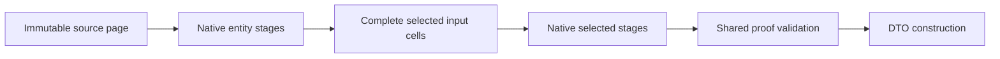

# CQL architecture

## Current verified milestone — 1 November 2026

**37 providers have scoped hosted HTTP evidence; 5 have browser evidence and 32 browser gates remain open.** Cardano passes native3/2, Mongo5/4, repeat0new/2existing, foreign-private0/public3 and matching SQLite/Neo4j replicas2/2. Two private saves were acknowledged once. Source writes and browser interaction are not inferred.

Latest hosted provider acceptance: parentaffe5719070d7b149d165b901306708e7643fb97/Corebe397f10419cf8b5c0dafc93ff1f4958b88588a2, app1615af0d/settingscfe35470 SUCCESS. Original Cardano cohort completion ACK retained; never replay its writes. Session lifecycle correction passes. Website80ba510 remains the last byte-verified publication; Cardano card publication is next. Browser and real-expiry interaction remain separate open gates.

There are **39 implemented query types**: 3 canonical adapters,34bounded public/source profiles and2local Azure/Oracle implementations. Cardano native35controls/realCQL3/2/manager-CLI3/2, API/local HTTP and hosted visitor federation/reuse/isolation/replicas pass. Deployed tariffs37/hosted37/browser5/open32. Full ORM/EF parity/HyperDrive certification remains incomplete.

Current implementation state: [CURRENT_STATUS](CURRENT_STATUS.md); feature acceptance: [parity checklist](CQL_PARITY_CHECKLIST.md).

1. **Capture:** bounded immutable query/selected-stage intent and closed literals; no user callback execution.
2. **Plan/admit:** explicit scope, eligible targets, exact scalar/relationship capabilities, visibility and work bounds.
3. **Own execution:** V2 HolonManager and physical-attempt owner; preflight all targets and re-admit actual contracts before dispatch.
4. **Native adapters:** Mongo aggregation/snapshot owner, SQLite serializable read owner, Neo4j captured scalar pipeline/read owner. Do not invent stronger provider consistency.
5. **Validate/return:** acknowledged complete detached evidence, exact values and shared remaining work; materialize only where the requested result contract permits it.

## Explicit read representations

CqlReadSourceProfile owns an explicitly configured query-only adapter and its
read activation/lifetime. CqlHostedSourceRegistry resolves that representation
for CQL without registering it as the canonical wallet/default write provider.
The query manager remains unbound; named adapters and actual capabilities are
captured and re-admitted by the shared planner/executor. No failed native query
silently substitutes a Mongo copy or another endpoint.

Discovery combines explicit host permission, query tariff, activation and native
capability planning. A supported provider enum alone grants nothing. Missing Mongo
can disable a paired example while retaining the source's native leaf examples.
Examples own fixed Rows/Federation operations and named scope, not executable URLs.

StorageQueryTariff derives capture bounds from its single supported unsigned-read
set. PreparedStorageExecution still needs independent server permission and a
captured price; its query-only set cannot authorize storage writes. The current
factory rejects overlap with native signing bindings. Simultaneous public-read
and canonical signed-write representations for one provider need a future
operation/representation-aware admission contract; removing the fence is not a fix.

Public EVM adapters share EvmPublicAccountMetadataSource in Web3Core. Fixed trusted
descriptors bind provider, chain ID, genesis hash, metadata names and allowed RPC
path. Ethereum/Polygon remain root-path-only; Arbitrum uses the official /rpc path.
Every selected balance is read against one RPC-reported finalized canonical hash.
The descriptor does not come from query JSON; wallet/signer fields are forbidden.
This is native provenance, not a light-client settlement proof. Google/S3 use
anonymous metadata-only SDK operations rather than owned encrypted record storage.

All public views retain NativeRecordHolonMapper identities: stable mapping owner,
provider, source namespace and native key. Visitor preparation instead requests
Core-derived IDs in the actor's cosmic-cql-demo namespace, journals a create-only
Mongo save before submission and retains uncertain outcomes. These snapshots can
replicate through normal V2 owned writes; native public views are not replication
targets. PreserveCopies returns physical provenance, not a cross-provider snapshot.

Only explicitly declared metadata keys remain queryable when snapshot encryption
is active. AdditionalQueryableKeys is trusted runtime/deployment policy, separate
from globally reserved system keys. Native errors, late malformed values and empty
pages still require complete protected-source validation before publication.

Deployment configuration must match the source/application/Core revision. Joint
public-profile candidates compose their permissions/examples once; independent
candidates from the same old snapshot are not sequential updates to apply. Exact
pins, release scope, host acceptance and remaining gates belong in CURRENT_STATUS.

## Native query and selected-stage owners

For projected All, native counterexample reduction follows every selected stage. Complete source/stage evidence validates before the Boolean is published; final row evidence and the terminal scan consume their budgets.
Source relationship composition has separate admission from entity All predicates. All three native source compilers now support the separate source-composition capability. Complete protected scopes are validated before business truth and paging; source predicates stay native.
Keep source translation, protected errors, membership/visibility and remaining-work accounting in their owning layers. No parallel fallback or silent retry.

[Active acceptance contract](CQL_PROJECTED_ALL_EXECUTION_CONTRACT.md) defines the current invariants.
[Full architecture/history](Archive/CQL_ARCHITECTURE_history_2026-10-27.md) retains earlier detailed designs, subsystem contracts and checkpoint evidence.
[Full ORM history](Archive/COSMIC_ORM_IMPLEMENTATION_ROADMAP_history_2026-10-27.md) retains replication/history/migration/placement and other programme requirements.

The native-only acceptance assembly links the shipping demo and provider adapters;
it does not implement replacement query execution. Its host supplies a V2
HolonManager with an explicit provider registry. The source/composition demo checks
both successful results and protected errors through that manager. Fixture creation,
ownership journals and exact cleanup stay in the test host, outside the read-only
public example. HTTP host contracts remain in their separate integration project.
The partial IQueryable bridge is shared Core code, independent of database type.
It registers owned expression chains with weak keys, binds standard LINQ closure
parameters per execution, captures an immutable CosmicQuery, then re-admits live
capabilities and invokes the existing V2 typed query owner. It neither compiles
application predicates to delegates nor fetches rows for client filtering. The
initial increment flattens exactly one explicitly named physical sequence;
remaining terminal/repeated-selection dispatch remains Q01 work, with explicit unsupported errors.
Standard cardinality and All terminals dispatch through CosmicScalarPlanner and
the existing V2 scalar owner, independently admitting scalar capabilities. All's
predicate remains separate from its source window. Entity cardinality after a
window now carries its own CardinalityPredicate descriptor and independent
SupportsPostWindowCardinality admission. The shared scalar predicate lowering
counts matches for cardinality and counterexamples for All, retaining each
operation's own meaning and the original source window.
Queryable Select transitions to a typed selected-sequence provider. The shared
query envelope owns standard/async enumeration for entity and selected results.
The selected provider rebinds source intent and selected stages per execution,
then uses the existing projection or selected-composition owner; selected All
uses the independent projected-All owner. Constructors and setters run only in
the established validated projection materializer, never during capture and
never as an alternative to missing native execution.
Entity element terminals delegate to the existing element planner/executor and
V2 typed hydration owner. First/Single cardinality, tail windows, Index bounds,
tracking and error semantics stay in that owner. The bridge handles a caller's
OrDefault argument only after an acknowledged empty result; it cannot replace a
native failure or ambiguous cardinality with a default object.
Queryable value aggregates bind typed paths and exact result domains before
planning against independent scalar-selection capabilities. Plain scalar Select
can lower into the same native selector aggregate; selected stages are never
moved across the reduction. Int32 Average now has an independently admitted double-output contract; Int64
uses independent checked-prefix enrollment, now verified on MongoDB, SQLite and Neo4j. The existing decimal-output
CQL contract is preserved rather than approximated with a client conversion.
The Int32 double-output mode shares integer-packet validation with decimal means
and grouped slots, and adds no provider row buffer. The scalar descriptor records
the exact result mode; scalar selection admission checks the independent flag
again at execution. The selected-scalar validator also verifies the new result's
finite Double type and Int32 input bounds. Existing capability constructors leave
the flag false, so no other provider is silently enrolled.
MongoDB Int64 double Average orders the selected source window by its canonical
ordering keys plus identity tie-breaker, then computes exact Decimal128 running
sums. The bounded input/count domain fits Decimal128 precision. Its six-field
packet includes a strict Boolean `prefixOverflow`; missing, numeric or additional
fields are invalid. The shared numeric owner checks exact limbs/count, rejects
contradictory no-overflow sums, and returns overflow for any visited prefix.
Only an acknowledged checked Int64 total is converted once to double before
division. Neo4j also independently advertises this mode. No client row accumulator
or decimal-mean conversion grants this capability.

SQLite attaches a connection-owned checked Int64 prefix aggregate under the
existing exclusive read owner. The selected source carries an explicit ordering
ordinal; SQL aggregate ORDER BY consumes that ordinal after source paging.
The callback retains a bounded running total/count and overflow latch, checks
cancellation/deadline/work budgets, and never buffers source rows. SQL computes
the independent exact limb/count packet in the same statement. The owner checks
hook failures before interpreting its strict 0/1 acknowledgement and unregisters
the hook on disposal. Kernel and V2 manager native gates prove reverse ordering,
post-page prefixes, nulls, overflow, cancellation and teardown.

Neo4j checked Int64 means reassert the admitted source ordering plus identity
immediately before native collect, after SKIP/LIMIT. Cypher reduce retains a
checked total and overflow latch. Positive and negative branches use their own
safe boundary subtraction; only an admitted branch performs addition. The
ordered participating-value list remains on the server and uses proportional
memory within the input-work bound and native transaction memory/timeout limits.
The exact eight-field integer packet includes Boolean prefixOverflow in every
normal/error union branch. Empty windows and genuinely empty sources retain the
same required/nullable shared-owner semantics. Unit packet tests and83 native
checks/store prove both overflow directions, reversal, paging and empty results.

Selected element terminals lower through CosmicProjectionElementPlanner into
existing native composition plus bounded Skip/Take and an independently enrolled
Reverse stage for tails. SQLite reranks descending prior ordinals; MongoDB assigns
new window ranks in descending prior-rank order; Neo4j orders the previous stage
positions descending before collecting the next stage. Detached stage proofs are
validated by the existing composition owner. Its shared ExecuteOwnedAsync checks
empty/multiple cardinality before constructing any DTO. V2 HolonManager gates the
new public async entry; the element result carries HasValue separately from Value.
The IQueryable bridge binds source/selected predicates per execution and handles
caller-supplied defaults only after acknowledged empty proof. Budgets include
full bounded source participation and each terminal-lowering stage.

Selected cardinality adds explicit RequestsCardinality intent to composition
plans and independently enrolled SupportsCardinality. Legacy constructors keep
that permission false. Empty stage lists are admitted only for cardinality intent.
The shared composition attempt owner now accepts a typed finalizer after detached
proof validation: row/element finalizers construct their selected output, while
cardinality finalizers normalize native counts directly. Cardinality debits final
proof payload and terminal scan work across providers before publishing values.

CosmicProjectionCompositionPacket.NativeSelectedCount is mandatory for this
intent and must equal complete validated output participation. SQLite executes a
native count over the same materialized stage CTEs in its serializable owner.
MongoDB executes a count facet in its existing snapshot session, explicitly
acknowledging zero; its positive rank decoder permits zero only for this terminal.
Neo4j preserves the acknowledged source/final-stage native header count. Missing
or contradictory counts fail before result publication. No DTO constructor runs
for Count/LongCount/Any. Standard selected predicates append after captured
windows, with closure binding repeated per execution.

Entity cardinality predicate capture uses the bounded scalar terminal grammar,
including child/descendant markers and expansion admission. The terminal
admission descriptor inherits source scope/read access and has no source window.
Planning and execution independently admit its read paths and explicit traversal
permissions. Existing capability constructors keep post-window cardinality false.
SQLite applies matching predicates to its ordered source subquery, with protected
CASE reductions and a serializable owner where relationship scopes require it.
MongoDB and Neo4j share their scalar terminal traversal/error lowering, changing
only the match contribution for cardinality. An empty terminal page visits no
terminal scopes; source-scope failures still precede paging. IQueryable binds
parameters per execution, while fluent cardinality capture freezes them.

Selected numeric reduction uses immutable CosmicProjectedNumericIntent and
CosmicProjectedNumericPlan descriptors plus a bounded exact-word acknowledgement
in the composition packet. Each provider independently enrolls scalar numeric
permissions through NumericReductions; legacy capability constructors keep it
absent. Selected scalar expressions and flat-record numeric selectors bind an
exact column. The V2 manager and shared composition attempt owner preserve source
and stage scope, cross-check native participating count against validated selected
cells, charge acknowledgement/proof/terminal work, and normalize through existing
integer/decimal/floating numeric owners. The numeric finalizer constructs no DTOs.

SQLite currently enrolls signed Int32/Int64 Sum/Average and nullable forms. Its
native reduction runs over the final materialized stage CTE in the same
serializable owner. Two integer sum words retain exact totals; Int64 double means
reuse the checked aggregate hook ordered by the final stage rank. The hook checks
budgets and is removed on disposal. Selected ordering/offset occurs before prefix
accumulation. SQLite now also enrolls decimal/Single/Double/UInt64 and nullable selected reductions; all3 wider domains are independently enrolled;
selected Min/Max uses its independently enrolled extrema contract described below. Q01 remains red for Q01d/e/f.

MongoDB Q01a now independently enrolls signed Int32/Int64 Sum/Average and nullable
forms. Source and selected reductions share AppendNumericKernel, preserving the
published exact-word arithmetic and checked-prefix logic. The selected path
projects its admitted column and final rank, then executes that kernel in a
facet under the existing selected snapshot session/deadline. Empty input receives
an explicit native zero packet. The repository reuses strict numeric decoders,
checks terminal work/proof bounds, requires one packet and returns it through the
shared selected owner. Scalar/record selectors and all27 native integer cases
are verified on all3 providers.

Neo4j Q01a now independently enrolls the same signed integer domains. The numeric
terminal consumes the final native selected-position list and captured scalar
cells in the existing query. It reuses integral-word expressions and the guarded
checked-prefix reducer, emitting one exact count/word/Boolean acknowledgement.
The decoder requires complete source and stage participation before accepting
that terminal, rejects duplicate/missing/malformed packets and charges final
proof payload plus terminal scan work. Empty input has an explicit zero packet.
The shared owner validates participating count and normalizes the result without
constructing DTOs. All27 integer cases/store and129 Neo focused CQL tests pass;
Q01a is green while wider domains and selected extrema remain red.

SQLite Q01b reuses existing decimal limb, UInt64 split and floating packet kernels against the final selected CTE. Floating hooks belong to the same serializable connection owner, enforce its deadline and release on disposal. The decoder validates domain-specific packet width and participation before the shared typed finalizer. No client-side aggregation or record construction is introduced. Native proof:37 wider-domain cases in `CqlLinqStagedWideAcceptanceTests.cs`.

Mongo Q01b sends final selected cells to existing exact kernels within the same snapshot session. Empty packets preserve native domain types (Decimal128 decimal words; Int64 floating words). Strict scalar decoding owns packet validation; terminal proof budgets charge actual domain width. No client aggregation or DTO construction.

Neo Q01b derives exact decimal/floating words from captured final selected values and reduces each word natively. UInt64 uses the existing canonical20-digit splitter. The same single-query owner validates complete stages before normalization; packet widths and proof charges are domain-specific. No extra MATCH, client aggregation or DTO construction. This does not strengthen Neo repeatable-read guarantees.

Q01c shared extrema uses independently captured ExtremaDomains, rechecked against live adapter capabilities before execution. It appends null exclusion (nullable/reference domains), exact column ordering and Take(1) after all selected stages, respecting the32-stage bound. The common attempt owner validates complete native source/stage/order/output proof before its finalizer reads one detached cell. Required empty values produce CQL_EMPTY_SEQUENCE; nullable/reference empties return null. Neither record construction nor client aggregation participates. Old capability constructors leave extrema unenrolled. SQLite, MongoDB and Neo4j now have native proof and explicit enrollment.

SQLite Q01c explicitly enrolls selected ordering domains for extrema. Native final filter/order/Take execute in its existing serializable composition owner. Expanded all-null proof reproduced UInt64 key normalization padding the JSON null token; the shared UInt64 Column normalizer now returns SQL NULL before numeric padding, preserving null semantics for every consumer. Required values retain exact20-digit numeric keys. Regression tests cover null/zero/UInt64.MaxValue. Reviewed native continuation passed all218 extrema cases without replaying creates.

Mongo Q01c enrolls exact selected ordering domains. Final null filtering, ordering and one-row selection run under the existing snapshot session/deadline; each stage retains native identity/rank proof. The shared owner reads the winning detached field only after validating complete participation and every stage. All218 extrema cases/33 domains and202 Mongo CQL tests pass.

Neo Q01c enrolls exact selected ordering domains; null filter/order/Take operate on the captured selected positions in the same native query. Complete stage/ordering proof is validated before the shared finalizer reads the winning field. All218 cases/33 domains and137 Neo CQL tests pass. No stronger repeatable-read guarantee is implied. All3 Q01c cells are now verified; repeated Select Q01d is independently verified below.

Q01d separates physical native Columns from immutable OutputColumnIndices/OutputAliases. Reselection changes only the final shape/bindings; earlier predicates/order/windows retain their physical dependencies and complete native proof. Later selected predicates/terminals resolve outward aliases back to physical indices. Final construction maps validated cells and never creates intermediate DTOs. Retained physical cells continue to consume normal work/payload budgets. The standard provider captures a bounded deferred parent binding (maximum32 repeated selections), re-evaluating earlier closures at execution; fluent selections remain immutable. Composition-only adapters are admitted through their composition contract, without an unrelated ordinary-projection requirement.4 shared tests/2,536 CQL regressions pass; all3 native acceptance now passes26 cases/store.

Q01e shared row plans now carry PostWindowPredicate and PostWindowLimit independently of the original source page. Element lowering keeps the page unchanged, applies its terminal predicate, then selects1 row (First/Last) or at most2 (Single). Last retains native tail intent after terminal filtering. PostWindowElementPredicate is separately enrolled; admission validates terminal grammar/read-access and combined expansion bounds. Actual adapter capability admission and the physical attempt preserve every field. SQLite is enrolled after native proof; Mongo/Neo native proof is recorded below; admitted expanded-graph source options are preserved for the same native graph owner. No client filtering or extra provider read substitutes for native lowering.2,540 CQL regression tests pass; SQLite45 native cases pass, all3 native acceptance now passes.

SQLite Q01e uses two translators sharing one bound-parameter owner:source protected validation remains outside the source page, terminal protected validation is a complete native reduction over that page, and final predicate/order/element limit returns selected roots. Both scope reads and selected rows share the serializable transaction whenever relationships/graphs participate. Existing graph expansion consumes only selected roots in that same owner, enforcing depth/snapshot/node and visibility/catalogue limits.45 native cases plus35 compiler tests pass. No client filtering or second hydration read is used.

Mongo Q01e compiles the original selected page before its terminal predicate. A native unbounded window computes the highest terminal error across every paged root before match/order/output limits, so First/Single/Last cannot discard a different root’s scope error. Terminal outcomes and outer source errors normalize to one canonical envelope. Existing snapshot-session membership and graph ownership remain intact; no nested facet, client predicate evaluation or second root hydration read is introduced.45 native cases and207 CQL/compiler tests pass; Neo native proof is recorded below.

Neo Q01e captures ordered paged node/projection references and terminal outcomes before selecting winners, so protected errors anywhere in that page cannot be truncated. Capture is bounded to10,000 roots plus one detection row; overflow returns CQL_QUERY_LIMIT, never partial success. Traversal states survive the final ordering WITH, fixing the reproduced desc5 scope error. Selected snapshots/graph expansion use the existing read transaction/owner. ProviderSnapshot remains independently unsupported; an explicit rejection test passes rather than downgrading consistency. Reviewed native proof:46 new cases;141 CQL/compiler tests pass.

Q01f foundation introduces CosmicEntityCompositionQuery with immutable filter/order/window stages after its untouched CosmicQuery source. Separate ICosmicQueryEntityCompositionStorageProvider/Capabilities prevent old flat scalar/projection compilers from silently consuming a staged source. Exact ordering admission reuses the existing one owner; stage predicate/visibility and combined expansion bounds admit independently. Input row/payload and cumulative stage-work options are positive/bounded. The V2 manager dispatches through the existing row attempt owner on the original physical adapter, retaining actor/usage ownership, cancellation, detachment, identity/visibility checks and graph options. Missing stage contracts, capability drift, warnings and incomplete acknowledgements cannot fall back to flat reads.5 shared tests/2,545 CQL regressions pass; IQueryable/provider/terminal/projection integration remains pending.

### Selection after entity stages

`CosmicEntityProjectionQuery` retains immutable entity-stage intent separately from its detached selection definition. Its single-provider plan admits source stages and exact selected domains independently. Actual execution requires `ICosmicQueryEntityProjectionStorageProvider`; flat projection/row interfaces grant no substitution. `CosmicProjectionExecutor` owns both shapes through the same inherited physical-attempt boundary and native-cell validation/DTO construction sequence. Entity-stage acknowledgements also reject warnings and output counts exceeding the source/stage window bound shared with entity cardinality. This is currently a shared tested foundation; native providers, standard Select binding and selected-stage/numeric integration are pending.

## Native point-source profiles

`CosmicQueryCapabilities.ForStringMetadataPointLookup` admits exactly one bounded
string metadata equality and one selected target. Immutable `BusinessPredicates`
separates caller intent from mandatory read policy; the source adapter enforces
that policy on canonical point evidence. The ActivityPub/Mastodon adapter proves
this path without timeline scans or local query substitution. It reuses its
status projection owner, propagates cancellation, bounds streamed payloads and
rejects ambiguous JSON. [Verified scope and remaining gates](CQL_ACTIVITYPUB_NATIVE_PROFILE.md).

### Entity stages followed by selected stages

`CosmicProjectionCompositionPlanner.PlanEntity` retains an independent
`EntitySource` plan alongside the selected plan. Standard LINQ captures both
chains and rebinds them once per execution. Actual adapters must independently
enroll `ICosmicQueryEntityProjectionCompositionStorageProvider`; the flat native
entry point rejects combined plans. HolonManager uses the existing V2 composition
attempt owner. All3 implementations now have23 common native acceptance cases.

SQLite validates both chains inside one serializable owner. Mongo validates
entity proofs, selected inputs and selected stages in the same snapshot/deadline;
final entity ordering and identity direction determine selected ranks. Neo exports
the final entity relation from its existing compiler, then captures typed cells
and selected stages in one statement. A leading canonical proof phase validates
original source snapshots/revisions, sticky traversal errors and work bounds
before selected participation is accepted. It retains ProviderDefault consistency
limits and does not advertise snapshot isolation. No owner hydrates application
source entities as an intermediate query engine.

Combined graph sources, reselection and element/cardinality/numeric terminals
following this selection remain unintegrated. Q01f stays red.

Bitcoin native milestone (1 November): bounded public-header equality/key-set source passes20 controlled checks and real shared-manager C#/CLI3/2. [Guide](../../Devs/BITCOIN_PUBLIC_HEADER_CQL_GUIDE.md), [proof/next HTTP gates](BITCOIN_PUBLIC_SOURCE_STATUS.md). No hosted admission, full Bitcoin consensus or canonical on-chain write claim; live count remains26.

Bitcoin API milestone1November: explicit lazy read profile, independent tariff, actual four-preset planner and local HTTP3/2+Mongo5/4/isolation pass. Protected candidate prepared only; hosted/browser open. [Proof and exact rollout next step](BITCOIN_PUBLIC_SOURCE_STATUS.md). No signed-chain writes or hosted certification inferred.

Bitcoin hosted completion1November: exact f71e482c SUCCESS at19ebbfe2c/Core7317ba1. Normal visitors pass native3/2, paired5/4, repeat0new, foreign-private0 and SQLite/Neo4j replicas2/2. Totals27HTTP/5browser/22browseropen; no Bitcoin source writes. Earlier Bitcoin pending notes superseded. [Proof/hashes](HOSTED_PUBLIC_SOURCE_ACCEPTANCE_2026-11-01.md#additional-bitcoin-acceptance).

XRPL native milestone1November: bounded hash-verified header CQL passes21controls,1real C# walkthrough and actualCLI3/2. [Guide](../../Devs/XRPL_PUBLIC_HEADER_CQL_GUIDE.md), [proof/next HTTP gates](XRPL_PUBLIC_SOURCE_STATUS.md). Counts30implemented/29deployed tariff/27hosted HTTP; no XRPL hosting or signed-write claim.

XRPL API milestone1November: explicit read-only profile/admission, four exact shipping-planned presets and local HTTP3/2+Mongo5/4/private0 pass. Protected candidate prepared only; hosting/browser remain open, live27unchanged. [Proof and rollout next](XRPL_PUBLIC_SOURCE_STATUS.md).

XRPL hosted completion1November: free Ripple endpoint correction74bdf044 SUCCESS/c6e7f14ba/Coree032d0a, native3/2, paired5/4, repeat0new, private0 and replicas2/2. Prior402/expired-empty cohort preserved; explicit post-fix cohort has original ACKs. Counts28HTTP/5browser/23browseropen; no source writes. [Proof/hashes](HOSTED_PUBLIC_SOURCE_ACCEPTANCE_2026-11-01.md#additional-xrpl-acceptance).

Stellar complete header decoder1November:20cases pass, including real protocol29 headers, all5specified StellarValue unions and exact signed/unsigned64bit fields. Next CQL adapter must bind API metadata to decoded identities before publication. [Proof](STELLAR_PUBLIC_SOURCE_STATUS.md#complete-header-decoder-milestone). No Stellar CQL/hosted certification yet.

Stellar native CQL1November: complete XDR-bound sequence-key queries pass21source+1real C# controls and actualCLI3/2. [Guide](../../Devs/STELLAR_PUBLIC_HEADER_CQL_GUIDE.md), [proof/HTTP next](STELLAR_PUBLIC_SOURCE_STATUS.md#native-cql--developer-demo-complete). Counts31implemented/30deployed tariff/28hosted HTTP; no Stellar hosting grant.

Stellar API milestone1November: independent read-only admission, exact four-preset shipping planner and local HTTP3/2+Mongo5/4/private0 pass; protected3setting candidate prepared only. Hosting/browser remain open; live28unchanged. [Proof/next rollout](STELLAR_PUBLIC_SOURCE_STATUS.md#api--local-http-complete).

Stellar hosted completion (1 November): application637a6d49f/Core2dd3c37, exact settings deployment3eda0ea7 SUCCESS. Native3/2, private Mongo2, federation5/4, repeat0new/2existing, foreign-private0/public3, replicas2/2 pass. Counts29hosted HTTP,5browser,24browser-open;31deployed query-tariff types. Read-only hash-pinned public headers, no Stellar writes or consensus/signature verification. [Evidence](HOSTED_PUBLIC_SOURCE_ACCEPTANCE_2026-11-01.md#additional-stellar-acceptance).

Algorand native CQL milestone (1 November):21controlled +1real HolonManager3/2 pass, actual commented CLI3/2 passes. Explicit current-account catalogue, SHA512/256 address checksums, exact UInt64 strings and per-row rounds; no historical/shared snapshot or source writes.32implemented query types/31deployed tariff/29hosted HTTP. API/hosting remain open. [Guide](../../Devs/ALGORAND_PUBLIC_ACCOUNT_CQL_GUIDE.md), [proof/next gates](ALGORAND_PUBLIC_SOURCE_STATUS.md).

Algorand API/local HTTP milestone (1 November):3API/prepared+1Core+1native HTTP tests pass;3publisher+1client controls pass. Native3/2, pairedMongo5/4, foreign-private0 verified locally. Original marker-verified fixture removed and ACKs retained. Protected3setting candidate prepared only; hosted/browser pending. [Proof](ALGORAND_PUBLIC_SOURCE_STATUS.md#api-and-local-http-complete).

Aptos native milestone1November:25controlled+1real HolonManager3/2 pass/no skips, actual commentedCLI3/2 passes. Explicit Mainnet account catalogue and one requested ledger version per source query; exact sequence strings, no state/consensus proof or cross-provider snapshot.33implemented query types;29hosted HTTP unchanged. API/hosting remain open. [Guide](../../Devs/APTOS_PUBLIC_ACCOUNT_CQL_GUIDE.md), [proof](APTOS_PUBLIC_SOURCE_STATUS.md#native-cql-milestone).

Aptos API/local HTTP milestone1November:2API+1Core+1native HTTP pass/no skips,3pure publisher+1client controls pass. Native3/2, Mongo federation5/4 and foreign-private0 locally verified; marker-owned fixture removed/ACKs retained. Coree845c62/task-only. Protected candidate/export planner and hosting wait for current Algorand rollout. [Proof](APTOS_PUBLIC_SOURCE_STATUS.md#api-and-local-http-milestone).

Algorand hosted completion1November:7a9ca308e/Corec17db5f, exact settingsf3ee7f37 SUCCESS. Native3/2, paired5/4, repeat0new/2existing, foreign-private0/public3, replicas2/2 pass. Current-account/per-response-round semantics, exact quantities; no source writes/historical/shared snapshot. Counts30hosted HTTP/5browser/25open,32deployed query-tariff types. [Proof/hashes](HOSTED_PUBLIC_SOURCE_ACCEPTANCE_2026-11-01.md#additional-algorand-acceptance).

Hedera/Hashgraph native milestone1November:21controlled+1real shared HolonManager3/2 tests pass/no skips; actual commentedCLI3/2 passes. LatestIndexed account catalogue, exact tinybars/native timestamps and strict official Mainnet endpoint; no SDK payment, source writes, freshness/shared snapshot or consensus proof.34implemented query types/30hosted HTTP; API/hosting remain open. [Guide](../../Devs/HEDERA_PUBLIC_ACCOUNT_CQL_GUIDE.md), [proof](HEDERA_PUBLIC_SOURCE_STATUS.md#native-cql-milestone).

Hedera API/local HTTP milestone1November:2API+1Core+1native HTTP+1actual4preset shipping planner pass/no skips;3publisher+1client controls pass. Native3/2, Mongo federation5/4 and private0 locally verified; owned fixture removed/ACKs retained. Protected3setting candidate prepared only, Core89b5ffa/task-only. Hosted/cloud query/browser gates remain open. [Proof](HEDERA_PUBLIC_SOURCE_STATUS.md#api-and-local-http-complete).

Aptos hosted completion1November:1cfb893c8/Coree845c62, exact settings1c100994 SUCCESS. Native3/2, paired5/4, repeat0new/2existing, foreign-private0/public3, replicas2/2 pass. Per-native-query ledger version and exact strings; no cross-provider historical snapshot, state/consensus proof or source writes. Counts31hosted HTTP/5browser/26open;33deployed query-tariff types. [Proof/hashes](HOSTED_PUBLIC_SOURCE_ACCEPTANCE_2026-11-01.md#additional-aptos-acceptance).

Radix native resource CQL: [commented C# guide](../../Devs/RADIX_PUBLIC_RESOURCE_CQL_GUIDE.md). 50/50 tests and actual CLI3/2 verified; API/localHTTP/hosted scopes pass; browser renewal remains open. Exact supply strings and one Gateway ledger state per query.

Radix hosted milestone: original cohort completed at74aaa9b4d/Core8b79301 after settlement correction; no duplicate saves. [Scope, failure history and hashes](RADIX_PUBLIC_SOURCE_STATUS.md#hosted-acceptance-complete). Browser renewal/interaction remain separate. Earlier deployed-tariff headlines incorrectly included local Azure/Oracle: actual live catalogue35, implemented types37.

Starknet bounded header profile: [setup/commented C# guide](../../Devs/STARKNET_PUBLIC_HEADER_CQL_GUIDE.md), [native/API/local HTTP proof and pending hosted gates](STARKNET_PUBLIC_SOURCE_STATUS.md). Explicit enrolled block-hash equality/membership, exact field/integer strings and RPC-reported L1 acceptance. Local paired3+2/2+2results and visitor privacy verified; hosted/browser publication separate.
