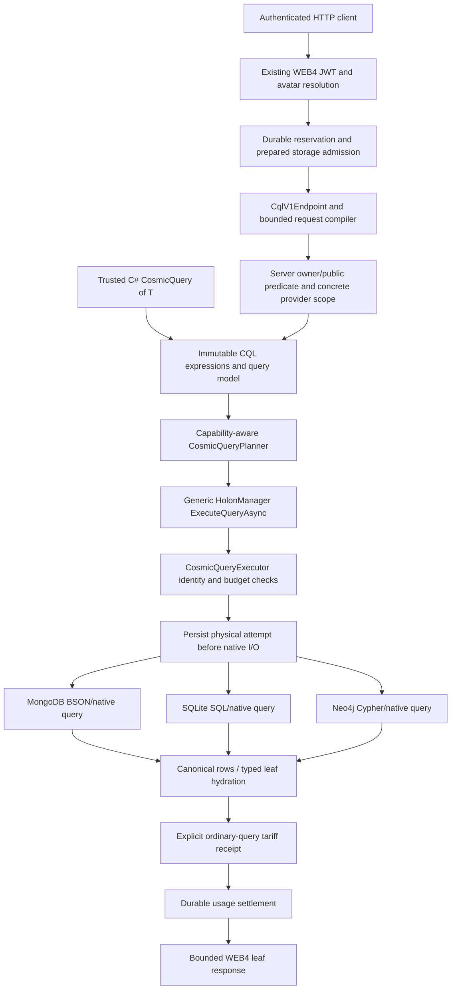

# CQL architecture

22 October 2026. CQL is a generic COSMIC ORM query pipeline. Native providers translate its admitted intermediate representation; they do not implement separate public query languages. [Developer manual](CQL_MANUAL.md), [HTTP contract](CQL_V1_HTTP_CONTRACT.md), [execution reference](CQL_EXECUTION_PIPELINE.md).

## Native graph execution checkpoint — 23 October

Core owns immutable graph intent, capability readmission, detached publication and typed selection ownership. Shared `HolonGraphQueryExpansion` assembles provider-owned native rows with cumulative node/UTF-8 bounds and persisted role ordering. SQLite owns one deferred Serializable native read transaction for roots and children, native parent/type/member predicates, pre-materialization row/byte bounds and the existing instruction/deadline hook. Caller Serializable transactions are reused without committing them. MongoDB now owns a snapshot session plus one cumulative native deadline for roots and child commands; its native104-case/admission31-case matrices pass, including cumulative-deadline and concurrent-write snapshot cases. Neo4j now uses one bounded native read-committed transaction; it does not claim snapshot isolation. Native81/unit31 pass, with final joint hosted82 also passing. Its schema2 projection adds canonical HolonType and is refreshed from canonical snapshots at activation. HTTP v1 now has optional bounded access-bound graph requests and explicit safe DTO projection. [Contract and native evidence](CQL_GRAPH_LOADING.md).

## Explicit graph consistency admission

Immutable graph options distinguish ProviderDefault from ProviderSnapshot. Snapshot requests require the GraphSnapshot capability at planning and actual-adapter readmission; that capability requires GraphExpansion. SQLite/Mongo declare their existing native snapshot owners. Neo4j supplies its documented read-committed mode under ProviderDefault and rejects ProviderSnapshot with CQL_CONSISTENCY_UNSUPPORTED before native I/O. Claimed caller profiles cannot upgrade an adapter. The guarantee is local to each provider; it is not a distributed common snapshot. Both graph factory signatures share one validation owner and preserve the existing five-parameter binary ABI.

## Mandatory access binding

CosmicQueryReadAccess owns the existing WEB4 owner/public rule as immutable actor/predicate data. It is inserted ahead of business predicates and native paging; composition preserves the binding without duplicating it. WEB4 constructs it from its authenticated/admitted actor and reuses the same output rule. Core rejects an access actor different from the inherited execution and rejects foreign detached rows before typed publication. SDK creation is a restriction, not authentication or credentials. Visibility-bound graphs require GraphReadAccess alongside GraphExpansion at planning and actual-adapter readmission; the three native readers, detached capture and typed selection owners enforce it. Arbitrary metadata sharing/role labels cannot grant access.

## Layers and ownership

The admission/attempt/receipt/settlement path applies when a hosted request supplies its PreparedStorageExecution. Trusted local SDK execution can run without that hosted scope; the application owns its access policy and adapters. The diagram does not imply a public unauthenticated SDK endpoint or simultaneous execution on all three providers for one v1 HTTP request.

| Owner/source | Responsibility |
|---|---|
| Core `Queries/CosmicQuery.cs`, expression/predicate types | Immutable composition, supported expression parsing and limits |
| Core `Queries/CosmicQueryPlanning.cs` | Resolve selected scopes against eligible targets; check declared capabilities |
| Core `Managers/HolonManager/HolonManager-Cql.V2.cs` | Generic public manager entry and typed integration |
| Core `Queries/CosmicQueryExecutor.cs` | Validate actual bindings/capabilities, inherited admission, cancellation and result budgets |
| Provider native CQL adapters/translators | Parameterized native predicates, ordering/page, native resource guards and canonical rows |
| ONODE `Services/Cql/CqlV1Compiler.cs` | Whitelisted JSON-to-CQL expressions, mandatory native access predicate, ordinal strings |
| ONODE `Services/Cql/CqlV1Endpoint.cs` | Exact actor/reservation binding, concrete server scope, planning, response limits/sanitization |
| Core prepared-storage/usage services | Physical attempt ownership, tariff evidence, no-execution proof, settlement and no replay |

All paths above are relative to their existing project roots; no duplicate query engine is introduced in Examples or providers.

## From expression to native execution

1. A trusted C# caller composes supported expression trees, or the v1 HTTP boundary compiles a bounded DTO. Metadata marker calls are parsed, never invoked as client predicates. Arbitrary CLR methods, getters/side effects and raw query text are not evaluated.
2. A planner binds the selected provider scope and required capabilities. An unsupported operation fails before native reads. Explicitly selected targets are not widened using registry contents.
3. HolonManager delegates to the generic executor. It rechecks actual adapter identities/capabilities; a stale/forged capability plan cannot authorize more work.
4. In a hosted request, the exact server-created PreparedStorageExecution owns the physical attempt. It persists intent before calling the native adapter and checks lifetime/cancellation around asynchronous work. Manager acquisition cannot silently activate a different paid provider as a constructor side effect.
5. The adapter applies native predicates, ordering and the page, enforces its resource controls, and returns canonical detached rows. Typed local hydration restores clean tracked leaf entities. Unsupported relationship loading is not simulated by fetching a dataset and applying LINQ in memory.
6. For the ordinary v1 service contract, a completed query attempt records its explicitly configured tariff receipt. Unknown completion is not converted into zero-cost evidence. The existing usage middleware settles durably before publishing its buffered response.

The bounded DTO and result recheck are separate protections. Visibility must be in the native WHERE/match predicate **before** the page; dropping forbidden rows after paging would produce incorrect pages and is not the implementation. The final result check refuses a provider visibility violation rather than silently repairing a bad result.

## Scope, consistency and provider selection

The local SDK supports current-default, named and all-eligible scopes over its supplied eligible snapshot. Results remain grouped with provider identity. Duplicate logical IDs from different providers are not globally merged; pages and ordering are per provider. There is no implied cross-provider snapshot, conflict resolution or distributed query transaction.

HTTP v1 chooses exactly one already-active MongoDB/SQLite/Neo4j provider. Omitted Provider resolves the server's current default, then the endpoint pins that concrete identity. A request cannot authorize extra providers, trigger activation, select a signer, override prices or request automatic failover. HyperDrive v2 supplies surrounding ORM routing/replication capabilities; broader query placement/federation policies are separate work.

## Security and data types

Production WEB4 supplies its existing verified avatar identity; the v1 query actor cannot come from request JSON. Admission must belong to that same avatar and execution handle. Server policy is owner-or-globally-public; Wizard and sharing-index metadata do not bypass it. Authoritative shared-recipient/tenant-specific policies are not claimed by this v1 contract.

Native type domains preserve exactness: numeric strings do not become integers, GUID comparison uses canonical validated text, and strings use the admitted ordinal operation. Typed invalid/missing values do not acquire accidental inequality matches. Metadata encryption remains the ORM's policy owner: encrypted content is not made queryable by an implicit client-side decryption scan.

HTTP v1 exposes String/Int64/Boolean/Guid metadata and a bounded canonical leaf-field set. Local CQL capabilities include additional explicitly declared types/operators; local availability does not widen the HTTP schema. [Scalar details](CQL_SCALAR_METADATA.md), [field comparisons](CQL_FIELD_COMPARISONS.md).

## Failure and lifecycle invariants

- No provider invocation before the required durable attempt. No later substitution of admission or concrete provider identity.
- No partial grouped result on a selected-provider failure or result-budget violation. Previously incurred reads are not described as rolled back.
- No guessed provider receipt, zero cost for unknown completion, or replay to discover an uncertain outcome.
- No hard five-second driver-interruption claim: HTTP cancellation is cooperative, with provider-native bounds preserved.
- No new version for a local no-op Save; conditional writes/committed deltas remain owned by the existing generic save pipeline.

## Demo and test architecture

The new three-provider demo deliberately reuses the native acceptance fixture's owned services, data journal, shipping controller/compiler/JWT validator, real native adapters and Mongo execution outbox. Avatar-directory resolution and reservation authority are controlled synthetic components. Demo-only `/demo` presentation, session tokens and Swagger exist solely in the loopback fixture; production Startup is not changed to expose them.

Readable SDK/HTTP examples live in `Examples/CosmicCqlDemo/V1NativeQueries.cs` and `V1Walkthrough.cs`. They are compiled into the existing native host and actually executed on every provider. The browser page uses the same HTTP endpoint, preserves Int64 JSON text, switches identities/providers and demonstrates duplicate operation rejection. Its presentation never implements predicate execution.

One producer lease wraps the owned Mongo/Neo runner and all shared builds. Success stops/awaits services, verifies terminal outbox states and removes only owned fixture resources after their processes close; failure preserves data for reviewed reconciliation. No new per-run runtime/container/environment is created. [Cleanup ledger](ENVIRONMENT_AND_CLEANUP_LEDGER.md).

### Selected typed role ownership

`HolonChildRoleHydration.ApplySelectedView` accepts explicit selected IDs against the owner's retained full stored manifest. The common hydration owner validates selection and resolution before factories/callbacks, preserves role ordering and the complete observation, and marks the result incomplete for replacement saves even after prior complete hydration. `HolonManager` uses it for type-filtered typed loads. This supplies a prerequisite for authorized graphs; it grants no authorization and does not expose a public graph transport.

The access-bound shared assembler carries `CosmicQueryChildSelection.ReadAccess` unchanged to native reads and defensively rejects unauthorized output. It records a monotonic incomplete child selection before publication. This does not authenticate the actor, filter fetched rows, grant completeness, or enable Core/HTTP graph admission. Provider query translation is still required.

### Native child policy boundary

The SQLite, Mongo and Neo child readers now apply the selection's mandatory owner/public policy through the existing CQL translator before native limits. Their graph entry points explicitly select the unrestricted or access-bound shared contract; both use the same transaction/snapshot/deadline owner. Mongo requires an explicit policy argument (possibly null for the unrestricted contract), so callers cannot accidentally omit propagation. No application-side result filtering occurs. Core/SDK/HTTP graph-policy admission requires the explicit GraphReadAccess capability, detached/typed validation and safe DTO output. Boundary fixtures now use public composition; private constructor reflection has been removed.

Detached graph capture now owns whole-graph policy validation before typed construction. The same immutable policy reaches typed selection observation after callbacks; typed partial hydration does not assume complete membership merely because ChildType is All. Base-state copying retains IsPublic alongside version/relationship observation, so materialization cannot silently change stored visibility. SDK/HTTP access-graph composition is admitted only with the native GraphReadAccess capability and uses verified safe HTTP output.

WEB4 public graph output has an explicit iterative DTO projector. It validates policy and selected shape, caps depth8/nodes and cancellation, retains the one-MiB serialized response bound, and never projects stored role/provider/runtime properties. Graph roots omit external ancestor IDs; leaf output remains compatible. Root trees may overlap independently, but duplicate roots and within-tree cycles reject. Public graph request/capability admission now validates bounded shape and re-admits the actual adapter before I/O.

Public graph admission now binds graph options before business ordering/paging and requires the explicit GraphReadAccess capability. Core composition supports both graph-first and access-first binding, preserving actor identity; the actual adapter is re-admitted before any physical attempt. WEB4 validates bounded graph parameters before provider lookup, and its signed actor/admission remains authoritative. No caller profile can upgrade an unsupported adapter.

## Native relationship predicate owner

CosmicQueryAnyChild is an immutable child predicate node produced by WhereAnyChild through the existing scalar expression compiler. ChildExists admission traverses the child predicate and rechecks the actual adapter. SQLite owns a single correlated EXISTS statement: current parent plus declared-role/parent-link membership, child visibility and scalar conditions precede root paging. Child/root aliases share one parameter budget. Neo4j owns a native HAS_CHILD EXISTS subquery with canonical schema3 role membership, child access, current parentage and revision checks. Its existing locked activation migration rebuilds the membership projection without modifying canonical snapshots. Mongo owns bounded native lookup with a protected root envelope, canonical membership and child access before paging; validation and lookup share one snapshot. Details in CQL_RELATIONSHIPS.md.

Mongo relationship preparation now owns the provider-only CosmicCqlMembership BSON descriptor in MongoNativeRecordWriter.SerializePayload. Projection derives from final canonical manifest after membership preparation and shares the authoritative record replacement. Activation upgrades missing/schema0 descriptors under whole-record equality without logical revision changes. Future schemas reject. Native relationship reads validate descriptors and perform bounded lookup in one snapshot, with one deadline and existing query budgets. Unit216/native37/joint96 certify this owner; see CQL_RELATIONSHIPS.md.

The HTTP compiler maps bounded anyChildren groups to immutable WhereAnyChild before sorting/paging. It shares the twelve-filter budget across root/child filters and permits at most four nonempty groups; server-owned read access remains the single authority. It resolves inherited IHolon contract members explicitly when building child expression trees, using the same whitelisted scalar compiler. Signed native HTTP and annotated SDK/HTTP examples pass on all three providers.

Descendant intent has explicit immutable depth/node bounds and certified adapter limits. Existing constructor signatures remain present; new overloads carry traversal limits. Actual-adapter readmission rejects borrowed bounds before dispatch. MongoDB, SQLite and Neo4j now declare native descendant ownership with explicit certified traversal limits. [Contract](CQL_DESCENDANT_CONTRACT.md).

SQLite now implements descendant intent with a bounded native recursive CTE and a connection-owned typed traversal outcome. Canonical membership validation is shared with direct-child queries and runs before existence even for empty parents. Both callbacks unregister before the existing EF/native read owner exits. Scope validation precedes result publication. Mongo uses a flat bounded breadth pipeline; Neo owns bounded quantified paths with inline membership/access pruning and native scope errors outside paging. [Details](CQL_DESCENDANT_CONTRACT.md).

Neo descendant scopes deduplicate endpoint states, retain first-cycle outcomes and produce typed cycle/node-limit columns before paging. Separate projection MATCH scopes permit self-loop validation. Certified runtimeNeo5.26.12, quantified-path requirement5.9+; read-committed semantics preserved. Unit316/scoped45/joint109 pass. [Evidence](CQL_DESCENDANT_CONTRACT.md#neo4j-native-execution).

Mongo descendant execution keeps a protected root envelope through flat breadth-first lookups, tracking visited IDs and node budgets under the same snapshot as membership validation. Every scope validates before the final business conjunction; an independent native facet error branch precedes root paging. The reader unwraps only provider-owned outcomes. Native memory146/292 returns a typed limit; no client scan or alternate query path is used. [Execution and resource contract](CQL_DESCENDANT_CONTRACT.md#mongodb-native-execution).

WEB4 descendant groups reuse the same relationship predicate expression builder as direct children. Bounds enter immutable CosmicQueryTraversalOptions; the server binds actor before composition and actual-adapter admission remains authoritative. Four combined relationship groups/twelve total filters bound input. Graph response shape stays independent. Core1830/joint109 pass signed native privacy/count/paging controls.
